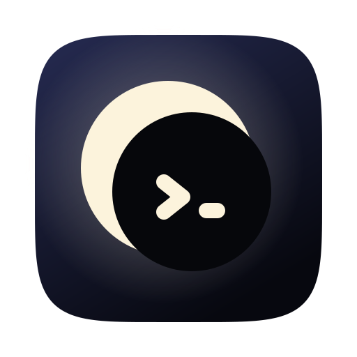

<div align="center">


# Luna TUI

**A board in your terminal that runs a software factory. You keep the final say.**

</div>

Luna waits on Claude in your [notch](https://github.com/HigorAlves/luna-notch). Luna TUI runs the factory in your terminal.

Luna TUI is a local dev harness for working with AI coding agents. You plan
tickets on a board inside [herdr](https://herdr.dev/). A machine then moves each
ticket through a fixed pipeline. It runs agents in throwaway Docker containers:
Claude by default, Codex where you pick it. It stops at approval gates, so you
stay in control. For stage-by-stage detail, read [docs/architecture.md](../docs/architecture.md). The roles, prompts and guardrails live in [`factory/`](../factory/).

## Install

### 1. Install herdr (0.7.0 or newer)

```bash
make tools    # installs the tools Luna needs, herdr included (Homebrew)
```

Or install it yourself from [herdr.dev](https://herdr.dev/). Check with `herdr --version`. The version must be 0.7.0 or newer.

### 2. Link the plugin

```bash
pnpm install
pnpm board:link    # builds the board, then runs `herdr plugin link ./board`
```

Linking is a one-time step. For Rust prerequisites and the details, read [board/README.md](../board/README.md).

### 3. Add the keybinding

Add this to your herdr config:

```toml
[[keys.command]]
key = "prefix+shift+b"
type = "plugin_action"
command = "hardness.board.open"
description = "open board"
```

Without a keybinding, `herdr plugin action invoke hardness.board.open` opens the board too.

### 4. Start the machine

```bash
make setup    # tools, credentials, integrations, starts the machine, links the board
make doctor   # what is set up and what is missing, any time
```

By hand, run `pnpm start`. It builds the stage images, then starts Postgres and the machine on http://127.0.0.1:4318. To work on the harness itself, run `pnpm dev`. It runs the machine on your host with hot reload. Then press your keybinding in herdr. The board opens. For prerequisites and checks, read [docs/install.md](../docs/install.md).

## Docs

| Page | What it answers |
|---|---|
| [docs/README.md](../docs/README.md) | The index |
| [docs/install.md](../docs/install.md) | Prerequisites, quick start, checks |
| [docs/architecture.md](../docs/architecture.md) | Pipeline stages, the hexagonal layout, factory mode |
| [docs/configuration.md](../docs/configuration.md) | Every environment variable |
| [docs/api.md](../docs/api.md) | HTTP routes and an example session |
| [docs/contributing.md](../docs/contributing.md) | Running the checks, opening a PR |

Packages (`@hardness/*`), env vars (`HARDNESS_MACHINE_URL`) and `~/.config/hardness/` still say `hardness`. Renaming them is a separate change. The product name is Luna TUI.

## Contributing

We welcome issues and pull requests. Read [docs/contributing.md](../docs/contributing.md).
