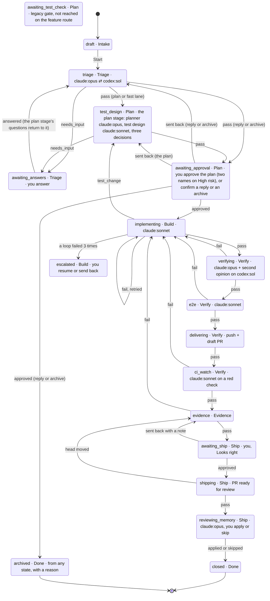
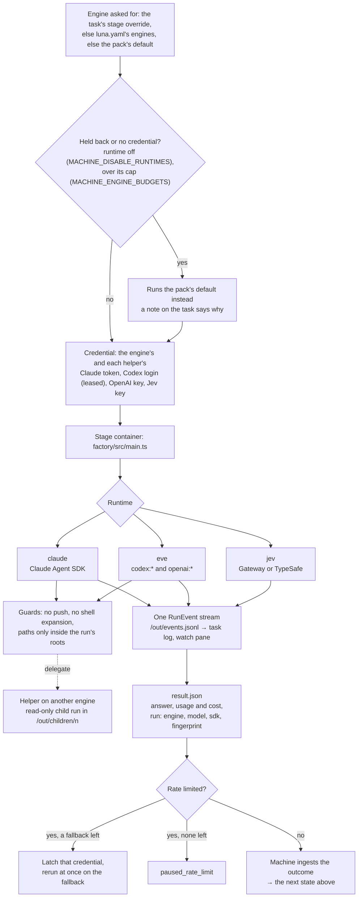

# Architecture

## Pipeline

Every ticket moves through these stages, from Intake (not ready yet) to Done ([diagrams of the whole path](#a-jira-ticket-end-to-end)):

1. **Intake**: a ticket you're still shaping. Nothing runs until you start it.
2. **Triage**, as the v2.2 diagram's panel 2 draws it. The signals come first, for every source and on every entry (the first run and each return from `awaiting_answers`): `triage_signals` is one call, one schema, asking the kind (`bug`, `feature`, `task`, `chore`, `question`, `incident`), the type of work, whether it is ready, the size on five levels (XS to XL), five urgency sub-scores (`who`, `what`, `impact`, `time`, `demand`), a preliminary risk and whether to archive, each with a confidence. The machine turns the sub-scores into a P0 to P3 priority with `scorePriority` (the repo's weights and bands; an incident or a security label is P0 first). **The confidence policy** reads each field against its bar (`triage.confidence`: kind 0.80, size 0.60, urgency 0.70, risk 0.85, archive 0.90, urgency by its least sure sub-score) and the flag band 0.15 under it, with a repo's `policy.decisions.triage_signals` winning per question and a filer's hints moving a field's confidence by half at most: a field at `proceed` goes on, one in the band is **flagged** and listed on the plan gate (`requested.flagged[]` as `triage.<field>`), one under it is a **question to the person** (the field, the model's guess and its confidence, the guess as the suggested answer) at `awaiting_answers`; the agent no longer settles it. A round asks at most `triage.max_questions` (3) and a card sees at most `triage.max_rounds` (2) rounds: the next need escalates to a person with the open questions listed. The questions the machine builds from the signals (fixed text, enum values, numbers) also go out by themselves as one comment, flattened (links shown in the open), to the card's own source only (its GitHub issue, its Jira ticket by the source's own key, the Slack thread it came from), once per set of questions and never when one carries a token; an agent's own questions stay on the board until a person taps `p` (`POST /tasks/:id/questions/post`). A card sees only cards of its own source in `card_search` (a Jira-linked card counts as Jira's). A person's lower risk correction cannot lower the machine's grade as the plan's floor, and a card is archived by the clock only after a reminder a day earlier. Then the agent (12 turns, five minutes, with the read-only `card_search` tool over the cards of the same repository) writes its part: a summary of at most 120 words, the goal in a sentence, and its decision with the reason. **The machine composes the Triage Record** (kind, type of work, size, priority with its sub-scores, preliminary risk, goal reference, signals, hints used, the questions and answers, `decisionBy`, `version` and the number of the version it replaces) and `recordComplete` checks it: an incomplete one sends the agent round once with what is missing, then escalates, so a card never leaves triage with a null record. **The fast lane is a rule** (`fastLane`): low risk, size S or smaller, a type of work that is not infra or data, one owning team (or none) from `locate`'s CODEOWNERS, and the risk and size signals at `proceed`; the agent cannot pick it (it picks `plan`, `conversation` or `archive`), the machine sets `fast_lane` or `plan` and logs `card.fast_lane`, and a repo with no graph skips the owners condition and says so. A `conversation` (the ticket asks something and changes nothing: the reply drafted with `reply-drafter`) waits for one tap, then posts the reply where the card came from and ends **closed**; an `archive` (duplicate, out of scope, stale or not actionable) archives on one tap. A card left unanswered at `awaiting_setup` or `awaiting_answers` reminds after two days and archives after five (`no_setup`, `no_answer`); an answer restarts the clock. A person can correct the record's kind, type of work, size, risk or priority while the card waits at a gate (`PATCH /tasks/:id/record`, `T` on the board); each correction, a reply or archive tap, and an approval with no edit becomes ground truth on the `triage_signals` decision record.
3. **Plan** (panel 3 of the diagram): runs in the `test_design` state, in this order. (1) The **code map**, when the repo has a graph (see Code graph below): the machine's `locate` matches the goal against the graph and hands the shortlist to the `code_map` agent, which confirms it and gives each file a role (`change`, `read`, `test`) and the entry points; the machine adds whether the graph is stale and flags the gate when it is more than `graph.stale_commits` behind. (2) **`risk_score`**, before the plan, on the record and the map: blast radius, reversibility and data sensitivity (each 1 to 3) and the complexity (`S` to `XL`); the level is their **product** (up to 4 low, 5 to 11 medium, from 12 high), never below triage's preliminary grade. (3) The planner writes the v2.2 `Plan`: steps (`description`, `files`, `done_when`, `est_loc`; a created file is declared `new`), criteria (ids `C1`...), out of scope, assumptions, rollback, migration and flags, with a `version` that rises on every revision (a re-run or a person's edit); the machine gives the ids and derives the slices Build reads. (4) The test designer sees only the goal and the criteria with their ids and writes scenarios in given/when/then, each tied to its criterion (`S1`..., type `happy`, `edge` or `failure`, layer `unit`, `integration` or `e2e`). (5) **Coverage by id**: a script (`coverageOf`) finds the criteria no scenario names and those that name a limit or an error with no edge or failure scenario, and scores covered over all (the criteria `coverage_check` confidently calls untestable left out); a gap, a score under `plan.coverage_score_min` (0.85) or a confident "does not pin" sends the designer back, up to `plan.coverage_rounds` (3). (6) The **plan check**: facts by script (`planFacts`: every criterion named by a step's `done_when`, every step file in the map or declared new, a rollback present) plus two judged questions (`fits_record`, `risk_appropriate`), never the plan's own brief; either sends the planner back, up to `plan.plan_check_retries` (2). Everything lands at **one** approval, `awaiting_approval`: the plan, the scenarios, the code map, the risk with its three scores, product and complexity, the coverage report and what was flagged. The gate takes `approved`, `changes_requested` (stored as `sent_back`) or `rejected` (archives with reason `rejected`; the plan gate's alone), each with an optional comment; steps, rollback, risk level and code map are editable beside the brief, criteria and assumptions. The machine's risk is a floor: a person may raise the level at once; a lower value is kept with its reason as ground truth and shown, while the approvers rule and Ship read the higher. Approvers come from `plan.approvers`: one for low and medium, two distinct names for high, and on high at least one must not be among the code owners. The owners are read from CODEOWNERS for the map's change and test files and the plan's step files, never from what the code mapper wrote (its `owners` are display only); it is an attestation, said so at the gate; a repo with no CODEOWNERS (or no rule matching the files) skips it and says so, and an owner lookup that could not run leaves it unenforced, flagged and said so. Once the plan is approved its steps, risk, map and rollback no longer edit (a plan that must change goes back through the gate), and the timer never approves a re-planned or flagged gate. The gate reminds after `plan.sla.reminder_days` (2) and escalates to a person after `plan.sla.escalate_days` (5). A plan found wrong in Build, Verify or review (`plan_wrong`, or Ship's `re_plan`) returns to the planner, not to triage, with the evidence (who raised it, why, the failing output's tail through `safe()` capped at 2,000, the reviewer's thread through `postable()` capped at 1,500), as data; a second one on the same card goes to a person. A ticket triage sent to the **fast lane** runs the same stage on `plan_fast` and `test_design_fast`: the graph's `locate` only (no map agent, no impact walk), one to three steps, one or two scenarios, the same plan check and one approver; if the fast planner says the ticket is bigger than it looked (`needs_full_plan`), the plan check cannot tell whether the plan fits, or the fast plan's own files reach more than one owning team (an owner lookup that could not run stays flagged), the stage plans again in full, in the same run, now with the map agent (`detail.lane`, `detail.laneNote`). On approval the machine keeps what it proposed, what you changed and your overrides with their reasons as ground truth (`<state dir>/ground-truth/plan/`, see `MACHINE_GROUND_TRUTH`).
4. **Build**: the implementer agent writes the change on a task branch (a git worktree on the host). The **build watch** follows the run's `/out` while the container runs: each slice that turns `committed` is pushed as it lands to a checkpoint ref, `refs/luna/wip/<branch>`, which runs no CI and is nobody's PR head (the container never pushes; Deliver updates the branch itself after Verify), and a killed container's ledger is kept for the next attempt. The implementer asks the machine for two checks through a mailbox of files under `/out/checks/`: a slice it marks `red` (with the failing output as its note) goes to `red_check`, and before it answers `done` it calls `scope_check`; the machine judges each on a decision pack and answers in a file, the implementer waiting a bounded time (`LUNA_CHECK_WAIT_MS`) and going on when no one answers. After the run the machine computes the scope facts from git over the final diff (changed files not in the plan's touchpoints or the code map and not declared in `outOfMap`, removed tests, new dependencies, added TODOs, secret-looking additions): an undeclared file or a removed test fails the stage with a finding per file before Verify, and declared files it accepts are appended to the graph's `misses.jsonl`. A `too_complex` escalation from the implementer gets one more run on the pack's stronger engine (`stronger(pack)`: Sonnet to Opus) before a person is asked.
5. **Verify**: runs the project's own checks, then the review pack. A check that names a `coverage` lcov report in `luna.yaml` is measured after it passes: of the lines the branch added, how many the report saw run (patch coverage; no "before" number exists). A file with uncovered added lines becomes a `test` finding the verifier weighs, and the summary rides to it as `context.coverage`. After the review, `finding_classify` (a decision pack on the check context, Jev first, `claude:haiku` fallback) classifies the six most confident findings against an excerpt of the code around each; its answers are recorded in `detail.classified` and `detail.calibration` (how often it agrees with the verifier) and never change the verdict.
6. **E2E and Evidence**: for a repo with a web surface, a QA agent drives the app in a browser (the `runner-qa` image) and writes a manifest, screenshots and video; repos with none skip with a recorded reason. The agent drives the **approved scenarios**, not the raw criteria: the manifest has one `acceptance[]` row per scenario (`text` the scenario title verbatim), a `video.chapters[]` entry per scenario when there is a recording, and `steps.jsonl` so the walk can be replayed. A failed run goes to `e2e_failure_cause`: a confident `env_flake` re-runs the pack once in the same stage run and a second failure escalates as `flaky_tests`; `product_bug` and `test_bug` fail as before with the cause recorded. Evidence then checks the manifest on the host, requires a row (and a chapter, when there is a video) for every approved scenario, and shows its verdict, artifact count and a few screenshot paths in the ship approval.

   Evidence then makes the **Evidence Pack** (`task.evidence`: summary, scenarios with their proof, findings, out-of-map files, risk, rollback, how to verify, commit, media, format). A decision, `evidence_format`, reads the record, the risk, whether there is a web surface, what the browser run left and whether the video image exists, and picks `video`, `captures` or `text`; a mechanical veto then degrades `video` to `captures` (no image, no recording or replayable steps, a QA target with `reentrant: false`) and `captures` to `text` (no browser run), with a `note` on the pack. The host assembles the pack from what the stages left, keeps a local copy of its media under `<state>/evidence/<task>/<sha>/` (swept by `evidence.retention_days`) and saves it on the task. The ship gate is the preview: the board shows the pack and the critic's verdict, and a person can send it back with a note (`t=12.5 scene=<id> el=<id> what to change`, parsed into a fix card by the machine); a send-back at `awaiting_ship` runs Evidence again with the format kept.

   For `video`, `stages/video.ts` runs a pipeline over jobs in the `runner-video` image (no network, no credential, the job dir at `/work`) and packs as sub-runs: `video_script` writes the script and a timeline the host checks (`checkTimeline`: contiguous scenes, one demo per approved scenario, under 240 s, a hook by 3 s, text floors, every on-screen number cited or labelled SCHEMATIC), a `narrate` job renders the voice (kokoro-js) with whisper word timestamps, a `cards` job renders the title cards from a time-driven page, `recording` drives the approved steps against the QA target with a mark per scene and a hold from each clip's length, `compose` cuts and aligns with ffmpeg, `measure` runs the numeric checks and makes the contact sheets, and `video_qa`, a cold critic on another engine than the writer (`claude:haiku`, which can read the sheets; `codex:sol` as the fallback), scores it. It ships only with every score at 8 or more, no P0 and no measured FAIL; otherwise one `video_fix` round runs on the named scenes (a send-back note re-enters here), and a second non-ship degrades the pack to captures with the critic's scores kept.
7. **Deliver**: pushes the branch with git and opens a draft PR through the GitHub API, so CI starts early. When GitHub reports the PR `CONFLICTING`, the machine rebases the branch once onto `origin/<default branch>` on the host and pushes it with `--force-with-lease` (only the task's own branch); a rebase that stops fails Deliver with the files in conflict. Its body follows the caveman-pr shape (a one-line what, terse why bullets) and adds `Closes #N` when the ticket came from a GitHub issue in the same repo.
8. **CI watch**: polls the PR's checks until they settle, outside the stage pool (polling computes nothing, so its slot goes to the queue meanwhile). A red run goes to the `ci_watch` pack: a fixable failure loops back to Build with its findings, a flake is re-run once, and infra or needs-debug failures escalate. A PR that conflicts with its base gets the same one rebase; a second conflict, or a rebase that stops, escalates as `conflict_unresolvable` (the pack can also answer that verdict for a red run it traces to a conflict). The container never pushes or rebases.
9. **Ship**: marks the draft PR ready for review (it opens a ready PR only if Deliver never did) and publishes the Evidence Pack, then **watches the PR until it merges**. `shipping` is an off-pool, resumable host stage (it holds no pool slot and a machine restart re-runs it): the *ship monitor* polls the task's own PR every `MACHINE_SHIP_POLL_INTERVAL` seconds (default 60) and keeps a cursor under `<state dir>/tasks/<id>/ship.json` (the last activity handled, replies and fix rounds per thread, CI re-runs, rebases).
   - **Readiness is a script** (`merge-readiness.ts`) over GitHub's facts, the pack and the policy: not a draft, CI green, mergeable, review approved (`reviewDecision` and the machine's own read of the base branch's `CODEOWNERS`: every changed path with owners needs an approving review on the current head from one of them, and a team the token cannot read is a named blocker), the pack's commit is the head, no freeze window (`freeze[]` in `luna.yaml`), no open `Depends on #N` / `Blocked by #N`, not stale. **Auto-merge goes by risk and policy**: `policy.auto_merge` is `off` (default: the machine never merges, it still watches and closes the loop when a person merges), `low`, or `medium` (low and medium). A high-risk pack is merged by the machine only with `auto_merge` on and a ship approver on record: approving `awaiting_ship` on a high-risk pack needs an `approver` who is none of the plan's approvers (an attestation, as at the plan gate). A medium-risk PR needs `medium`, a low-risk one `low` or `medium`. The merge is sha-guarded (the PR merged is the one judged) and goes to the merge queue when the repo has one.
   - **Review activity is judged by decisions** (`event_class`: noise or something to act on; `comment_intent`: question, nit, change request or disagreement; `fix_scope`: in place, re-verify the delta, or re-plan; `evidence_valid`: is the pack still true after a fix). Below `proceed` (or with no model) the item goes to a person; a failed decision is never read as noise. A **question** is answered from the Evidence Pack within one poll by `pr_reply` (a small haiku pack): the reply goes on the thread and never resolves it. A **change request** or nit is fixed in place by the existing `addressing` pack on the task's own worktree, the project's checks run over the delta (`re_verify_partial` adds the `verifying` pack over only the delta), a green fix is pushed (never forced), replied to and resolved; the pack's text is re-stamped and republished (`refresh_text`), or Evidence runs again when a scenario's media is stale (`refresh_media`, reusing `head_moved`). A red check resets the worktree to the head it started from and asks a person. **Bounds**: at most two fix rounds per thread, three per PR, one CI re-run and one rebase; every bound reached asks a person. A red CI after Ship runs the `ci_watch` pack as a sub-run (`fixable` becomes a fix round, `flake` re-runs the jobs once, `infra`, `needs_debug` and `conflict_unresolvable` ask a person); a conflict is rebased once, then asked. What the machine posts to GitHub is the model's reply flattened (one line, no `@mention`, no `#N`, capped); reviewer comments reach a model only as data.
   - **Closing the loop**: when the PR merges the pipeline logs `task.shipped` (streamed to the board) and posts one plain summary where the task came from: a comment on the GitHub issue, a reply in the Slack thread (your user token) and once on the Jira ticket.
   - **The retro** follows the merge. It starts with `worth_learning` on the machine's predicted-against-actual facts; a confident no skips the pack (`rules: null`, a note) and the gate still opens. Otherwise the `reviewing_memory` pack (read-only) reads the facts, the slice ledger, the runs and `git log`, and proposes rules for `docs/agents/project-context.md` plus a recalibration table, graph misses and prompt updates. The last gate shows them: `a` applies the rules and `A` skips them. After a merge the rules go to their own branch `luna/memory-<task id, 8 characters>`, cut from `origin/<default branch>`, pushed with `-u` and opened as a draft PR (never to the merged branch); before a merge they are committed on the task branch as before (refused above 150 lines / 6 KB, pushed only if the branch has an upstream).

Triage, Plan and Build run stage packs (see [Factory mode](#factory-mode)) when a credential and the runner image are available. Deliver and Ship run for real too — they are plain host commands (`git push` + `gh pr create --draft` / `gh pr ready`), not Claude agents — as soon as a task has a branch. CI watch polls on the host and runs its pack only for a red check. Evidence runs on the host (its video pipeline starts containers). Intake, Done and any stage without a runner are stubs that pass, unless you queue a result with `POST /dev/stubs`. Full route list: [api.md](./api.md).

The machine is one service for every repo you point a task at, not one per repo: `MACHINE_MAX_CONCURRENT` (default 4) caps how many tasks can be driving a stage at once *in total*, across all of them, not per repo. Each repo can still speak for itself through a `PIPELINE.md` at its root (QA on or off, a monthly budget, a concurrency cap, timer-approved plans, held-out test cases; see [configuration](configuration.md)), and `/metrics?groupBy=repo` tells the repos apart. A task past that cap is `queued` until a slot frees — durably, in Postgres, so a restart doesn't lose track of it. Open as many boards as you like, from any workspace: they're all clients of this one machine and see the same tasks and the same queue.

## Board columns from task state

| Column | Task states |
|---|---|
| Intake | `draft`, `setup`, `awaiting_setup` |
| Triage | `triage`, `awaiting_answers` |
| Plan | `test_design`, `awaiting_test_check`, `awaiting_approval` |
| Build | `implementing`, `paused_rate_limit`, `escalated` |
| Verify | `verifying`, `e2e`, `delivering`, `ci_watch` |
| Evidence | `evidence` |
| Ship | `awaiting_ship`, `shipping`, `reviewing_memory` |
| Done | `closed`, `archived` |

The Plan stage runs in `test_design`, so a task shows in Plan while it plans, and its one gate, `awaiting_approval`, is in the same column (the columns are the diagram's seven stages; a card waiting on its triage questions stays in Triage). PR tasks keep their place: `reviewing` under Verify, `addressing` under Build. `awaiting_test_check` stays a valid state (older tasks sit there) but a feature task no longer reaches it: the scenarios ride on `awaiting_approval`'s `requested.cases`, where `PATCH /tasks/:id/cases` edits them too.

A task on a repo with no `luna.yaml` runs the `setup` stage first: the setup pack reads the checkout read-only and proposes the file, the machine proves every proposed check once with the proposed services beside it, and the `awaiting_setup` gate shows you the file and the proof. Approving writes `luna.yaml` into the checkout and the task goes on to triage; a `:setup <repo>` task (route `setup`) closes instead. Sending it back with a note re-runs setup with the note as guidance. See [configuration](configuration.md).

The card states the board already shows map from the same data: a waiting gate is "needs you", a running stage is "working", `escalated` and an aborted run are "lost". Source of truth: `COLUMNS` and `COLUMN_OF` in `contracts/src/index.ts`.

## PR tasks

The board's `P` view lists every open PR involving you (the machine polls `gh search prs --review-requested=@me` and `--author=@me`, then one GraphQL call per PR) and splits them by what you do about them: Review requested, Ready to merge, CI failed, CI running, Changes requested, Mine. `m` merges a ready PR; `c`, `v` and `t` turn a PR into a **PR task**: a task whose `source.kind` is `github_pr` and whose `route` is `ci_fix`, `review` or `address`. The transition engine switches on the route first, so a PR task walks a short graph built from the same stages:

| Route | Graph |
|---|---|
| `ci_fix` | `ci_watch` → closed on green; on red the ci-investigator pack runs and a fixable verdict goes `implementing` → `verifying` (the project's checks only, no review pack) → `delivering` (a push to the PR's branch) → `ci_watch` again, three strikes as today |
| `review` | `reviewing`: the host fetches the diff, files and existing comments; the `pr-reviewer` role answers line-anchored comments and a verdict per `inline-review`, dispatching the `security-reviewer` helper when the diff touches a sensitive path; the host posts one COMMENT review at once. A `comment` verdict closes; `approve` / `request_changes` wait at the Ship gate (`a` posts it, `r` drops it) |
| `address` | `addressing`: the host fetches the unresolved review threads; the `code-fixer` role categorizes each per `receiving-code-review` (action, question, nitpick, disagree), commits the fixes and has the `reply-drafter` helper write each reply; then `verifying` (checks only), then the follow-up `delivering` pushes, posts the replies and resolves the threads it marked, then `ci_watch` as in `ci_fix` |

A PR task's worktree is checked out on the PR's own head branch (`<worktrees>/<repo>/pr-<n>-<branch>`), and that branch is the one its stages may commit to. Agents never hold a GitHub credential: everything they read about the PR comes in the stage input, everything that goes out is posted by the host after the stage. A PR from a fork can be reviewed but not fixed or addressed; a PR in a repo with no local checkout is read-only until the board clones it (`POST /github/clone`).

## Notch tasks

A task whose `source.kind` is `notch` is a Luna Notch ticket run on the machine (RFC 0004): the notch owns the ticket and talks to Jira, Slack and Teams about it, the machine only runs it. Such a task has no Jira link (`jiraOf` answers null, so nothing in its text links, and JiraSync, JiraWatch and the PR title leave it alone; `J` refuses it with `notch_task`) and gets no Slack thread from `ThreadReplies`. Its `jiraKey`, when present, only names the branch through the repo's `jira.branch` pattern (`task/PLAT-123` with the default, the issue type being unknown) and keeps JiraIntake from importing the same issue again; the issue itself is never read or written. GitHub is shared: the machine pushes and opens the PR as for any task.

### Packs on demand

`POST /runs` (`application/pack-runs.ts`) runs one context-only pack on data a client already read, for the notch's Slack and Teams triage (`chat_triage`), labels (`triage_signals`) and Jira intake (`jira_intake`). A context-only pack is one `packStates` maps to no task state, less a deny list (`domain/context-packs.ts`: `eval_judge` is the evals runner's only); each reads one key of the stage input's context, checked against that key's schema before anything runs. It runs the way the Slack inbox's triage and Jira intake do, through `runPackOnce` (`application/stages/run-once.ts`): the stage container over an empty `/work`, only the engine's credential, the answer validated against the pack's schema. Calls have their own cap of two, apart from the stage pool, so a triage someone waits on never queues behind a long stage nor takes a task's slot; up to eight more wait, a client that leaves is dropped from the queue or has its container stopped (the request's signal reaches `runPackOnce`), and a call while the day's budget is spent is refused. Each call that ran is a `pack_runs` row (pack, engine, model, client, outcome, turns, duration, cost), and its cost counts toward the daily ceiling (`spendSinceUsd`); the context and the answer are never kept: the run folder (`MACHINE_STATE_DIR/pack-runs/`, never the stage runs' `runs/`) goes when the call ends and at start-up. The route is off only with `MACHINE_AGENTS=off`: each call needs just its own engine's credential.

## Slack inbox

The board's `S` view is the Slack twin of the PR inbox. `SlackInbox` (`application/slack-inbox.ts`) polls your workspace through the `Slack` port (`application/slack.ts`, implemented over plain `fetch` in `adapters/slack/web-api.ts` with your user token from the internal app in `slack/manifest.json`): mentions through `search.messages`, DMs and a budgeted sweep of your channels through `conversations.history`, replies in threads you are in through `conversations.replies`, and reactions pushed over Socket Mode (`adapters/slack/socket-mode.ts`, Node's own WebSocket, when an app-level token is set). Several mentions in one thread fold into one item (`domain/slack-item.ts`); the rules file (`domain/slack-rules.ts`; `MACHINE_STATE_DIR/slack-triage.md`, written from the template in `docs/agents/slack-triage.md`) drops your own messages and muted channels, settles app posts without the model and sets priority floors for VIPs, always-P0 keywords and watches; what is left goes to the `slack_triage` pack: an agent of the harness like every stage, the `slack-triager` role (`factory/roles/slack-triager/role.md`, rubric and worked examples) on Haiku at low effort, three turns, no tools, run through the factory runner in the stage container with the stages' image and credential (`application/stages/slack-triage-runner.ts`; `/work` is an empty folder under `MACHINE_STATE_DIR/slack-triage/<time>`, the batch of up to 25 items rides in `context.slack`, the structured answer comes back in `result.json`). A poll persists and publishes first and the pack runs after it, one container at a time, publishing again when the verdicts land; each run is a row in `slack_triage_runs` (`GET /slack/triage-runs`). Items and the watches you save live in `slack_items` and `slack_watches`, so triage and your read state survive restarts, and every change is published as one `slack.items` snapshot. Each open ask carries a reply SLA from the rules file's `## SLA` (10m, 30m, 1h, 1h by priority unless you change it): `dueAt` and `overdue` are computed when the snapshot is built, never stored, and a minute tick republishes when an item goes overdue with nothing from Slack to say so. Replying posts as you with the same token; `t` turns an item into a task whose `source.kind` is `slack`; done is manual, and a thread that moves after you cleared it reopens, re-triaged. What you do feeds back into `slack-triage.learned.md` beside the rules file, keyed by user or channel id, which the next poll merges into the rules; the snapshot's `quiet` flag says when the rules file's quiet hours are on, and the board then raises notices for P0 only.

## Jira

Tickets live on the board; Jira follows them. A task carries at most one issue (`Task.jira`), linked four ways: intake imports it (`source.kind = jira`), a `PLAT-123` in a new ticket's text links on creation, `J` on the board links by key or search (`POST /tasks/:id/jira`, `GET /jira/search`), or `J` creates an issue from the ticket (`POST /tasks/:id/jira/create`). Everything Jira is behind the `Jira` port (`application/jira.ts`, implemented over plain `fetch` against REST v3 in `adapters/jira/rest.ts`: basic auth with your email and API token, one `Retry-After` wait on a 429, two retries with a growing pause on a 5xx or a dropped connection, a clear "token rejected or expired" error on a 401, and Atlassian Document Format converted to and from markdown in `adapters/jira/adf.ts`, task lists, ordered lists, bold and code included); with no token every call says so and nothing syncs.

Four pieces use it, each a twin of something that exists:

- **JiraSync** (`application/jira-sync.ts`, like `threads.ts`) reacts to pipeline events. When a linked task enters a state the repo's `luna.yaml` maps under `jira.on`, it reads the issue's current status and available transitions and performs the one whose target matches the declared name (case does not matter), with `jira.fields[state]` rendered (`{pr_url}`, `{task_id}`, `{branch}`, `{board_url}`); it records `jira.transitioned`, or `jira.blocked` (and marks the link) when nothing leads there or Jira refuses, never a fake status. Reactions for one task run one after another in event order, so two quick transitions read Jira in turn and the later one lands last; a stepping stone the task has already left is skipped when the newer status is reachable directly. A blocked mark is retried by JiraWatch (`JiraSync.retry`) on each of its passes while the issue answers, quietly until a route exists. `escalated: Blocked` plus the stage's own mapping gives the round trip: escalating moves the issue, resuming moves it back. Comments per `jira.comments`: `milestones` writes picked up (left to intake for an imported issue, which already said so), PR opened (once per url, remembered as a `jira.commented` event rather than in memory) and a closing comment (the PR, the criteria, verifying's verdicts per case, the evidence artifacts); `gates` adds every "needs you"; `none` nothing.
- **JiraIntake** (`application/jira-intake.ts`, like `intake.ts`) polls each repo's `jira.intake.jql` at its `every`. A new issue (no task by its key) first runs through the **`jira_intake` pack**: the `jira-triager` role (`factory/roles/jira-triager/role.md`) on Sonnet at low effort, eight turns, Read/Glob/Grep over a clean detached checkout of the repo's default branch at `<worktrees>/<repo>/jira-intake`, fetched and reset before every run and mounted read-only, never your live checkout with whatever sits uncommitted in it (`application/stages/jira-intake-runner.ts`, modelled on the Slack triage runner; the issue rides in `context.jira`; its run folder, `MACHINE_STATE_DIR/jira-intake/<key>-<time>`, goes once the run answered, and a failed run's stays for the retention sweep like Slack triage's). `ready` makes a Backlog ticket with the pack's title, description and criteria (falling back to the issue's own and its checklist) and comments "Picked up"; `needs_brief` makes no ticket and asks the questions, each with the answer the agent would pick, back on the issue, retrying when the issue changes; `not_for_agent` says why once. An issue whose last comment is the machine's own is left alone until someone else writes or edits it (its `updated` stamp moving past that comment). With agents off, issues are imported as written.
- **Intake classification** (`application/classify.ts`). With a Jev credential, both intakes first run `triage_signals` on a new issue (its title, description and labels) through `PackRuns`, like a `POST /runs` call from the client `intake`: the stage container, the Jev key by name, a `pack_runs` row for its cost, the day's ceiling. The answer routes the report and is not kept: the card's own `classification` (`kind`, `typeOfWork`, `sizeBucket`, `subScores`, `priority`, `riskPrelim`, `ready`, the lowest of the answers' `confidence`, `at`, `model`, and for a v1 answer `area` and one `urgency` score) is the triage stage's reading, taken again each time the stage runs. Routing is conservative: only when `kind` is `question` and the kind's own confidence (`kindConfidence`, else the lowest) is at or above the kind's `proceed` bar (`triage.confidence.kind`, 0.8, or the repo's `policy.decisions` override) does the issue skip `jira_intake` and become no task, declined the way `not_for_agent` is, once, with the classification in the comment (a GitHub issue is told once per run of the machine, which keeps no record of the comment). Anything else goes on exactly as before, `jira_intake` getting the classification in `context.jira` as a hint. Without a Jev credential nothing is classified and intake is unchanged; a failed or refused run (budget, queue, the model) is logged and intake goes on without it.
- **JiraWatch** (`application/jira-watch.ts`, like `pulls.ts`) refreshes every linked open task's `jira` (status, priority, due date, type, and the site's timezone from `/myself`, read once) every five minutes, retries a blocked transition through JiraSync, and records `jira.moved` when the issue reaches a Done-category status, Cancelled or Won't Do while the task is open. It warns once a day inside the last fourteen days of `MACHINE_JIRA_TOKEN_EXPIRES` (Jira never names the expiry ahead of time; a 401 that does overrides it), which `GET /jira/status` shows as `tokenExpiresAt`.
- **Branch and PR**: a linked task works on the branch its repo's `jira.branch` pattern names (`{type}/{key}`: `bug/PLAT-123`; the pattern must carry `{key}` or `{id}`, and when the repo already has that branch the task id is appended), so Jira's own GitHub app files the branch and PR under the issue. Once the worktree exists the persisted branch is the owned one: it is not recomputed from the link (an issue whose type changes in Jira keeps its branch), the link cannot be moved or removed (`409 has_worktree`), and no second open task may take the same issue (`409 already_linked_elsewhere`). The pack runner accepts `task/*`, a PR task's head, the branch it named, or a persisted branch carrying the issue key or task id, and never `main`, `master`, `develop` or the repo's default branch; the factory's commit guard matches a named branch exactly (`task/` is the only prefix). The PR title opens with the key and the body ends with the issue's url.

**SLAs** (`domain/sla.ts`, `application/sla.ts`): four clocks per ticket, computed when a task is serialized from the row and one stage-run query, never stored beyond `tasks.state_since` (set on every transition, backfilled from the latest transition event): the gate clock from `state_since` for a waiting state (`sla.gate`, else `MACHINE_SLA_GATE`, 1h; halved for a High or Highest Jira priority, doubled for Lowest), the stage clock from the running stage run's start for stages the repo named (`warn` from 80%), the cycle clock from creation (`sla.cycle`, else `MACHINE_SLA_CYCLE`), and the Jira due date, which ends at 23:59:59 in the Jira site's timezone (UTC until JiraWatch has read it) and counts from the ticket's creation or its link time (`jira.linkedAt`), whichever is later. A minute `Ticker` (`application/ticker.ts`, shared with the Slack inbox) recomputes every open task from one list and one stage-run query and republishes a task when a clock flips; `GET /tasks` prices the whole list the same way. `GET /metrics` adds `gates`: gates answered in the window, the share inside the gate SLA, the median wait per gate.

## A Jira ticket, end to end

The pieces above, put together for the commonest path: an issue in Jira becomes a ticket on the board and runs until Done. The same stages run for a ticket typed into the TUI or sent by the notch; only the first diagram is Jira's.

### From Jira to the board

With agents off, the issue is imported as written. A repo with no `luna.yaml` runs `setup` and its `awaiting_setup` gate before triage.

### Through the stages

Each box is a task state, labelled with its board column and the engine its pack runs on by default; `you` marks a gate the board (or the notch) answers.

Every loop back to `implementing` counts against its own loop (verify, e2e, CI); the third failure of one escalates, and so does a task that has used all six implementer runs. A stage that fails outright (triage, test design, deliver, ship) escalates at once. A rate limit with no fallback engine left pauses the task in `paused_rate_limit` (Build) until the window resets.

An agent that stops on purpose answers `escalated` with a typed `escalation`: `plan_wrong`, `env_broken`, `flaky_tests`, `too_complex`, `undeclared_scope` or `other` (the default); the reason rides on the transition event and the `escalated` approval's `requested`. `plan_wrong` is the one that does not wait for you: on a feature task past triage, the plan cannot be built as written, so triage runs again with the retries kept (a PR route has no plan to redo, so it escalates). Any state that has not ended can also go to `archived` (`POST /tasks/:id/archive`, or `Z` on the board) with one of `duplicate`, `sla_expired`, `rejected`, `not_for_agent`, `pr_closed`, `no_setup`, `no_answer`: the running stage stops, the close steps run (the worktree is removed) and the task keeps `archiveReason`. A ticket left at `awaiting_setup` or `awaiting_answers` past the repo's `sla.archive` (five days when it says nothing; `off` keeps it waiting) is archived this way as `no_setup` or `no_answer` (`sla_expired` is what older cards carry), with a notice at its own source; any gate past its clock (two days by default) gets one `sla.reminder` event per visit (a line in its thread, a Jira comment with `comments: gates`), and the later gates are reminded, never archived. A task also carries `record` (triage's `TriageRecord`: what it understood, each signal with its confidence, the route taken and why) and `evidence` (the `EvidencePack`: scenarios and their results, risk, rollback, how to verify), null until a stage writes them, and both ride in every stage input's `task`.

While the task moves, Jira follows it: JiraSync performs the transition the repo's `luna.yaml` maps under `jira.on` for each state it enters (`escalated: Blocked` moves it back on resume) and comments per `jira.comments`; JiraWatch refreshes the link every five minutes and notes it when Jira closes the issue first. The branch is the repo's `jira.branch` pattern (`bug/PLAT-123`), so Jira files the PR under the issue. A notch task skips all of this: the notch talks to Jira.

### Inside every stage box

`GET /metrics` then reads the same runs back by repo, engine (`groupBy=engine`, cost per engine on the TUI) or fingerprint (`groupBy=fingerprint`).

## Repository layout

| Path | What it is |
|---|---|
| `board/` | The Luna TUI board, the Rust TUI and herdr plugin. A client of the machine. |
| `machine/` | The orchestrator: TypeScript on Node 24+, HTTP API plus an SSE stream, Postgres for state. |
| `factory/` | What runs inside a stage container: the runner and its three runtimes (`claude` on the Claude Agent SDK, `eve` on Vercel's eve, `jev` on TypeSafe's SDK or the AI SDK's decision API through the Vercel AI Gateway), the roles, the prompt templates, the skills plugin, the guards and the `luna` tools; with a Laminar key from the machine, the runner continues the machine's trace inside the container (`factory/src/core/telemetry.ts`, `runtimes/eve/agent/laminar.ts`). |
| `contracts/` | Types shared by the machine, the factory and the board, including the pack registry. |
| `fixtures/` | Fixture repos used by `pnpm golden` (one seeded bug or feature each). |
| `evals/` | Replay evals (`pnpm eval`): eval cases per pack, graded by schema, checks and the `eval_judge` pack (an agent pack) or by label and confidence (a decision pack), with a scorecard per engine; `harvest`, `dataset push`/`pull`, `scorecard` and `defaults` close the loop from recorded decisions to a default engine per slot. See [evals/README.md](../evals/README.md) and [Evals and calibration](#evals-and-calibration). |
| `observe/` | ClickHouse config for the `observe` compose profile (Laminar, the local trace and eval UI; see [configuration](configuration.md#observability-laminar)). |
| `docs/` | This folder. |
| `compose.yaml` | Postgres and the machine (`docker compose up`); `pnpm dev` starts only Postgres; `--profile observe` adds Laminar. |

## Layout inside `machine/src`

Grouped by layer, not by technology:

- `domain/` — pure types and logic with no I/O: task/stage-run/event rows, the transition engine, locked-files/pr-body/detect-checks helpers, memory-rule parsing, stage-input building.
- `application/` — use cases and ports: `pipeline.ts` (orchestrates the transition engine and the stage runners), `task-store.ts` (the persistence port `pipeline.ts` depends on, never a concrete DB call), `ports.ts` (the `StageRunner`/`StageContext`/`StageResult` contract), the stage runners under `application/stages/` (`pack-runner.ts`, `verify.ts`, `deliver.ts`, `ship.ts`, `ci.ts`, `e2e.ts`, `evidence.ts`, `memory.ts`, `ingest.ts`, `stubs.ts`), the GitHub poll loop (`intake.ts`), and the Jira pieces (`jira.ts` the port, `jira-sync.ts`, `jira-intake.ts`, `jira-watch.ts`, `jira-tasks.ts` behind the routes, `sla.ts` the ticket clocks).
- `adapters/` — everything that talks to the outside world: `persistence/` (Postgres via TypeORM, implementing the `TaskStore` port), `http/` (the Hono API), `docker/` (the stage sandbox), `process/` (the generic subprocess runner), `git/` (worktrees), `github/` (the GitHub API through Octokit, behind the `GitHub` port in `application/github.ts`), `jira/` (Jira Cloud REST v3 over `fetch` and the ADF converter, behind the `Jira` port in `application/jira.ts`), `laminar/` (run traces and eval records to a local Laminar over `@lmnr-ai/lmnr`, behind the `Telemetry` port in `application/telemetry.ts`, a no-op without a key). `http/` also announces running stage containers on the event stream, which the board follows in herdr tabs.
- `bootstrap/` — wires the above together at startup (`stages.ts`); `main.ts` itself is just the entry point.

Dependencies point inward: `adapters` depend on `application` ports, `application` depends on `domain` types, nothing in `domain` or `application` imports `typeorm`, `pg`, `hono`, or shells out to `docker` directly, and nothing but `adapters/github/` imports Octokit, and nothing but `adapters/laminar/` imports `@lmnr-ai/lmnr`.

This is a lightweight application of ports-and-adapters, not a formal DI container: most stage runners already took their dependencies as plain function parameters before this layout existed (`deps.exec`, `deps.runPack`, `deps.sandbox`), so the move mostly made that existing seam's *location* match its *role*. A port got a named interface only where three or more call sites actually shared one (`TaskStore`, `GitHub`, the generic `exec`).

## Contracts of the v2.2 diagram

RFC 0006 aligns the machine with the v2.2 flow diagram. Wave 8 gives the machine the diagram's vocabulary and changes no route and no default; each behaviour change lands in the wave that owns its stage, reading what is defined here. Everything is additive: a record, plan, case, finding, pack or `luna.yaml` written before the wave parses and behaves as before.

**The objects, and where each lives.**

| Object | File | Read from today's shape by |
|---|---|---|
| `Criterion`, `Scenario`, `PlanStep`, `Plan` | `contracts/src/plan.ts` | `criteriaOf`, `scenarioOf`, `stepOf`, `planOf`; `TestCase` is the same schema as `Scenario` |
| `Finding` v2 (id, category, resolution, merged) | `contracts/src/stage.ts`, helpers in `finding.ts` | `normaliseFinding`, `severityOf`, `findingId`, `mergeDuplicateFindings` |
| `TriageRecord` v2 (summary, typeOfWork, urgencyDetail, riskPrelim, ...) | `contracts/src/stage.ts` | all new fields optional |
| `CreateCardInput` (sources, reporter, hints, originMachine, attachments), `HINT_WEIGHT` | `contracts/src/card.ts`, `api.ts` | accepted and ignored until wave 14 stores them |
| `BuildReport`, `VerifyReport` | `contracts/src/reports.ts` | `buildReportOf`, `verifyReportOf` (`machine/src/application/reports.ts`) from stage runs and logged details |
| `EvidencePack` v2 (results, findingsDetail, previewUrl, media localPath) | `contracts/src/stage.ts` | `assembleEvidencePack` fills them from the Verify Report when one exists |
| `FactoryConfig` and `CONSUMED_FROM` | `contracts/src/config-v22.ts` | `luna.yaml` sections over the diagram's defaults, in `Policy.factory` |

The Build Report rides on the passing `implementing` finish (`detail.report`) and the Verify Report on the passing `ci_watch` finish, the last step of verify; `GET /tasks/:id` shows both as `reports {build, verify}`. A field the machine cannot know yet is null: `envHash` and `envReproduction` until wave 11, `tests[].before/after` and `tokens` until wave 10, `base` until wave 11.

**The event names, by panel.** `CardEventName` (`contracts/src/card-events.ts`) is a way of reading a fact the machine already logs, not a second row for it: `namesOf` (`machine/src/domain/card-events.ts`) derives the name or names of a row from its kind and payload, and `TaskEvent.names` carries them on the stream (`GET /events?names=` filters by them). A fact that had no row gets one under the diagram's own name, with ids, counts and enum values only.

- Intake: `card.created`, `card.merged` (wave 14), `card.setup_needed`, `card.setup_done`
- Triage: `card.triaged`, `card.answers_needed`, `card.answered`, `card.archived`, `card.fast_lane`
- Plan: `card.planned`, `card.tests_designed`, `card.approval_needed`, `card.approved`, `card.rejected`
- Build: `build.started`, `build.checkpoint`, `build.paused`, `build.escalated`, `build.done`
- Verify: `verify.started`, `verify.findings`, `verify.e2e_done`, `pr.opened`, `ci.status`, `verify.done`
- Evidence: `evidence.started`, `evidence.media_ready`, `evidence.published`, `evidence.stale`
- Ship: `ship.event`, `ship.ready`, `ship.approval_needed`, `ship.merged`, `card.closed`, `card.learned`

`build.paused` and `build.escalated` are read from a transition out of `implementing` only. The metrics (`Metrics.flow`) are computed from this log through `namesOf`, with no new columns.

**The scoring model** (`contracts/src/scoring.ts`): `scorePriority` weights the five sub-scores (`who`, `what`, `impact`, `time`, `demand`, each 1 to 3, weights 3, 3, 2, 2, 1), pulls each toward the neutral 2 by its confidence, and bands the sum (28 P0, 22 P1, 16 P2, else P3); `knockOut` sends a production outage, data loss, a security issue, an incident or a compliance deadline to P0 and parks a bug nobody can reproduce or ask about; `wsjf` ranks the backlog by cost of delay over cost of doing; `riskProduct` is the diagram's risk (a product of 4 or less is low, 5 to 11 medium, 12 or more high) and sits beside `riskLevelOf` in `packs.ts`, which the plan stage still uses. Triage reads `scorePriority` and the P0 flags since wave 9; the backlog and size waves (14, 15) read the rest.

## Evals and calibration

Every decision pack call the pipeline makes leaves a record (`MACHINE_DECISIONS`, on by default): the context the model judged, its validated answer, each question's verdict under the pack's own bars, the engine and model, and the trace id of its span, under `<state dir>/decisions/<pack>/<day>/`. In `MACHINE_TRACES=full` the same context and answer sit on the decision's span as input and output (only for the pipeline's own calls, never a `POST /runs` client's), so a trace can go from the Laminar UI into a labeling queue and a dataset. When a later fact settles what the right answer was, the machine writes it onto the record as `truth` (`application/decision-truth.ts`): a flake re-run that passed or failed again (`e2e_failure_cause`), the format a pack finally shipped with after the vetoes (`evidence_format`), a slice that went green on the test the red check saw (`red_check`), the person approving the plan untouched or editing the question's subject (`plan_check`, `coverage_check`, `risk_score`), the retro gate's decision (`worth_learning`), a ship approval that kept a finding (`finding_classify`), and what the PR did after a comment was judged (`event_class`, `comment_intent`); `scope_check`, `fix_scope` and `evidence_valid` get no truth from the machine, a person labels them.

`pnpm eval harvest --pack <decision>` turns records into cases under `evals/<pack>/cases/` after scrubbing them (logins, emails, hosts and home paths become `.example` names and `/work` paths; a record with anything token-shaped is refused and named); a record with a truth gets `equals`/`oneOf` checks on the label, one without is marked `review` for a person. `pnpm eval dataset push` mirrors a pack's cases to a Laminar dataset named after it (`taskId` = the case id, so the same case lines up across runs) and, with `--queue`, sends the unlabelled ones to a labeling queue with the model's own answer prefilled; `pnpm eval dataset pull` turns labelled datapoints back into cases, each parsed with the pack's context schema first. The repository stays the source of truth for cases; Laminar holds the mirror and the queue.

A decision is graded without a judge: `correct` (the labelled questions' choices equal the target), `confidence` (what the model reported) and `verdict` (the pack's policy over the answer), and the scorecard summarises accuracy, acted-on accuracy (among answers the policy would act on), coverage (the share it would act on), the Brier score, the expected calibration error over five bins, the mean confidence and the overconfident count (`evals/src/calibration.ts`); `--trials N` repeats each case, `--dataset <name>` grades a Laminar dataset before it is committed. `pnpm eval scorecard` writes `evals/scorecard.md` over every baseline and proposes a default per pack by a stated rule (the highest acted-on accuracy with coverage at least 0.6 and four cases; ties within two points go to the cheaper engine; Jev wins only by five points, being the metered path; fewer than two engines measured keeps the current default); `pnpm eval defaults --write` writes `contracts/src/decision-defaults.json`, which `PACKS` reads for each decision pack's default and fallback (`allowed` is fixed in code; a bad entry falls back to the built-in default and fails the contracts test). The steps are in [runbooks/calibrate-decisions.md](runbooks/calibrate-decisions.md).

## Shipping

Approving the preview gate (`awaiting_ship`) runs `git push -u origin <task branch>` from the task's worktree, then `gh pr create` (or reuses the PR if one is already open for that branch). It needs, on the host:

- A GitHub token in `GITHUB_TOKEN` (or `GH_TOKEN`) with repo scope: every GitHub call goes through the API with it. Git itself stays yours: pushes and clones use your own git credentials.
- A repo with an `origin` remote you can push to.

Without either, the stage fails with a clear reason and escalates — nothing silently retries a `git push` against a repo with no remote.

## Factory mode

The agent stages run as stage packs inside the stage container, through `factory/src/main.ts`, on one of three runtimes, each built on its vendor's SDK: `claude` (`factory/src/runtimes/claude/`, the Claude Agent SDK, Claude models only, on the subscription token first and `ANTHROPIC_API_KEY` as the fallback), `eve` (`runtimes/eve/`, Vercel's eve, for every other agent model: `codex:*` engines on the Codex login through `chatgpt()`, `openai:*` on `OPENAI_API_KEY` through `openai()`) and `jev` (`runtimes/jev/`, decision packs only, opt-in and metered: through the Vercel AI Gateway with the AI SDK's `experimental_decide` when `AI_GATEWAY_API_KEY` is set, else TypeSafe's `@typesafe-ai/sdk` with `TYPESAFE_API_KEY`). `runtimes/index.ts` is the only file that imports a runtime, and each SDK is imported only inside its runtime's folder.

**Three images, each on top of the last.** `hardness-runner` carries the factory, Node, `gh`, Go, Rust, Graphify and the Codex CLI and runs every stage pack. `hardness-runner-qa` adds Playwright, chromium, ffmpeg and agent-browser for `e2e`. `hardness-runner-video` adds the video tools (`narrate`, `cards`, `compose`, `measure`, the demo fixture) with the kokoro and whisper models baked into `/models`, for the `recording` pack and the machine's video jobs; without it Evidence never makes a video. `pnpm images` builds all three; each is skipped when its key is current.

Each pack (`contracts/src/packs.ts`) names a role, the engines it may run on and an effort, its access (`contracts/src/access.ts`: read, write, web, subagents, skills, shell command prefixes and luna tools, in no runtime's words; the Claude runtime turns it into the SDK's tool lists in `runtimes/claude/access.ts`, eve into its tools in `runtimes/eve/compile.ts`), turn and time limits, the skills the role may invoke and the answer schema the stage must return. A role is a folder, `factory/roles/<role>/`: its `role.md` has the role's one-line description in a frontmatter and, after it, the prompt body, and an optional `eve.md` is appended to it on eve runs; the stage prompt is `factory/prompts/<pack>.md` rendered from the stage input. Every agent runtime serves the `luna` tools (a progress label, the slice ledger, the settled decisions; `core/luna-tools.ts`) and runs the guards below before a tool call starts. The Claude runtime serves the tools as an in-process MCP server, runs the guards as `PreToolUse` hooks, loads the skills from `factory/plugin` and sets `settingSources: []`.

An engine (`contracts/src/engines.ts`, such as `claude:opus`) names a model in the catalog, `contracts/src/models.ts`, the only file that holds a provider's model ID; the runtime gets the pinned ID (`claude-opus-5-5`), never an alias, so a model cannot change under a pack between runs. The machine picks the engine (`machine/src/domain/engine-choice.ts`): the task's own (`stages`, from the TUI or Luna Notch), else the repo's `luna.yaml` `engines:`, else the pack's `engines.default`. One outside the pack's `allowed` is refused before a container starts; one whose credential this machine lacks gives way to the default, with a `stage.engine` note on the task. The stage gets only that engine's credential and names the engine in its `StageInput`; `main.ts` hands it to that engine's runtime. The effort stays on the pack: it is about the job, not the model. `contracts/src/engines.test.ts` checks every pack's engines against the catalog (tools and structured output for an agent pack, the pack's effort, no retired model) and that no source file outside the catalog names a model ID. Today every default is a Claude engine; `triage` also allows `codex:sol`, and `slack_triage` and `chat_triage` allow `codex:luna`.

A pack may name `engines.fallback`, an ordered list of engines it allows. When a stage ends on a usage limit, the machine latches that engine's credential as it always does and runs the stage again at once, as a new attempt, on the first fallback that has not run it this time round, whose credential is present and whose window is not latched; a `stage.engine` event on the new run says `fallback after <engine> rate limit`. The task pauses in `paused_rate_limit` only when no fallback is left. `triage` falls back between `claude:opus` and `codex:sol`, `slack_triage` and `chat_triage` between `claude:haiku` and `codex:luna` (each to the other); the Claude-only packs have no fallback and pause as before. `POST /runs` does the same within one call. The Slack inbox's own triage loop always runs `slack_triage` on its default and keeps its behaviour on a limit.

eve is server-shaped. At image build, `runtimes/eve/build.ts` compiles each pack that allows an eve engine (today `triage`, `plan`, `slack_triage` and `chat_triage`), and each helper on an eve engine as its child run's pack, into an eve app (the role body, its addendum and the factory rules as instructions; the pack's skills; the guarded tools; a sandbox that runs commands in `/work`) and runs `eve build`. A run starts that server on loopback with a per-run password, sends the prompt with the pack's answer schema through `eve/client`, and follows the session's events into run events; the luna tools call back into the runner over a loopback bridge with a per-run token. The Codex CLI in the image gives `chatgpt()` the login's token, from the per-run copy the machine mounts at `/tmp/.codex` (see [configuration](configuration.md#credentials)).

A pack's `helpers` are roles its agent may hand work to, each on its own engine. A helper on the agent's own runtime is that runtime's subagent: on Claude the SDK's `Agent` tool (`reviewing`'s `security-reviewer` on `claude:opus`, `addressing`'s `reply-drafter` on `claude:haiku`). Any other helper is reached through the `delegate` tool (`core/delegate.ts`), which both agent runtimes serve beside the luna tools when the pack has one (eve maps no subagent, so on eve every helper is delegated): `{ helper, message }` runs the helper as a child of the stage, in the same container, on its engine's runtime, as `helperPack()` builds it (the helper's role and `prompts/helper.md`, the parent's access narrowed to reading, no helpers of its own, an answer of `{ answer, findings? }`), into `/out/children/<n>/` (`prompt.md`, `result.json`, `events.jsonl`), and the child's validated answer is the tool's result. Delegation has depth 1 (a child has no `delegate`); children run one at a time, each within what is left of the parent's turns and time; a child whose credential is not in the container, or that fails, is the call's error and the agent goes on. The parent's stream gets a `child` event as each starts and ends (with its engine, `ok`, `error` and `costUsd`), its transcript an indented `↳` line per child event, and its `result.json` usage the children's cost. The machine gives a stage its helpers' credentials beside its own engine's, each credential once (a helper's that is missing, held back or busy past two minutes is left out with a note). `verifying` asks a `second-opinion` on `codex:sol` once before its verdict; at image build eve builds an agent for each helper on an eve engine (`verifying--second-opinion`).

The plan stage's packs: `code_map` (haiku, reads the graph; runs first, as `<runId>-map`, only when the repo has one), `plan` (the planner) and the fast lane's `plan_fast` and `test_design_fast` are agent packs that run in the `test_design` state beside `test_design` itself (`RUNS_IN`); the stage runs each as a sub-run under a derived run id (`<runId>-plan`, `<runId>-tests-<n>`), so each has its own run folder and container, is not resumable on its own (a restart runs the stage again) and runs on its own engine. `triage_signals`, `risk_score`, `coverage_check` and `plan_check` are decision packs (as are Ship's `event_class`, `comment_intent`, `fix_scope`, `evidence_valid` and `worth_learning`: 38 packs in all, the Ship decisions on a ship context); the last three read a plan context and run through `PackRuns`, like `triage_signals`. `reply-drafter` is a helper of `triage`.

A pack is an `agent` pack (a role works the stage from a prompt), a `script` pack (no model, evidence) or a `decision` pack: typed questions (`contracts/src/questions.ts`: a choice, a yes/no, a score on a rubric) answered in one call, with no role, tools, prompt or worktree, and an answer schema derived from the questions. A decision pack runs on any engine it allows: Jev through `factory/src/runtimes/jev/` (its own wire), Claude as one structured turn with no tools (`runtimes/claude`), or a generic `decide` eve app for `codex:*` and `openai:*` engines (`runtimes/eve/decide.ts`); the last two put the questions to the model as the one text `core/decide.ts` renders and ask for structured output on the answer schema, with a confidence per question the model reports itself (how honest that confidence is, and which engine each slot defaults to, is measured by the evals: [Evals and calibration](#evals-and-calibration)). `triage_signals` is the only one: it labels an issue's kind, area, readiness and size, runs on Jev by default and on `claude:haiku` (or `codex:luna`) when Jev has no credential or is disabled (the machine moves a call whose engine nobody named to the pack's fallback; a named engine is never swapped). Confidence is policy as data: each question has `proceed` and `flag` bars in the pack (`policy`, 0.7 and 0.5), `applyPolicy` gives each answer `proceed`, `flag` or `ask` and the worst as `overall`, and a repo overrides a bar per question under `policy.decisions` in its `luna.yaml`. Intake runs it on every new issue (see [Jira](#jira)), and `POST /runs` for clients.

The guards (`factory/src/core/guards.ts`) are the same for both agent runtimes: no push, no history rewrite, no PR, issue or release writes (`gh api` only for GET), no commits off the task's branch, no AI attribution in a commit (`commit -F` only for a file inside the roots whose text passes), and git's abbreviated long options (`--amen`, `--no-verif`) count as the option they abbreviate. Every path a tool names must lie in the run's roots (`core/roots.ts`), resolved the way the kernel would open it, symlinks followed: the worktree, `/out`, the stage input, the skills and a scratch folder made per run under `/tmp` (the model's `TMPDIR`; eve's commands' `HOME` too). Everything else is refused, whatever names it: the Codex home and its token, `HOME`, `/proc`'s environ files, `/etc`, other runs. Claude's Bash runs a real shell, so a command that would expand anything (`$NAME`, `$(…)`, backticks, `<(…)`) is refused; only the QA credentials a stage's targets name (`env:QA_PASSWORD`) may be expanded. eve's `bash` is not a shell at all: a command line becomes one argv (`core/argv.ts`) that runs as one process with an explicit environment, and unquoted shell syntax is refused. A web fetch (Claude's `WebFetch`, eve's `web_fetch`) reaches only http(s) on the public web: never loopback, private, link-local or metadata addresses. The eve server gets no credential in its environment: its API password, the luna bridge's token, the GitHub token (handed to `gh` alone) and an OpenAI key reach it through a 0600 file outside every root. The container stays the boundary for what a guard cannot see: an interpreter a writable pack may run (`node -e`) can read whatever the container user can, so everything the stage does not own is mounted read-only or not at all.

`main.ts` only reads the input, renders the prompt and writes the result; what does not depend on an SDK lives in `factory/src/core/` (`stage-io.ts`, `render.ts`, `output.ts`, `events.ts`, `transcript.ts`, `fingerprint.ts`, `roles.ts`, `luna-tools.ts`, the guards with `roots.ts` and `argv.ts`, and `runtime.ts`, the interface a runtime implements). The Claude runtime is `run.ts` (builds the SDK options and follows `query()`), `agents.ts`, `guards.ts` and `luna.ts` (the role definitions, the hooks and the tool server); eve's is `run.ts`, `compile.ts`, `build.ts`, `exec.ts`, `sandbox.ts` and the agent's own files under `agent/`; Jev's is `run.ts` (the runtime and the `JevTransport` it calls through, picked by the key that is set), `gateway.ts` and `typesafe.ts` (the two transports) and `questions.ts` (the questions in each wire's words and the answers back in the pack's; a yes/no's probability is its `p` on both, a choice's or score's confidence TypeSafe's own, which the Gateway passes in its provider metadata, else read from the distribution); a call's `costUsd` is its tokens at the catalog's `pricing`, and the run's `sdk` (for its fingerprint) is `ai` on the Gateway, else `@typesafe-ai/sdk`. A runtime ends its stage itself a little before the pack's time limit (`deadlineMs` in `core/runtime.ts`), so a result that says why is always written, and `settle()` in `core/output.ts` fails a run that answered nothing the pack's schema accepts. `runtimes/conformance/` holds one scenario table (a structured answer, an answer as JSON text, one off the schema, a rate limit, a model error, a model that never answers, a guarded call, shell syntax, a path outside the roots, a ledger tool call, and `delegate`: a child's answer, its events and cost, depth 1, a child's failure and a missing credential as the call's error) that every runtime runs against a fake of its own transport (Jev the rows a runtime without tools or text answers can play), in `pnpm --filter @hardness/factory test`.

A runtime reports its run as one event stream (`RunEvent`, `contracts/src/events.ts`: `session`, `text`, `tool_call`, `tool_result`, `step`, `usage`, `rate_limit`, the luna ledger's events, `note`, and `child` for a delegated helper's run) through `emit` and writes no line itself. `core/transcript.ts` prints the readable transcript from it (the board's watch pane follows it with `docker logs -f`; the machine's stuck detector counts its `→ <Tool> <target>` lines), `core/output.ts` writes every event in order to `/out/events.jsonl`, and the machine puts only the task-level ones (`step`, the ledger, notes) on the task's log. Every guard decision is a `tool_call` with `allowed` and, when refused, its `reason`: Claude's from the `PreToolUse` hooks, eve's from its approvals as the session reports them (`core/events.ts` joins a call with its decision), so the file is the audit trail of allowed and denied calls. Every run's `result.json` names what it ran on, `run: { runtime, engine, modelId, sdk: { name, version }, fingerprint }`: the SDK version is read from its installed `package.json`, and the fingerprint (`core/fingerprint.ts`) is a sha256 over the template (a decision pack's questions), the role as the runtime sends it with its helpers and addendum, the skills' files, the access, the answer schema and the factory rules, everything that shapes the model's input apart from the task's data. The machine keeps `runtime`, `model_id`, `sdk_version` and `fingerprint` on `stage_runs`, `pack_runs` and `slack_triage_runs`; a change in quality between runs is then a diff between two fingerprints (`GET /metrics?groupBy=fingerprint`).

The stage contract is the run folder: the machine writes `/in/stage.json` (`StageInput`), the runner writes `/out/result.json` (`StageOutput`, with the ledger, the SDK session id and the run record), `/out/events.jsonl` and `/out/files/**`. Both shapes live in `contracts/src/stage.ts`; `contracts/src/factory-contract.test.ts` checks that every answer a pack may give is one the machine ingests. The SDK's session transcripts are kept per task under the machine's state dir (`tasks/<id>/session`, mounted at `/session`), so a session outlives its container.

No other tool has to be installed: a fresh clone builds the stage image from `factory/` and `contracts/` alone. The prompts, role bodies and skills were copied from the [orc](https://github.com/HigorAlves/orc) plugin once (see `factory/NOTICE`) and are maintained here.

### Code graph

Every stage container (and the checks container) gets the worktree's `.git` pointer file bind-mounted read-only over `/work/.git`, and the admin dir's `commondir` and `gitdir` files are read-only inside the writable git dir mount, so no stage can repoint the checkout; the index and HEAD stay writable, so a commit still works.

The machine keeps one [Graphify](https://github.com/Graphify-Labs/graphify) code graph per repository, so a stage finds code by querying a graph instead of grepping the tree.

- **Where it lives.** `<MACHINE_STATE_DIR>/graphs/<repo-slug>/<commit>/` holds `graphify-out/graph.json`, `GRAPH_REPORT.md` and a `stamp.json` (`commit`, `builtAt`, node, edge and community counts, the Graphify version); `current` points at the newest. The slug is the repo's name and eight hex of its path's hash. The previous commit's folder is kept while a stage may still have it mounted.
- **How it is built.** A build is a sandbox job on the runner image with its entrypoint replaced by `python3 /graph-tools/build.py` (`machine/runner/graph/build.py`): a code-only, AST-only Graphify build, no model and no credential, over a clean checkout of `origin/<default>` mounted read-only. A failed build leaves the last graph in place.
- **The watch.** The machine has no merge hook, so `GraphWatch` polls: every `MACHINE_GRAPH_INTERVAL` it fetches each known repo's default branch (non-terminal tasks' repos and the repo map's remembered ones) and builds when the head differs from the stamp, one build at a time. A stage that finds no graph asks for a first build without waiting for it. A repo's `policy.graph: off` skips it.
- **In a stage.** `runAgent` mounts `current` at `/graph:ro`, sets `LUNA_GRAPH=/graph/graphify-out/graph.json` and writes `context.graph` (`path`, `commit`, `builtAt`, `fresh`); the prompts print it as a `Code graph:` line. `fresh` is false only when the graph's commit is a strict ancestor of the task's base commit; a graph built past the base is still usable. `/graph` is a read root of both runtimes' guards and `graphify query|explain|path|affected|god-nodes` are allowed commands; a stage never builds or updates a graph, and the `code-discovery` skill queries it first and falls back to Grep with no graph or a stale one.
- **Blast radius.** Verify reads the repo's `graph.json` and follows links in reverse, two hops, from the nodes of the changed files: the files that depend on what changed. They widen the `luna.yaml` check selection and ride to the verifier as `context.blastRadius` ("Review these first"); the stage detail keeps them as `blastRadius`. The radius is a list to review, not a choice of tests: no per-repo test mapping exists.
- **Misses.** `<state dir>/graphs/<slug>/misses.jsonl` gets one line (`task`, `at`, `files`) each time a scope check accepts files outside the code map. A rebuild mounts it read-only and `build.py --misses` counts the lines into `stamp.misses`; an AST build cannot add edges from a file list.
- **`code_map`.** The plan stage's first pack reads the graph (`god-nodes`, a `query` on the record's goal, `affected` on the symbols it names) and answers `components`, `files` (at most 40), `owners` (CODEOWNERS when the repo has one, else `git shortlog`) and a confidence. The map rides on the plan context to the planner and to the three decisions, and on the stage's detail as `map`; a failed or absent map is `null` and the stage plans without it.
