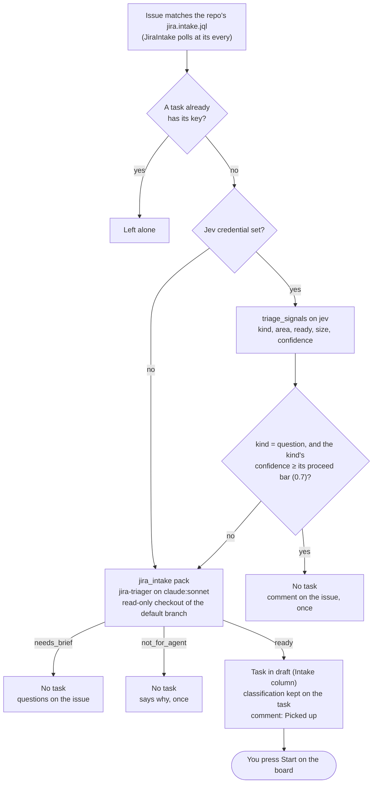
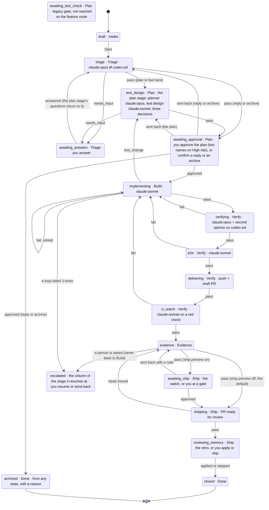
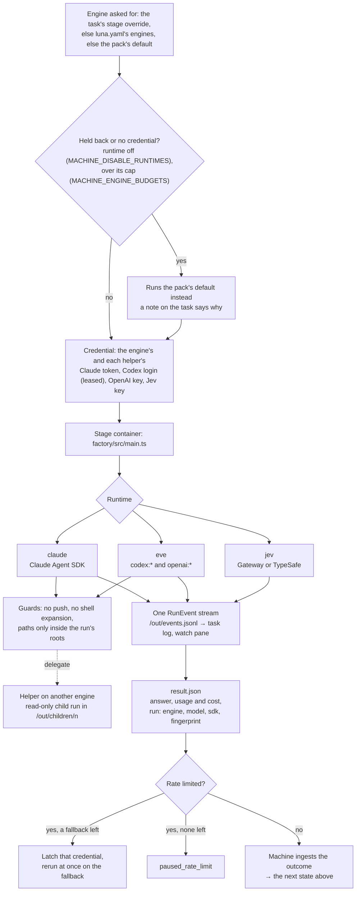

# Architecture

## Pipeline

Every ticket moves through these stages, from Intake (not ready yet) to Done ([diagrams of the whole path](#a-jira-ticket-end-to-end)):

1. **Intake** is panel 1 of the v2.2 diagram. It holds a ticket you're still shaping. It also holds a report that came from a source. Nothing runs until the card starts. Then the machine sets its context up by script, with no model. The machine looks for the repository in this order. First it uses the card's own repository. Next it uses a `links.repo` hint. Next it uses a repository configured for the Slack channel or the Jira project. Last it uses the repository map by the GitHub source. The machine finds the project in this order. First it uses the card's project. Next it uses the prefix of the Jira key. Else it uses the `luna.yaml` `jira.project` of the repository. The machine finds the owners from CODEOWNERS through the code graph. It reads the history of every source: Slack replies, Jira comments, GitHub comments. The history holds 50 entries, each flattened and capped. A Jira project resolves to a repository only when exactly one known checkout names it in its own `luna.yaml`. A Slack channel has no configured source yet. So such a card waits at Intake for a person to pick. The context-complete check is a script too. It needs a repository. It needs a reporter that you can contact, or no reporter. It needs 20 words of text or an attachment. A card that fails the check waits at `awaiting_setup` with `requested.kind: "context"` and what is missing. The machine asks the reporter once at the card's source. It uses fixed words with no text of the card. A person answers with `:context repo|project|text` on the board (`POST /tasks/:id/context`). The machine then checks the card again. The gate keeps the 2 day reminder and the 5 day `no_setup` archive. A card keeps where it came from. It keeps every source. The first source is its own `source`, and it never changes. It keeps the reporter, followers, project and owners. It keeps attachments, as references and never content. It keeps hints. It also keeps the duplicates merged into it. Duplicates work as follows. `similar` shortlists the five nearest open or recently closed cards and backlog items of the repository. It uses lexical similarity and no embeddings. The `intake_dedup` decision pack judges them in one call. Its answer is `same`, `related` or `different`, each with a confidence. The `dedup.*` thresholds decide. The machine runs the check once for every new card of a repository. It runs the check after context setup and before triage. It also runs the check when a card leaves the context gate. It checks only against cards of the same repository that the reporter of the new card could already see. A report from that GitHub repository sees a GitHub card. A report from the same channel sees a Slack card. A report from the same project sees a Jira card. Nobody sees a card with no source or from anywhere else. One exception exists. A card typed in the TUI (no source, the operator's own) sees every card of its repository. The machine never shortlists a card that the reporter could not see. It never shows that card to the model. It never merges into that card. It says nothing about that card. A confident `same` on a card merges the report into it with no person. The machine adds the source of the duplicate. The reporter follows the card. The demand goes up. The machine scores the priority again with the own weights and bands of the repository. The duplicate ends `closed`, with `mergedInto` naming the kept card. The host close step does nothing for it. A confident `same` on a backlog item bumps the item and closes the card. `related` links the two cards (`related` on both). Under the asking bar, the card waits at a dedup gate (`awaiting_setup`, `requested.kind: "dedup"`) that lists the candidates. The card waits there also when the original has already ended. A person answers `duplicate` of one candidate, `related` to some, or `neither` (`POST /tasks/:id/dedup`, ids from the listed candidates only). The answer is ground truth for every slot of the `intake_dedup` record. A failed decision lets the card go on to triage with a note. The machine tells the source of the duplicate which card tracks it. It gives the short id of the card. It adds a link only when you set `MACHINE_PUBLIC_URL`. The same visibility rule applies. Otherwise it says only that the machine tracks the report. Demand counts distinct reporters. The machine derives the demand sub-score from that count (1 to 3). A merge records the sources and followers that it added. An unmerge takes back only those. The card that it brings back carries a recorded "neither" and a link to the kept card. So the machine does not check it again. The machine accepts a person's merge only for a card that has not reached Build (no workspace, no PR). The repository that a person gives the context gate must be one that the machine already knows. It is in the repository map, or it is a remembered checkout. The person gives it as an absolute normalised path. `POST /tasks/:id/merge` and `/unmerge` are a person's way to say or undo it.
2. **Triage** is panel 2 of the v2.2 diagram. The signals come first, for every source and on every entry. An entry is the first run or a return from `awaiting_answers`. `triage_signals` is one call with one schema. It asks for the kind: `bug`, `feature`, `task`, `chore`, `question` or `incident`. It asks for the type of work. It asks whether the card is ready. It asks for the size on five levels (XS to XL). It asks for five urgency sub-scores (`who`, `what`, `impact`, `time`, `demand`). It asks for a preliminary risk. It asks whether to archive. Each answer has a confidence. The machine turns the sub-scores into a P0 to P3 priority with `scorePriority`. It uses the weights and bands of the repo. An incident or a security label is P0 first. **The confidence policy** reads each field against its bar. The bars are in `triage.confidence`: kind 0.80, size 0.60, urgency 0.70, risk 0.85, archive 0.90. Urgency uses its least sure sub-score. The flag band is 0.15 under each bar. A repo's `policy.decisions.triage_signals` wins per question. The hints of a filer move the confidence of a field by half at most. A field at `proceed` goes on. The machine **flags** a field in the band. The plan gate lists it (`requested.flagged[]` as `triage.<field>`). A field under the band is a **question to the person** at `awaiting_answers`. The question holds the field, the guess of the model and its confidence. It gives the guess as the suggested answer. The agent no longer settles it. A round asks at most `triage.max_questions` (3) questions. A card sees at most `triage.max_rounds` (2) rounds. The next need escalates to a person with the open questions listed. The machine builds some questions from the signals, with fixed text, enum values and numbers. These questions also go out by themselves. They go out as one comment, flattened, with links shown in the open. The comment goes to the card's own source only. That source is its GitHub issue. It may be its Jira ticket by the source's own key. It may be the Slack thread it came from. The machine posts each set of questions once. It never posts a question that carries a token. The own questions of an agent stay on the board until a person taps `p` (`POST /tasks/:id/questions/post`). A card sees only cards of its own source in `card_search`. A Jira-linked card counts as Jira's. A lower risk correction from a person cannot lower the grade of the machine as the floor of the plan. The clock archives a card only after a reminder a day earlier. Then the agent writes its part. It has 12 turns and five minutes. It has the read-only `card_search` tool over the cards of the same repository. It writes a summary of at most 120 words. It writes the goal in a sentence. It writes its decision with the reason. **The machine composes the Triage Record.** The record holds the kind, type of work, size, priority with its sub-scores, and preliminary risk. It holds the goal reference, signals and hints used. It holds the questions and answers, `decisionBy` and `version`. It also holds the number of the version that it replaces. `recordComplete` checks the record. An incomplete record sends the agent round once with what is missing. After that, the machine escalates. So a card never leaves triage with a null record. **The fast lane is a rule** (`fastLane`). It needs low risk and size S or smaller. It needs a type of work that is not infra or data. It needs one owning team (or none) from the CODEOWNERS of `locate`. It needs the risk and size signals at `proceed`. The agent cannot pick the fast lane. It picks `plan`, `conversation` or `archive`. The machine sets `fast_lane` or `plan` and logs `card.fast_lane`. A repo with no graph skips the owners condition and says so. A `conversation` is a ticket that asks something and changes nothing. The `reply-drafter` drafts the reply. The card waits for one tap. After the tap, the machine posts the reply where the card came from. The card ends **closed**. An `archive` is a duplicate, an out-of-scope, a stale or a not actionable ticket. It archives on one tap. A card left unanswered at `awaiting_setup` or `awaiting_answers` reminds after two days. It archives after five (`no_setup`, `no_answer`). An answer restarts the clock. A person can correct the record while the card waits at a gate (`PATCH /tasks/:id/record`, `T` on the board). The person can correct the kind, type of work, size, risk or priority. Each correction becomes ground truth on the `triage_signals` decision record. A reply or archive tap becomes ground truth too. So does an approval with no edit.
3. **Plan** is panel 3 of the diagram. It runs in the `test_design` state, in this order. Step 1 builds the **code map**, when the repo has a graph (see Code graph below). The `locate` of the machine matches the goal against the graph. It hands the shortlist to the `code_map` agent. The agent confirms the shortlist. It gives each file a role (`change`, `read`, `test`). It also gives the entry points. The machine adds whether the graph is stale. It flags the gate when the graph is more than `graph.stale_commits` behind. Step 2 runs **`risk_score`** before the plan, on the record and the map. It scores blast radius, reversibility and data sensitivity (each 1 to 3). It also scores the complexity (`S` to `XL`). The level is the **product** of the three scores (up to 4 low, 5 to 11 medium, from 12 high). It is never below the preliminary grade of triage. Step 3: the planner writes the v2.2 `Plan`. It has steps with `description`, `files`, `done_when` and `est_loc`. It declares a created file as `new`. It has criteria with ids (`C1`...). It has out of scope, assumptions, rollback, migration and flags. It has a `version`. The `version` rises on every revision, such as a re-run or a person's edit. The machine gives the ids and derives the slices that Build reads. Step 4: the test designer sees only the goal and the criteria with their ids. It writes scenarios in given/when/then. Each scenario ties to its criterion. A scenario has an id (`S1`...), a type (`happy`, `edge` or `failure`) and a layer (`unit`, `integration` or `e2e`). Step 5 is **coverage by id**. A script (`coverageOf`) finds the criteria that no scenario names. It also finds the criteria that name a limit or an error with no edge or failure scenario. It scores covered criteria over all criteria. It leaves out the criteria that `coverage_check` confidently calls untestable. A gap sends the designer back. A score under `plan.coverage_score_min` (0.85) sends the designer back. A confident "does not pin" sends the designer back. The designer gets up to `plan.coverage_rounds` (3) rounds. Step 6 is the **plan check**. It checks facts by script (`planFacts`). Every criterion needs a `done_when` of a step that names it. Every step file must appear in the map or the plan must declare it new. The plan must have a rollback. It also asks two judged questions (`fits_record`, `risk_appropriate`). It never uses the plan's own brief. A failed fact sends the planner back. A failed question sends the planner back. The planner gets up to `plan.plan_check_retries` (2) retries. Everything lands at **one** approval, `awaiting_approval`. The approval shows the plan, the scenarios and the code map. It shows the risk with its three scores, product and complexity. It shows the coverage report and what the machine flagged. The gate takes `approved`, `changes_requested` or `rejected`, each with an optional comment. The machine stores `changes_requested` as `sent_back`. `rejected` archives with reason `rejected`. Only the plan gate has `rejected`. A person can edit the steps, rollback, risk level and code map. A person can also edit the brief, criteria and assumptions. The machine's risk is a floor. A person may raise the level at once. The machine keeps a lower value with its reason as ground truth, and shows it. The approvers rule and Ship read the higher level. Approvers come from `plan.approvers`. One name is enough for low and medium. High needs two distinct names. On high, at least one name must not be among the code owners. The machine reads the owners from CODEOWNERS. It reads them for the change and test files of the map and for the step files of the plan. It never reads them from what the code mapper wrote. The `owners` of the mapper are for display only. The rule is an attestation, and the gate says so. A repo with no CODEOWNERS (or no rule matching the files) skips the rule and says so. If an owner lookup could not run, the rule stays unenforced. The gate flags this and says so. Once a person approves the plan, its steps, risk, map and rollback no longer edit. A plan that must change goes back through the gate. The timer never approves a gate that the machine re-planned or flagged. A person's raised risk at a plan gate is the floor of the next one. This holds after changes requested and after a plan found wrong. The raised risk does not lapse. The gate names a criterion that the machine excused as untestable. It also flags the coverage verdict. Paths that a model names (step files, map files, entry points) must be plain repo-relative paths. A plain path has no `*`, `?`, `{`, `}`, backslash, NUL, absolute path or `..`. Brackets and parentheses are ordinary, and the machine reads them literally. The machine drops the other paths, and the plan check names them. The scope check reads a planned entry literally. It reads an entry as a glob only when the entry holds `*`, `?` or `{`. Only a plan that the machine stored before this wave can hold them. The gate reminds after `plan.sla.reminder_days` (2) and escalates to a person after `plan.sla.escalate_days` (5). A plan found wrong in Build, Verify or review returns to the planner, not to triage. The signal is `plan_wrong`, or `re_plan` from Ship. The plan comes back with the evidence, as data. The evidence holds who raised it and why. It holds the tail of the failing output through `safe()`, capped at 2,000. It holds the thread of the reviewer through `postable()`, capped at 1,500. A second plan found wrong on the same card goes to a person. A ticket that triage sent to the **fast lane** runs the same stage on `plan_fast` and `test_design_fast`. It uses only the `locate` of the graph, with no map agent and no impact walk. It has one to three steps and one or two scenarios. It has the same plan check and one approver. The stage plans again in full in three cases. The fast planner says the ticket is bigger than it looked (`needs_full_plan`). The plan check cannot tell whether the plan fits. The files of the fast plan reach more than one owning team. An owner lookup that could not run stays flagged. The full plan runs in the same run, now with the map agent (`detail.lane`, `detail.laneNote`). On approval, the machine keeps what it proposed, what you changed and your overrides with their reasons. It keeps them as ground truth (`<state dir>/ground-truth/plan/`, see `MACHINE_GROUND_TRUTH`).
4. **Build** is panel 4 of the diagram. It runs in this order on the feature route. The PR routes run only the implementer, as before. Step 1 is the **entry contract**. A script (`entryContract`) checks what Plan handed over. Plan must hand over an approved plan with a version. It must hand over a scenario for every criterion that the gate did not excuse as untestable. It must hand over a code map (or the note that says why there is none). It must hand over a risk, the Triage Record and at least one planned file. The script sends what is missing back to the plan stage as re-plan evidence (`raised_by: entry_contract`, once per card). After that, it sends the card to a person. A gate that a person approved before v2.2 passes as `v1`, with a brief or slices and one case. Step 2 is **tests first**. A test writer (the `build_tests` pack, `claude:sonnet`) writes one failing test per approved scenario. It tags each test `@scenario:<id>`. It reports the failing output of each test through `scenario_red`. It commits nothing. The machine checks the diff by script (`scenarioTags`). Each scenario needs a tagged test. Only test files and fixtures may change. The diff must not remove a test. A Rust source file also counts when the step only adds lines to it and every added line is inside a `#[cfg(test)]` module. The machine finds those modules with `rustTestRegions`. The implementer can still change such a file. Only the loss of a scenario tag from it is a weakened test. The machine asks `red_check` per scenario. The failure must be the missing behaviour. The test must not be tautological. `red_check` reads the source of the test from the worktree, beside the report of the writer. The machine asks a flag again. The flag stands when two of up to three answers agree. Each verdict is a `scenario.red_check` event. An escalation keeps the verdicts in `testsStep.redChecks`. The machine makes the one commit `test(<card>): scenarios` itself before any production code. A missing tag goes back once. A wrong or missing red goes back twice. After that, the card goes to a person. A repo with `policy.holdout_cases` skips the step. Step 3 is **checkpoints**. The machine pushes the tests commit and every committed slice to `refs/luna/wip/<branch>`. This ref has no CI and is nobody's PR head. The container never pushes. The machine retries a push after 1 s, 5 s and 25 s inside the signal of the stage. A push that still fails is a note, never a failure. Each landed push is a `build.checkpoint` row. Step 4: the **implementer** builds to make the tests pass. It calls `red_check` per slice. It calls `scope_check` before it answers. It reads its own diff into a **Diff Summary** (`what`, `why`, files, flags, migrations, risks). The facts of git win on code-map membership, dependencies and TODOs. Step 5 is the **budget**. Each card gets 15 iterations, 2 million tokens and 90 minutes. An iteration is each red or green and each failed sweep. The tokens count new work. This is the runtime's own count of input and output. The machine keeps cache reads beside it and off the budget. The machine reads the budget before each run and when a run ends. A spent budget goes to the `escalation_reason` decision. The time limit of a run is the smaller of its own limit and the minutes left. Step 6 is the **regression sweep**. It runs by script in the container of the stage after the last slice is green. It runs the `luna.yaml` checks whose paths cover the changed files and the files that the graph names for them. It runs the whole-suite checks whose `minutes` hint is within `build.regression_full_suite_minutes`. It also runs lint, typecheck and format. A failing check sends the implementer round again with its name and output tail (data, capped). Step 7 is the **scope check**. It computes the facts from git: undeclared files, removed tests, switched-off tests, weakened tests, new dependencies, TODOs and secret-looking additions. It gives each issue a severity. A blocker gets one fix pass. A second scope red escalates `undeclared_scope`. `should_fix` and `nit` ride on the Build Report. Step 8 is the **escalation**. An escalation from Build carries a reason. The escalations of the machine itself count too. A fact decides the reason where one decides. Examples are a second scope red, or a service or container that never started. Otherwise the `escalation_reason` decision decides, with a confidence. Under the bar, the reason is `other`. `plan_wrong` returns to the planner once. `too_complex` gets the stronger model once, with one fresh budget. The gate holds the reason, its confidence, the summary and the tail of the output. A person can correct the reason (the enum only: `POST /tasks/:id/escalation-reason`). What the person then commits is ground truth. Step 9 is **trust**. Nothing that the checks rely on comes from a row, a ref or a commit that a container can write. A container's events never take a kind that the machine logs itself. The machine drops `stage.finished`, `stage.started` and the other reserved kinds at ingest with a note. The tests commit is the sha that the machine itself recorded. The machine trusts it again only while it is an ancestor of HEAD. Its parent must be the commit that the card's first run started from (a `stage_runs` row). Its own diff must pass the tag check. Otherwise the card escalates `head_moved`. The machine writes nothing on a branch that the container moved. The machine measures the scope from that commit. Else it measures from the start of the first run. It never measures from a ref. A scope that it cannot measure escalates as an environment problem. Step 10 is the **Build Report**. It goes to Verify. It holds the base, tokens, minutes, the iteration log, and each scenario's test before and after. It also holds the Diff Summary, the declared files and the scope result with severities. `GET /tasks/:id` also shows the progress of Build live (`buildProgress`).
5. **Verify** is panel 5 of the diagram. It runs in this order. Step 1 makes a **fresh workspace** from the card's repository at its head commit. It runs the **environment check** against the one that Build recorded. A lockfile that differs at the same commit is a blocker. A different image is only a note. Step 2 is the **review**, first. The `verifying` pack reads the change. It runs on another model family than the implementer's when that family's credential is on the machine. This means `codex:sol` against a Claude build and `claude:opus` against a Codex one. One family's credential runs as before. The pack never mounts the card's shared agent session. It has no `slice_list` tool. It works from the plan, the scenarios and the Build Report as data. Each finding has an id, a level (`blocker`, `should_fix`, `nit`) and a category. It names the criterion it is about (`criterion_ref`). It has a suggested fix and a location. The machine merges the same finding when the pack raises it twice. The highest level wins. Step 3 is **`finding_classify`**. It is a decision pack on the check context. It classifies every merged finding. It takes twenty at most, the most severe first. It judges each against an excerpt of the code around it. Its rows are by finding id in `detail.classified` with `detail.calibration`. They never change the verdict. Step 4: the checks run only when **no blocker stands**. The checks are the repository's own checks, the regression sweep and the patch coverage. `verifySteps` names each step (`machine/src/domain/verify-order.ts`). A blocker ends the stage as a failure with the findings and no suite run. A red check is a finding of category `tests`, unless it is red on the base too. The machine asks each failing check again on the commit the change is measured from, in a throwaway clone with the same image, services and identity. It runs only the failing test files when the output names them, else the whole check. A check that fails there as well is not the card's. When no failing check is the card's, the stage escalates with `env_broken` and `red_on_base`, naming the tests. It does not go back to Build, and it counts nothing against the verify cap. A card with some checks red on the base and some its own goes back with its own only. The answers are kept by base commit, image, check and files: a green one for 30 minutes, a red one for 2, because a fixed service leaves the commit and the image as they were. Patch coverage below `1 - verify.coverage_drop_max` of the lines added is one `should_fix` finding. The finding names the files. With `verify.mutation.command` set in the `luna.yaml` of the repository, the machine runs it in the sandbox after the checks. It reads a score from the last output line `mutation score: <0 to 1 or n%>`. A score under `verify.mutation.min_score` is a `should_fix` finding. When the command is unset, nothing runs. Only a blocker fails the stage. Step 5 is **rounds**. The machine sends Build the same set of blocker findings (by finding id) `verify.build_rounds` (1) times. If the same set comes back, it goes to a person with the findings. A new set starts its own count. The browser run and CI loops end after `verify.e2e_rounds` and `verify.ci_rounds` failures (3 each). A card sent back from the browser run carries the findings of that run. Each failed scenario gives one finding. It holds what the scenario expected, what it saw, the names of the artifacts and the judged cause. These findings replace the findings of the last Verify pass. Evidence never sends a card back to Build. Step 6 is the **browser run**. The machine judges it scenario by scenario. Its manifest has one row per approved scenario by id. A scenario with no row is `not run`. The machine drops an artifact that is not a plain-named regular file in the run's folder. The machine asks `e2e_failure_cause` per failed scenario, five at most. Step 7 is the **CI watch**. A typed decision says what kind of red it is: `ci_failure_class` (real, flake, infra, drift). It works on the name of the failing job and the tail of its log, flattened and capped, as data. Only a real failure asks the CI investigator for the fix. The machine re-runs a flake or an infra failure `verify.ci_flaky_reruns` times. A failure that stays red goes to a person. Only the re-run of a flake teaches the decision. A drift rebases when `verify.auto_rebase` allows. Step 8 is the draft **PR's body**. The machine owns the section between `<!-- luna:pr:start -->` and `<!-- luna:pr:end -->`. The section holds why and the version of the plan. It holds the criteria of the plan by id. It holds scenarios with their tests. It holds open findings by level. It holds files outside the map. It holds base and head commits. It also holds the issue link. A later update replaces only that section. Step 9 lists what Verify does not build in 12a. It does not run extra browser scenarios by the blast radius of the change. No setting exists for it, and a later wave adds it. It does not make a person's dismissal of a finding into ground truth on `finding_classify`. That is the ship gate of wave 13. No gate for it exists before. Step 10 is the **Verify Report**. It carries the engine and family that reviewed. It carries the findings by level with their resolutions. It carries the checks, and the coverage and mutation numbers. It carries the browser run by scenario. It carries the CI class and the rounds used.
6. **E2E and Evidence** cover a repo with a web surface. A QA agent drives the app in a browser (the `runner-qa` image). It writes a manifest, screenshots and video. A repo with no web surface skips this step, with a recorded reason. The agent drives the **approved scenarios**, not the raw criteria. The manifest has one `acceptance[]` row per scenario, with `text` as the scenario title verbatim. It has a `video.chapters[]` entry per scenario when there is a recording. It also has `steps.jsonl`, so a person can replay the walk. A failed run goes to `e2e_failure_cause`. A confident `env_flake` re-runs the pack once in the same stage run. A second failure escalates as `flaky_tests`. `product_bug` and `test_bug` fail as before, with the cause recorded. Evidence then checks the manifest on the host. It requires a row for every approved scenario. It also requires a chapter for every approved scenario when there is a video. It shows the verdict, artifact count and a few screenshot paths in the ship approval.

   **Evidence (panel 6 of the diagram), in order.** Step 1 is *collect*. The host reads the card's own record first. This holds the browser-run rows of the Verify Report, else the manifest of the e2e finish, else the manifest of the container by title. Only then does the host read the files under `<state>/runs/<run>/files/qa/`. It reads them all through the bounded reader. The reader follows no link and reads regular files. It has size caps. It reads at most 2000 files and four levels. A missing manifest is a note on the pack, never a failure. A scenario with no row is a note on the pack too. So is a missing chapter. Evidence shows less and says why. It stops only for a usage limit and for a card with no workspace or head commit. Step 2 is *format*. The decision `evidence_format` answers `video`, `screenshots_or_terminal` or `text_only`. It answers `video` for a UI or flow change when the browser run ran. It answers `screenshots_or_terminal` for an API or CLI change. It answers `text_only` for CI/CD, config, infrastructure or a pure refactor. The pack stores `video`, `captures` or `text`. A mechanical veto degrades `video`. The veto applies when there is no image, no recording or steps, or a QA target with `reentrant: false`. A mechanical veto degrades `captures` with no browser run only when Verify ran no checks and Build tagged no scenario tests. Step 3 makes *text, terminal capture or film*. A `captures` pack with no browser run gets `terminal.txt`. The file shows the test of each scenario, red to green. It shows the command of each check and the end of its output. The machine builds it from the card and runs nothing again. A `text` pack gets a 20-line `checks.txt`. The pack lists both files as media lines, never inline. Two containers make a film at once. One makes the voice and cards (`narrate`, `cards`). The other makes the recording (the `recording` sub-run). The sub-run paces by a read-only copy of the timeline. The two lanes start together. A failing lane aborts the other. `compose` then holds the last frame of a recorded stretch that is shorter than its clip. It cuts a stretch that is longer by more than a second. The film's length limit, fix rounds, voice and language come from `luna.yaml` (`evidence.video_budget_s`, `regenerate`, `tts.voice`, `tts.language`). Step 4 is *the frame check*. After `measure`, the `frames` tool reads the text on the frames of the film. It uses tesseract, every 2 s and 0.3 s after each scene start. It also reads the text on every screenshot. Some matches are a measured P0 card. These are a token or cloud and payment key shape, a private key, and a connection string with a password. They are also a `password=` or `secret=` assignment, and an `Authorization` bearer or basic value. They are also an e-mail address (not at a reserved or `.test` domain) and a phone number. A card number that passes the Luhn check also counts. One list holds them (`machine/runner-video/tools/lib/findings.ts`), and the tool and the host both use it. The tool checks the whole text of an image. It cuts the text that it hands the host to 4,000 characters. A cut text counts as not read. A P0 card gets the one fix round. After that, the film drops to screenshots. When nothing matches, the typed decision `frame_privacy` judges credentials and personal data once. The machine marks an image `scanned: false` when the tool could not read its text or cut it. The critic (`video_qa`, an agent) gives a confidence. A `ship` under 0.5 gets one more pass. Step 5 is *the pack*. It holds results by layer, a diff summary, a revision, and the findings with their resolutions. The host assembles it and runs `packComplete`. The host repairs by script what a script can. It can repair an empty summary, rollback or how-to-verify. It can repair a media entry missing on disk. It can repair a captures pack with no scenario. The host never repairs a commit that is not the head. Step 6 is *store, publish and ready*. Media go where `evidence.storage` says. The choices are `release_asset`, the default, which is a draft pre-release `luna-evidence` through the GitHub port, or `local`. The machine keeps media 180 days locally unless the repository says otherwise. `MACHINE_RETENTION_DAYS` no longer applies to evidence. **By default Evidence publishes the pack to the PR and marks it ready for review with no gate.** It finds the PR for the branch. It requires the head of the PR on GitHub to be the commit of the pack. It never pushes. It uploads the media. It writes the marked section into the body and the one comment. It marks a draft PR ready. **`ship.preview: on` keeps the old gate.** Evidence then publishes nothing. The card waits at `awaiting_ship`. There a person can send it back with a note (`t=12.5 scene=<id> el=<id> what to change`) or approve. `shipping` publishes after the approval. **The machine uploads an image whose text it did not read only after a person approved the preview.** It does the same for any video that it did not check frame by frame. The browser run's own recording is never read, so it carries `scanned: false`. The machine never uploads a HAR, by kind. The machine reads every text file through the bounded reader. Text files are the terminal capture, checks, captions and a JSON report. Each file passes the same findings check as the text of a picture. On any hit, the file stays local with a fixed note. The machine redacts a clean file and uploads it. An asset's name holds the task, the commit, the digest and the extension, nothing else. The machine names scan copies by index. The machine reuses a film from the local pack that it kept for the old commit, not from the published one. Text that a model or a container wrote and that reaches the PR gets its addresses broken. The machine adds a zero-width space after the scheme and after `www`. So none autolinks, and no closing keyword works by URL. Step 7 handles *stale parts*. When the head moves after the machine made a pack, Evidence logs `evidence.stale`. It makes again only what the new commit made stale. It always makes the text again. It makes the film again only in three cases. The scenarios of the film changed. A newer browser run changed a result or the steps. A rendered surface changed between the commits. The paths come from host git through `at()`. The machine copies a film that is not stale from its own store of the old commit. No video run starts. Step 8 lists *what this does not promise*. The media sit on a draft pre-release. Only people with push access can read them until someone publishes the release. Publishing the release makes every past asset public. The text reader (OCR) misses, by construction, small or low-contrast text, other scripts, and text on screen under two seconds. It also misses secrets split across lines or images, codes, faces and an image inside an image. An image with no readable text counts as clear. The `frame_privacy` decision sees at most forty texts. A scenario's pass without a Verify Report is the browser run's own word. Marking a PR ready notifies its reviewers with no click. Step 9 is *thumbs*. `y` and `n` in the Evidence section of the board (`POST /tasks/:id/evidence/feedback`) record whether the pack was useful. They record it as ground truth under `<state>/ground-truth/evidence/`. The board shows the pack with no gate open.

   For `video`, `stages/video.ts` runs a pipeline over jobs in the `runner-video` image and packs as sub-runs. The image has no network and no credential. The job dir is at `/work`. `video_script` writes the script and a timeline that the host checks. `checkTimeline` checks for contiguous scenes, one demo per approved scenario, and under 240 s. It checks for a hook by 3 s and text floors. It also needs a citation or a SCHEMATIC label for every on-screen number. A `narrate` job renders the voice (kokoro-js) with whisper word timestamps. A `cards` job renders the title cards from a time-driven page. `recording` drives the approved steps against the QA target. It makes a mark per scene and a hold from each clip's length. `compose` cuts and aligns with ffmpeg. `measure` runs the numeric checks and makes the contact sheets. `video_qa` is a cold critic on another engine than the writer. It uses `claude:haiku`, which can read the sheets, with `codex:sol` as the fallback. It scores the film. The film ships only with every score at 8 or more, no P0 and no measured FAIL. Otherwise one `video_fix` round runs on the named scenes. A send-back note re-enters here. A second non-ship degrades the pack to captures with the critic's scores kept.
7. **Deliver** pushes the branch with git. It opens a draft PR through the GitHub API, so CI starts early. GitHub may report the PR `CONFLICTING`. Then the machine rebases the branch once onto `origin/<default branch>` on the host. It pushes the branch with `--force-with-lease`. It does this for the task's own branch only. The lease is the head that the branch was pushed at. When that push fails, the machine puts the branch back at that head, so the next push is not refused as a non-fast-forward (CI watch does the same). A rebase replays the commits one by one. When it stops, the machine merges `origin/<default branch>` into the branch instead. A merge compares only the final results. So it ignores a file that an early commit changed and a later commit put back. If the merge conflicts too, the machine checks each file that the card changed. When the default branch already has every one of them exactly as the card has it, Deliver fails with the verdict `already_on_base`, and a person archives the card. Otherwise the `addressing` pack resolves the conflicted files in a fresh workspace (`mergeRound`, the same step that the ship watch uses). The project's checks run on the result, and the merge goes to the PR with a normal push. A check that fails is asked again on the base's own tip. When it fails there too, the round escalates with `env_broken` and says the base is red without the card. When the resolution fails, Deliver fails with the files in conflict and the reason. The body of the PR follows the caveman-pr shape (a one-line what, terse why bullets). It adds `Closes #N` when the ticket came from a GitHub issue in the same repo.
8. **CI watch** polls the checks of the PR until they settle. It runs outside the stage pool. Polling computes nothing, so its slot goes to the queue meanwhile. A red run goes to the `ci_watch` pack. A fixable failure loops back to Build with its findings. The machine re-runs a flake or an infra failure once. It escalates only when the failure stays red. Needs-debug failures escalate. A PR that conflicts with its base gets the same one rebase. If the rebase stops on a conflict, the machine merges the base instead, on a fresh clone. The `addressing` pack resolves the conflicts. The machine checks that the pack touched only those files and left no marker. The project's checks must pass. Then the machine pushes one merge commit, never forced, and Verify runs again. A merge that does not land escalates as `conflict_unresolvable`, with its reason. So does a second conflict after two merge rounds. The pack can also answer that verdict for a red run that it traces to a conflict. The container never pushes or rebases.
9. **Ship** is panel 7 of the diagram. It runs in this order. The card waits at `awaiting_ship` while the machine watches its PR (`ship-monitor.ts`). With `ship.preview: on`, the old preview gate comes first. Approving it publishes the pack and starts the watch. Step 1 is *the watch*. It polls every `ship.poll_minutes` (5). `MACHINE_SHIP_POLL_INTERVAL` overrides it. It runs outside the stage pool. It asks nobody anything unless something needs a person. Step 2 is *event classes*. GitHub's facts decide `conflict`, `base_moved`, `freeze` and `blocked_by_other_pr`. The machine asks the `event_class` decision only for an activity item and a red CI. It accepts only the labels that make sense for what it observed. Anything else goes to a person. The machine reads only an `OWNER`, `MEMBER` or `COLLABORATOR` who is not the machine's own login. Step 3 is *the read step* (`pr_reply`). It reads a comment before the machine decides its intent. A question gets an answer through `postable()`, capped at 2 per thread and 10 per PR. Step 4 is *intent, fix scope and the guard*. `comment_intent` and `fix_scope` size a nit or change request. A script guard holds a fix inside the PR's own files. It keeps the fix away from CI configuration, `CODEOWNERS`, `luna.yaml` and lockfiles. It also holds the fix under a size. Step 5 is *the fix*. The machine makes it on a fresh workspace. It returns as a bundle that the machine accepts as a fast-forward. A fix that needs a new plan goes back to Plan once (`re_plan`). The new plan waits at the plan gate. Step 6 is *evidence valid* (`evidence_valid`). It chooses what the machine refreshes. The machine writes the text of the pack again by script, with the fix recorded under "Changes after review". Or the affected scenarios get a new browser run, and Evidence re-makes the media. An unsure answer runs Evidence again. Every re-publish goes through `publishAndReady`, the one publisher. The machine keeps a person's edit of the section of the pack as ground truth (`evidence.edited`). Step 7 is *readiness and the review rule*. Readiness is a script (`merge-readiness.ts`) over GitHub's facts, the pack and the policy. The code fixes the checklist. It holds pack, draft, CI, conflicts, approvals and owners. It also holds CODEOWNERS change, fix approval, evidence at the head, freeze, blocked and stale. Config sets its parameters, never its items. The machine re-verifies a head older than `ship.stale_days` once on a fresh workspace. The project's checks run in full. This replaces simple blocking. Step 8 is *the ship approval*. A High-risk card asks a release owner "safe to release now?" after readiness. The owner sees the checklist and the pack. When the repo asks two people of a High-risk plan (`plan.approvers.high` above 1), the approver must not be one of the approvers of the plan. With one approver (the default), the person who approved the plan approves the release. Rejecting archives the card. Nothing closes on GitHub. Step 9 is *the merge*. It happens at `shipping`. `shipping` reads readiness again on GitHub's facts. The sha of the head guards it. It follows `ship.merge`. The event is `ship.merged`. Its sha is the merge commit that GitHub reports. Step 10 is *close the loop*. The machine posts a fixed summary where the card came from. `task.shipped` stays the stream message. A PR closed without a merge archives the card (`pr_closed`). Step 11 is *the retro*. It runs at `reviewing_memory`. First `worth_learning` runs on the predicted-against-actual facts. Then the `reviewing_memory` pack runs. A card with nothing to learn closes with no click. Only a retro that proposes something waits for a person.

   **When the machine merges by itself, and when it never does.** It merges a Low or Medium risk PR (`ship.auto_merge: medium_when_review_required`, the default) in one case only. The repo must require a review. A ruleset can require it. So can branch protection, GitHub's own `REVIEW_REQUIRED` for the PR, or a CODEOWNERS file that names an owner for every changed path. The PR must also have an approval on the head commit from a collaborator who is not the machine. A person merges on GitHub when the repository requires no review. The card goes on by itself. **An unreadable rule means manual.** A High-risk PR asks a release owner after readiness, whenever the machine may merge at all (`off` merges nothing and asks nobody). Some repositories set `ship.auto_merge` to `low` or `medium` themselves and have no approval on the head. The board asks about these after readiness. No mode merges a PR that nobody looked at.

   **The clocks never merge or archive.** A PR quiet for two days (`ship.sla.reminder_days`) gets a reminder. After five days (`ship.sla.escalate_days`), the machine names its release owners, with fixed words. Activity starts the period again. There is no second total-time cap (`MACHINE_SHIP_MAX_WAIT_DAYS` is gone).

   **What a retro may change.** It may change one file (`docs/agents/project-context.md`), in a draft PR on `luna/memory-<task id, 8 characters>`, after a person's approval (`a`). The file also gets the learned facts that the retro promotes (see [Token economy](#token-economy)). Everything else that it proposes is inert text in the body of that PR. This covers prompt updates, runbooks and ADRs. The machine records recalibration and graph misses where the eval loop and the graph read them. A graph miss counts only when the Build Report of the card declared the same path.

   **What leaves the machine in Ship.** These things leave. The section and comment of the pack (fixed words and facts, with model text only through `postable()`). Replies to questions. The push and summary of a fix. A merge request. A reminder and an escalation line. The close-the-loop summary. A draft PR after a retro approval. The machine never gives an approval. It calls `postReview` only on the review route. It never closes a PR.

   **What Ship does not promise.** The machine merges nothing that nobody looked at. It needs readiness green on GitHub's facts, read at that moment. It guards the sha of the head. It needs an approval on the head from an owner, member or collaborator who is not the machine's own account. It needs a review that the repository's own rules require. Under the explicit `ship.auto_merge: low` or `medium`, a person's approval at the board after readiness replaces that review. A High-risk card in the default mode needs the required review and the approval on the head. It also needs the answer of the release owner. A standing "changes requested" from a collaborator blocks the merge, whatever GitHub's review decision says. These are the limits, in plain words:

   - An approval from a collaborator's second account, or from a bot with write access, counts as a look.
   - The name of the release owner is an attestation from the one API token. The machine does not check it when the repo names no owners.
   - A ruleset with bypass actors still reads as a required review.
   - Anyone with write access can retarget, close or rename the PR.
   - Every model sees hostile PR text. Four things contain it. First, the typed answers. A model only picks among capped branches and never touches the risk. Second, the fix guard. It allows the PR's own files and test files, both names of a renamed file, and no control-plane path. It has a size cap in which a binary file counts as over. Third, the caps on replies. Fourth, the approval on the head after every fix. The machine never gives a comment from anyone who is not an owner, member or collaborator to the fix agent or the re-plan. Such a comment reaches the reader and the decisions only marked as the data of an untrusted author.
   - Inside the PR's own files and any test file, the fix agent can write any code. CI runs it with the repository's CI secrets.
   - `ship.auto_merge: low` or `medium` lets one board click stand in for a review, by the owner's choice.

   **Not built (recorded limits).** The machine does not emit `ship.override { merged_not_ready }`. It does not count gate send-backs in the overrides of the retro. The four older `worth_learning` eval cases have no new fields. The proposals of a retro ride only with a rules proposal. These also do not exist: webhooks (polling only), a checklist that a repository edits, and the "tone from past approved replies" of the diagram.

Triage, Plan and Build run stage packs (see [Factory mode](#factory-mode)) when a credential and the runner image are available. Deliver and Ship run for real too, as soon as a task has a branch. They are plain host commands (`git push` + `gh pr create --draft` / `gh pr ready`), not Claude agents. CI watch polls on the host and runs its pack only for a red check. Evidence runs on the host (its video pipeline starts containers). Intake, Done and any stage without a runner are stubs that pass, unless you queue a result with `POST /dev/stubs`. Full route list: [api.md](./api.md).

The machine is one service for every repo you point a task at, not one per repo. `MACHINE_MAX_CONCURRENT` (default 4) caps how many tasks can drive a stage at once *in total*, across all of them, not per repo. Each repo can still speak for itself through a `PIPELINE.md` at its root. It can set QA on or off, a monthly budget, a concurrency cap, timer-approved plans and held-out test cases (see [configuration](configuration.md)). `/metrics?groupBy=repo` tells the repos apart. A task past that cap is `queued` until a slot frees. The queue is durable, in Postgres, so a restart does not lose track of it. You can open as many boards as you like, from any workspace. They are all clients of this one machine. They see the same tasks and the same queue.

## Change size and stacked cards

Four words. The *origin* is the card or ticket that the machine split. A *child* is a card or ticket that a split makes. A *dependency* is a card that another card names in `card.dependsOn`. The *parent* is the one dependency that a card stacks on (`card.base.card`). The origin never builds, so it is never a parent.

**The size guard.** At Plan, after `risk_score` and before the planner, the typed decision `size_estimate` places the change on a rubric of seven anchored levels. `contracts/src/size.ts` turns the score into lines. The machine reads the answer only when `est_loc` is sure. After the planner, the script sums the step estimates of the plan, and that number rules once there is a plan. Only the hard limit (`size.hard_limit_loc`, 2,500) sends a card to a split. The target range (1,000 to 2,000) is what the decomposer aims at, and a flag at the gate. Verify counts the real diff. It reports one `should_fix` finding of category `size` when the diff is over the hard limit, unless a person kept the card whole.

**The decomposition loop.** Over the limit, the `decompose` agent pack (no tools, no repository) proposes two to `size.max_children` children. Each child has a goal, criteria, an estimate and the positions of the children it follows. A script (`splitFacts`) checks count, limit, cycle, references, criterion cover and words to work from. `split_check` judges cover, overlap and stand-alone. The loop runs at most `size.max_rounds` rounds. The machine does not split a child that is itself a part again (`size.depth`). The loop makes nothing. It ends in the plan gate with `requested.outcome` `split` (a proposal) or `split_failed` (the reason and the issues).

**The split gate and its answers.** A person has four answers. The person can approve the split. The person can send it back with a comment, which the decomposer reads. The person can keep the card whole. The person can reject it. No clock approves it. A High-risk origin needs the approvers that a High-risk plan needs. Keeping a card whole is a person's recorded override. The machine flags it at every later gate, on the Verify Report and on the PR.

| What a split makes | Who taps first | Where |
| --- | --- | --- |
| Child cards, when the origin is a card with no ticket the machine can write to | a person, at the split gate | `Pipeline.approveSplit`: one `createTaskOnce` per child under `split:<origin>:<n>`, in dependency order |
| Child tickets, when the origin came from a ticket the machine can write to | a person, at the split gate (a card) or on the split draft (a ticket) | `TicketMachine.splitChildren` through the `Tickets.create` port, in the origin's own project or repository |

The gate says which of the two an approval makes. The machine refuses an approval (409 `split_changed`) when that changed. A child inherits the repository and the engines and nothing else. It gets no approval, record, source, reporter or Jira link. Its risk is never below the risk of its origin. A model writes its title and description, and they are foreign everywhere. The machine flattens and caps them. Prompts declare them as data. The machine never posts them by itself to the thread or ticket of the origin. The source of the origin hears one fixed line. The machine builds the branch of a child from ids (`task/<id8>-part-<n>-of-<origin id8>`). The origin ends `archived` with reason `split`.

**The dependency rule.** A card with `dependsOn` stays a draft (`startWhenReady`, event `card.held` with the reason and fixed words). It stays a draft until every dependency has merged or has an open PR (`card.released`). It stacks on the one open dependency whose branch holds the others. With none, `card.base` is empty. The rule holds the card before it starts. So the machine plans the children along a chain one after another. If someone archives or removes a dependency, the card stops with a person. The backlog applies the same rule. An entry has `schedulable` and `blockedBy`. `promote` of an entry that is not schedulable answers 409 `not_schedulable`.

**A stacked branch.** The machine cuts the workspace of a child from the tip of its parent, fetched from `origin` (never the folder of another card). The own repository of the machine records the base commit (`refs/luna/base`) and the branch name of the parent (`luna.baseBranch`). Only host git writes both, through `at()`. So every diff, scope check and Verify shows the child's own change. The PR targets the branch of the parent. It carries a fixed "Stacked on #N" line. The readiness checklist has a `stack` item. It turns red while the parent has not merged. It also turns red when the PR targets any branch but the default one. A stacked move (onto a new parent tip, or onto the default branch after the parent merged) falls back to a merge the same way a rebase onto the default branch does. A branch that already holds a merge since its base is merged, not replayed, because a replay drops the merge and brings the conflict it resolved back. Deliver sends a stacked move that still conflicts to the same merge round.

**The two events of the parent.** The ship watch reads the parent from facts, never a model. `parent_changed` means that the head of the parent is not the recorded base. It rebases the child onto the new tip. It pushes with a lease on the old head. It re-stamps the Evidence Pack. It does this at most 20 times. After that, a person acts. `parent_merged` retargets the PR to the default branch. It moves the child onto it. It pushes with a lease. It rebuilds the PR section of the machine. The machine deletes the branch of the parent only when `ship.merge.delete_branch` is on and no other card stacks on it. A rebase that stops on a conflict pushes nothing. The machine then merges the base instead and resolves the conflicts, as the CI watch does. Only a merge that does not land asks a person. A parent that someone archived asks a person once. An approval that a person gave while stacked does not survive the retarget. A child needs its own approval on its new head. The machine merges only into the default branch. A PR merged into any other branch is not a ship, and the machine archives its card `pr_closed`.

**Not built.** These do not exist yet: editing a split at the gate, editing a card's dependencies on the board, and a stack across repositories. A merge queue for a whole stack does not exist. Webhooks for the events of the parent do not exist. Closing the origin when all its children ship does not exist. Jira's own epic type and issue links do not exist. The Backlog and Tickets views of the board do not show the new fields.

**After the security pass.** A card can leave its stack because its parent is gone. This happens when a person retargets its PR to the default branch. The card then needs a new review. The machine records the head and the time it left. It ignores every approval that a person gave at or before that moment. It treats the Evidence Pack as stale. The card goes back through Verify and Evidence over its new range against the default branch (`a new review is needed because the change now includes its parent's commits`). The machine retargets the child of a merged parent only after it moved the branch off the parent and pushed. The `stack` item of the child stays red while the card has a base. The machine reads the default branch from GitHub, never from the clone of the host. When it cannot read the branch, the card is not ready. A merge into another branch is not a ship. The machine links child tickets at create time from what the tracker returned. A GitHub port cannot read a child back. GitHub children carry the label of the intake. A split of a ticket with no card gives every child a risk floor from the assessed blast radius of the origin, never below medium. Each split draft has its own id. The hash of the tap covers the children (titles, goals, criteria, dependencies, order). The machine reads them under the row lock. The machine only ever re-drafts a draft that it stored before this. Child card keys are per gate. A split gate that a person sends back or rejects archives the children that it left. Keep-whole records every approver. The machine refuses an automatic approval at a split gate. A child inherits the audience of its origin for the size and duplicate lookups. The backlog does not schedule or promote an item when it cannot read the states of its dependencies.

Limits: the host checks out a hostile parent branch in the work tree of the machine. So a `.gitattributes` that names a filter, which the git config of the user defines (such as LFS), runs that filter on the host. This was true before. It now reaches branches that the agent of another card wrote. `releaseHeld` reads every held card on every tick. The idempotency keys of a client share a namespace with the split keys of the machine.

## The shared backlog

The backlog holds candidates that are not cards yet, from every source, in one list (`backlog_items`). A candidate has sources, a title and text, and five sub-scores (1 to 3). It has a size (XS to XL), a demand count and `dependsOn`. It also records when someone added it and when someone last assessed it. `rankBacklog` orders the candidates by cost of delay over cost of doing (the `wsjf` of wave 8). Delay is the `costOfDelay` of wave 8. Urgency is the `time` score. Compounding is the mean of `who`, `what`, `impact` and the demand score. The demand score rises by one for each report beyond the first, and stops at 3. Doing comes from the size (3, 4, 6, 8, 9). Ties go to the older item. The machine marks an item stale when nobody has assessed it for `backlog.stale_days` (14). The routes are `GET /backlog`, `POST /backlog`, `POST /backlog/:id/bump`, `/promote` and `/decline`. `/promote` makes a card through `create_card` with the scores as hints, and removes the item. The Backlog view of the board (`B`) lists the items with the score, size, demand, age and stale mark. Scheduling by `dependsOn` is for a later wave. So is the use of the backlog by the Slack inbox and by the ticket machine.

## The Ticket Machine

This is panel 0 of the v2.2 diagram. The rule is that nothing leaves the machine without a person's tap. The machine reaches a Jira or GitHub ticket through one port (`Tickets`, `machine/src/application/tickets.ts`, adapters in `machine/src/adapters/tickets/`, a no-token fallback). It holds the ticket as one object per key (`tickets` table). The tool owns the description and reporter. The machine owns its status and links. A re-read never overwrites what the machine owns.

- **Scope.** The machine reads a ticket only when its assignee is in `tickets.assignees` or it carries a `tickets.teams` label or component. A repository's own JQL or label filter narrows the scope further. Edits settle for `tickets.debounce_seconds`. With no scope configured, the filter of the repository is the whole scope.
- **Validity before assessment.** The machine first enriches the ticket by script. The script adds linked tickets and the epic. It adds the recent tickets of the reporter and the component. It adds the code that the text points at. It adds the cards and backlog items that the audience of the ticket can see, by `canSeeKept`, failing closed. Then one `ticket_validity` decision answers: workable, needs info (exactly what is missing), duplicate, or not ours. The machine assesses only a workable ticket. It parks a bug with no sure repro steps and no reachable reporter without a model call.
- **Assessment.** One `ticket_assess` decision answers fifteen typed scores and five flags. `ticketScore` reads them in code. It computes the knock-outs. It maps urgency to P0 to P3 with the weights of the repository. It maps complexity to S/M/L/XL and blast radius to low/medium/high. It computes the priority as cost of delay over cost of doing. Confidence pulls each score toward neutral. The assessment history keeps every sub-score.
- **Recommendation and drafts.** `recommend` decides by rule where the scores decide. The choices are do now, schedule, decline and needs decision. The name for XL is `split`, the manual split of the diagram. A sure size estimate over the limit makes the same recommendation. `recommend` asks `ticket_recommend` where the scores cannot decide. A script builds the assessment comment and the needs-info comment in fixed words. The `ticket_reply` pack writes the decline reply. Every draft goes through `postable()`. The machine refuses a draft that carries a token. Every draft waits.
- **The tap.** `POST /tickets/:key/approve|edit|ignore|card|backlog` are the only paths to a comment, a transition or a card. Each draft tap carries the hash of the draft. The machine refuses a draft that changed. The intakes only call `TicketMachine.ingest`, which has no write path. `tickets.auto: on` keeps the old behaviour of the Jira and GitHub intakes.
- **Backlog.** A ticket for later goes to the shared backlog on a tap. Its sub-scores become the scores of the item. Its size and its ticket come with it, with the ticket as the source. A re-assessment updates the item. Declining the item of a ticket drafts the decline reply.
- **After the card tap.** The card tap is the consent for the Jira sync that follows. The two-way sync runs while a card exists, as the diagram draws it. `jira.comments` turns its comments off. A card that the machine made from a ticket links only to its own source. The machine looks for no Jira key in the text of the ticket. The machine marks a draft `posting` under a row lock before it calls the port. So two taps post once. The machine does not keep a reply that the `ticket_reply` pack writes (no tools, one turn) when the reply holds an address.
- **Ground truth.** A card tap, a backlog tap or an approved decline or park draft labels what the person chose on the `ticket_recommend` record behind the recommendation. The label is `ticket_confirmed` when the person chose what the machine recommended. It is `ticket_override` when not. It goes through `learned` of the decision log. A tap with no record behind it labels nothing. This is the case when the rule decided and no engine ran. The machine keeps an approved, edited or ignored draft in `<stateDir>/ground-truth/ticket/`. For an edited draft, it keeps the text before and after.
- **At the card's gate.** A linked ticket may change its scope or priority while the card is before Build. Then the open gate of the card and the next gate that it opens carry the field names and the time (`ticketChanged`, never ticket text). The gate view of the board shows `the ticket changed since this was written`.
- **Not built.** These do not exist: re-assessing a stale backlog item that came from a ticket, because no clock reads tickets and GitHub has no read. Ticket events for GitHub issues, because the machine watches only Jira. The card-to-ticket mirror of status, PR and Evidence links through the `Tickets` port, because JiraSync is as it was. Restarting the triage SLA clock when a comment answers its questions, because the SLA has no way to restart the clock of a state. The machine records a `ticket.answered` row instead.
- **Events and clocks.** The Jira watch compares each linked ticket with the stored one. A scope edit, a priority change, a reassignment or a new comment each becomes a row on the card. Each also re-assesses the ticket. Each raises a gate re-check (before Build) or a flag (during or after). The machine computes the clocks and keeps them on the ticket. The clocks are acknowledge, resolve, stale, and a needs-info reminder and park. An overdue clock leads only to a draft.

## Board columns from task state

| Column | Task states |
|---|---|
| Intake | `draft`, `setup`, `awaiting_setup` |
| Triage | `triage`, `awaiting_answers` |
| Plan | `test_design`, `awaiting_test_check`, `awaiting_approval` |
| Build | `implementing`, and `paused_rate_limit` or `escalated` when the card resumes at Build or at no recorded stage |
| Verify | `verifying`, `e2e`, `delivering`, `ci_watch` |
| Evidence | `evidence` |
| Ship | `awaiting_ship`, `shipping`, `reviewing_memory` |
| Done | `closed`, `archived` |

The Plan stage runs in `test_design`. So a task shows in Plan while it plans. Its one gate, `awaiting_approval`, is in the same column. The columns are the seven stages of the diagram. A card that waits on its triage questions stays in Triage. PR tasks keep their place: `reviewing` under Verify, `addressing` under Build. `awaiting_test_check` stays a valid state, and older tasks sit there. A feature task no longer reaches it. The scenarios ride on `requested.cases` of `awaiting_approval`, where `PATCH /tasks/:id/cases` edits them too.

A task on a repo with no `luna.yaml` runs the `setup` stage first. The setup pack reads the checkout read-only and proposes the file. The machine proves every proposed check once, with the proposed services and egress list. The proof runs in a throwaway clone, made as the workspace of a card is. It never runs in the checkout, because the install of a check would fill it with Linux binaries. Then the machine starts the app from `verify.e2e.start` as the browser run does, and waits for its ready path. The `awaiting_setup` gate shows you the file, the proof, the app start and every host that the sandbox refused. Approving writes `luna.yaml` into the checkout, and the task goes on to triage. A `:setup <repo>` task (route `setup`) closes instead. Sending it back with a note re-runs setup with the note as guidance. See [configuration](configuration.md).

The card states that the board already shows come from the same data. A waiting gate is "needs you". A running stage is "working". `escalated` and an aborted run are "lost". An escalated or paused card stays in the column of the stage that it resumes at (`columnOf`), so a failed delivery shows under Verify and a conflict at the ship watch shows under Ship. The source of truth is `COLUMNS`, `COLUMN_OF` and `columnOf` in `contracts/src/index.ts`.

## PR tasks

The `P` view of the board lists every open PR involving you. The machine polls `gh search prs --review-requested=@me` and `--author=@me`. Then it makes one GraphQL call per PR. The view splits the PRs by what you do about them: Review requested, Ready to merge, CI failed, CI running, Changes requested, Mine. `m` merges a ready PR. `c`, `v` and `t` turn a PR into a **PR task**. A PR task is a task whose `source.kind` is `github_pr` and whose `route` is `ci_fix`, `review` or `address`. The transition engine switches on the route first. So a PR task walks a short graph built from the same stages:

| Route | Graph |
|---|---|
| `ci_fix` | `ci_watch` → closed on green; on red the ci-investigator pack runs and a fixable verdict goes `implementing` → `verifying` (the project's checks only, no review pack) → `delivering` (a push to the PR's branch) → `ci_watch` again, three strikes as today |
| `review` | `reviewing`: the host fetches the diff, files and existing comments; the `pr-reviewer` role answers line-anchored comments and a verdict per `inline-review`, dispatching the `security-reviewer` helper when the diff touches a sensitive path; the host posts one COMMENT review at once. A `comment` verdict closes; `approve` / `request_changes` wait at the Ship gate (`a` posts it, `r` drops it) |
| `address` | `addressing`: the host fetches the unresolved review threads; the `code-fixer` role categorizes each per `receiving-code-review` (action, question, nitpick, disagree), commits the fixes and has the `reply-drafter` helper write each reply; then `verifying` (checks only), then the follow-up `delivering` pushes, posts the replies and resolves the threads it marked, then `ci_watch` as in `ci_fix` |

The machine checks out the worktree of a PR task on the own head branch of the PR (`<worktrees>/<repo>/pr-<n>-<branch>`). That branch is the one that its stages may commit to. Agents never hold a GitHub credential. Everything they read about the PR comes in the stage input. The host posts everything that goes out after the stage. You can review a PR from a fork, but you cannot fix or address it. A PR in a repo with no local checkout stays read-only until the board clones it (`POST /github/clone`).

## Notch tasks

A task whose `source.kind` is `notch` is a Luna Notch ticket that runs on the machine (RFC 0004). The notch owns the ticket and talks to Jira, Slack and Teams about it. The machine only runs it. Such a task has no Jira link. `jiraOf` answers null, so nothing in its text links. JiraSync, JiraWatch and the PR title leave it alone. `J` refuses it with `notch_task`. It also gets no Slack thread from `ThreadReplies`. Its `jiraKey`, when present, only names the branch through the `jira.branch` pattern of the repo (`task/PLAT-123` with the default, the issue type being unknown). It also keeps JiraIntake from importing the same issue again. The machine never reads or writes the issue itself. The notch and the machine share GitHub. The machine pushes and opens the PR as for any task.

### Packs on demand

`POST /runs` (`application/pack-runs.ts`) runs one context-only pack on data that a client already read. It serves the Slack and Teams triage of the notch (`chat_triage`), labels (`triage_signals`) and Jira intake (`jira_intake`). The token economy's `loop_judge`, `loop_redirect` and `fact_propose` are context-only packs too. A context-only pack is one that `packStates` maps to no task state, less a deny list (`domain/context-packs.ts`). `eval_judge` is only for the evals runner. Each pack reads one key of the context of the stage input. The machine checks that key against its schema before anything runs. The route runs the way the triage of the Slack inbox and Jira intake do, through `runPackOnce` (`application/stages/run-once.ts`). It uses the stage container over an empty `/work`, only the credential of the engine, and the answer validated against the schema of the pack. Calls have their own cap of two, apart from the stage pool. So a triage that someone waits on never queues behind a long stage. It never takes the slot of a task. Up to eight more calls wait. The machine drops a client that leaves from the queue, or stops its container (the signal of the request reaches `runPackOnce`). The machine refuses a call while the budget of the day has run out. Each call that ran is a `pack_runs` row (pack, engine, model, client, outcome, turns, duration, cost). Its cost counts toward the daily ceiling (`spendSinceUsd`). The machine never keeps the context and the answer. The run folder goes when the call ends and at start-up (`MACHINE_STATE_DIR/pack-runs/`, never the `runs/` of the stage runs). The route is off only with `MACHINE_AGENTS=off`. Each call needs just the credential of its own engine.

## Conversation Machine (Slack)

The Slack side is the Conversation Machine of the diagram. A message becomes one **canonical message** (`contracts/src/conversation.ts`). A thread becomes one **conversation object** (`Conversation` on `SlackItem.conversation`). It holds the last 20 messages, the people, and whether the thread is private. It holds the repository that claims the channel, the kind, the relation and the shortlist. It also holds how many secrets the machine cut. Everything below is by script unless it says "decision".

- **Scope.** The machine reads only what a person opted in. Three things count. A channel watched from the board (`W`). A channel that a repository lists in `conversation.channels` of its `luna.yaml`. A DM that a person opted in by its id. `MACHINE_SLACK_SCOPE=all` restores the old reading of every mention, DM and channel. It is a machine variable, never a `luna.yaml` key. `ChannelClaims` (`application/channel-claims.ts`) maps a channel to its repository. If two repositories list one channel, the channel gets none.
- **The screen.** `screen()` (`domain/secrets-check.ts`) cuts token shapes, card numbers and social security numbers out of every message before the machine stores it. E-mail addresses and phone numbers stay in the stored thread. The machine masks them (`maskPii`) in every copy that leaves the thread. These copies are a prompt, a card, a backlog item, an event and a decision record. Slack text is hostile. The machine flattens and caps it before a prompt, an event, a card or the board.
- **The debounce and the two decisions.** A thread waits `conversation.debounce_seconds` (90) after its last message, unless it mentions the person. Then `ConversationMachine` (`application/conversation-machine.ts`) enriches the thread by script (`conversation-enrich.ts`). It adds the thread as lines, the profile of the author, and the candidates that its channel can see by similarity. It asks `conversation_assess` once. The answer has the kind, whether the thread needs a reply, three knock-out flags, and five 0 to 2 scores. The machine computes the priority in code (`domain/conversation-score.ts`). It uses knock-outs at p >= 0.7, else the weighted score with the weights and bands of the repository. Below `conversation.confidence`, the machine asks the person (verdict `ask`) and stops. Otherwise `conversation_relation` (decision) says which candidate the thread is about, if any. It also says whether the thread asks for new work. `relationOf` turns the answer into one of four relations or `ask`.
- **The four actions of the relation** (`application/conversation-actions.ts`, once per thread). A card in progress gets the thread in its `links` and the author in its `followers`, never in `sources`. The item takes the priority of the card. A backlog item gets one bump per thread and per author. A new candidate in a public channel that one repository claims joins the backlog. With none, the machine only records it. None of them posts or makes a card. **Only `t` makes a card from a conversation** (`POST /slack/items/:id/task`).
- **The audience rule.** A thread sees cards whose first source is a thread of the same channel. In a channel that a repository claims, it also sees the ticket-sourced cards of that repository. Each card shows its source. A card from another Slack conversation, a DM or no source never appears. The text of a private conversation never reaches a card, a backlog item, the draft of another thread, a tone example or an eval case.
- **The draft.** After the relation, `conversation_reply` (an agent pack with no tools and one turn) writes the reply from data blocks. The blocks hold the thread, the state of the card, and an allowlisted Evidence Pack summary (summary, format, result counts). They also hold the docs of the repository (three sections, `repoDocs`) and the last five edits of the same channel. A draft keeps an address only when it is exactly one that the machine put in the context (the PR link of the card). Anything else drops the draft, and the row says so. `triage.draft` mirrors the waiting draft.
- **Drafts and the tap** (`application/conversation-drafts.ts`, table `slack_drafts`). A thread has one waiting draft. It expires after `conversation.draft_expiry_hours` (24). A thread that moves supersedes it. Another person who replies inside `conversation.active_minutes` also supersedes it. A tap claims the draft as `posting` under the lock of the thread. The claim holds the hash of the text that the person saw. The claim comes before the machine calls Slack. Two taps in flight post once. A failed post gives the claim back. A message that went out stays posted.
- **Nothing reaches Slack without a tap.** `SlackSender` (`application/slack-send.ts`) is the only caller of `postMessage`, `mark` and `openDm` of the port, and of `chat.postMessage` of the bot token. Each call needs a `Tap` or a `Standing`. A `Tap` is `tapOf`, in the HTTP adapter only. It is also `tapOfEvent`, an event stamped `by: "person"`, in `threads.ts` only. A `Standing` is `conversation.auto: on`, or `MACHINE_SLACK_DIGEST_AT`. `conversation-tap.test.ts` drives the real poll, the clocks, the event handlers and the retries over a recording Slack. It asserts no write and no card. `slack-writes.test.ts` holds who may call what.
- **Outbound goes to the originating thread.** The updates of a card are drafts on the conversation that the card came from, at its root ts. The updates cover pickup, PR opened, escalation, close, archive, the questions of triage, and the shipped summary. The shipped summary also goes on each attached thread. A card with no conversation gets a `conversation.undeliverable` event. GitHub issue comments are as before.
- **Ground truth.** A kind or relation that a person sets by hand is a truth on the record of the decision. A lowered knock-out labels its flag. The machine keeps a priority override in the ground-truth file only. Each draft outcome writes `<stateDir>/ground-truth/conversation/<thread>-<draft>.json` (mode 0600). Sent or edited labels `needs_reply`. Ignored and expired label nothing.
- **`slack_triage` runs only with `conversation.auto: on`** (a repository's `luna.yaml`). The channels of that repository keep the old batch triage with its inline draft, the machine-owned thread and the unattended posts.

### The limits of the Conversation Machine

What the security pass checked and what it leaves to you, in plain words.

- **What a draft may hold.** A draft may hold one address at most: the PR link of the card. Any other address drops the draft. This includes a bare `name.tld`, which Slack links by itself. The same rule applies to a text that a gate approves (a triage reply, questions). The row of the thread says why, in fixed words. A file name such as `README.md` stands only when a docs excerpt that the machine supplied names that exact token.
- **Who may post unattended.** Only a card whose repository set `conversation.auto: on` can post unattended. That repository must also claim the source channel. The conversation must not be private. Any other card's updates are drafts.
- **Where a file's say ends.** A merged `luna.yaml` change can opt in any channel that the token of the operator reads. It can also turn `auto` on for that repository. The machine drops a DM or group DM id in a `luna.yaml` with a warning. A person opts a DM in only from the board.
- **A tap settles the draft its person saw.** The board sends the id and hash of the draft with the reply. The machine posts a reply without them, or with the id and hash of another draft, as typed. Such a reply settles and labels nothing. A draft left `posting` for over five minutes becomes `unknown`. The machine never offers or posts it again, since it may have gone out.
- **What stays visible.** In a claimed channel, the description of a ticket-sourced card reaches the decision prompt. Its title can appear in a draft. A draft in a public channel can quote the docs of a private repository, with the reading of the operator as the only safeguard. Private text reaches the model provider and telemetry when the machine is on. E-mail addresses and phone numbers stay unmasked in the store and on the board.
- **What a stranger can cost.** In an opted-in channel, a stranger can cause one assess, one relation and one draft run per thread per debounce window. The machine does not prune superseded drafts.

### Defaults that changed

- Reading is opt-in per channel. Set `MACHINE_SLACK_SCOPE=all` for the old reading.
- With `conversation.auto` off (the default) nothing reaches Slack without a tap. The one standing exception is the digest, and only when you set `MACHINE_SLACK_DIGEST_AT`.
- The machine-owned thread no longer posts for any card. The machine no longer sends its paused, "needs you" and reminder lines to Slack. They are on the board.

### Not built

These do not exist yet. Tone from the Notes of the rules file (the tone examples are the last five edits of the channel only). Embeddings for the relation (the lexical shortlist stays). A Teams or Discord adapter. A key to send an outbound `status` or `shipped` draft other than `r`. A filter in the `L` picker. A test that refuses a pack answer that invents an address inside a docs excerpt (only the PR link passes). `SlackReads` exists as an export, but the inbox and the replies still use the full `Slack` port.

## Slack inbox

The `S` view of the board is the Slack twin of the PR inbox. `SlackInbox` (`application/slack-inbox.ts`) polls your workspace through the `Slack` port (`application/slack.ts`). The adapter uses plain `fetch` in `adapters/slack/web-api.ts` with your user token from the internal app in `slack/manifest.json`. The poll reads mentions through `search.messages`. It reads DMs and a budgeted sweep of your channels through `conversations.history`. It reads replies in threads that you are in through `conversations.replies`. It reads reactions that Socket Mode pushes (`adapters/slack/socket-mode.ts`, the WebSocket of Node itself, when you set an app-level token). Several mentions in one thread fold into one item (`domain/slack-item.ts`). The rules file (`domain/slack-rules.ts`) is `MACHINE_STATE_DIR/slack-triage.md`. The machine writes it from the template in `docs/agents/slack-triage.md`. It drops your own messages and muted channels. It settles app posts without the model. It sets priority floors for VIPs, always-P0 keywords and watches. The rest goes to the `slack_triage` pack. The pack is an agent of the harness like every stage. It uses the `slack-triager` role (`factory/roles/slack-triager/role.md`, rubric and worked examples) on Haiku at low effort. It has three turns and no tools. It runs through the factory runner in the stage container, with the image and credential of the stages (`application/stages/slack-triage-runner.ts`). `/work` is an empty folder under `MACHINE_STATE_DIR/slack-triage/<time>`. The batch of up to 25 items rides in `context.slack`. The structured answer comes back in `result.json`. A poll persists and publishes first. The pack runs after it, one container at a time. It publishes again when the verdicts land. Each run is a row in `slack_triage_runs` (`GET /slack/triage-runs`). Items and the watches that you save live in `slack_items` and `slack_watches`. So triage and your read state survive restarts. The machine publishes every change as one `slack.items` snapshot. Each open ask carries a reply SLA from the `## SLA` of the rules file (10m, 30m, 1h, 1h by priority unless you change it). The machine computes `dueAt` and `overdue` when it builds the snapshot, and never stores them. A minute tick republishes when an item goes overdue with nothing from Slack to say so. Replying posts as you with the same token. `t` turns an item into a task whose `source.kind` is `slack`. Done is manual. A thread that moves after you cleared it reopens, re-triaged. What you do feeds back into `slack-triage.learned.md` beside the rules file, keyed by user or channel id. The next poll merges it into the rules. The `quiet` flag of the snapshot says when the quiet hours of the rules file are on. The board then raises notices for P0 only.

## Jira

Tickets live on the board, and Jira follows them. A task carries at most one issue (`Task.jira`). A task gets its issue in four ways. Intake imports it (`source.kind = jira`). A `PLAT-123` in the text of a new ticket links on creation. `J` on the board links by key or search (`POST /tasks/:id/jira`, `GET /jira/search`). `J` also creates an issue from the ticket (`POST /tasks/:id/jira/create`). Everything Jira is behind the `Jira` port (`application/jira.ts`). The adapter uses plain `fetch` against REST v3 in `adapters/jira/rest.ts`. It uses basic auth with your email and API token. It waits once on `Retry-After` for a 429. It retries twice with a growing pause on a 5xx or a dropped connection. It gives a clear "token rejected or expired" error on a 401. It converts Atlassian Document Format to and from markdown in `adapters/jira/adf.ts`, with task lists, ordered lists, bold and code included. With no token, every call says so and nothing syncs.

Four pieces use it, each a twin of something that exists:

- **JiraSync** (`application/jira-sync.ts`, like `threads.ts`) reacts to pipeline events. A linked task may enter a state that the `luna.yaml` of the repo maps under `jira.on`. Then JiraSync reads the current status and available transitions of the issue. It performs the transition whose target matches the declared name (case does not matter). It renders `jira.fields[state]` (`{pr_url}`, `{task_id}`, `{branch}`, `{board_url}`). It records `jira.transitioned`. It records `jira.blocked` (and marks the link) when nothing leads there or Jira refuses. It never records a fake status. Reactions for one task run one after another in event order. So two quick transitions read Jira in turn, and the later one lands last. JiraSync skips a stepping stone that the task has already left when the newer status is reachable directly. JiraWatch retries a blocked mark (`JiraSync.retry`) on each of its passes while the issue answers. It stays quiet until a route exists. `escalated: Blocked` plus the own mapping of the stage gives the round trip. Escalating moves the issue. Resuming moves it back. Comments follow `jira.comments`. `milestones` writes picked up, PR opened and a closing comment. It leaves picked up to intake for an imported issue, which already said so. It writes PR opened once per url, and remembers it as a `jira.commented` event rather than in memory. The closing comment holds the PR, the criteria, the verdicts of verifying per case, and the evidence artifacts. `gates` adds every "needs you". `none` writes nothing.
- **JiraIntake** (`application/jira-intake.ts`, like `intake.ts`) polls the `jira.intake.jql` of each repo at its `every`. A new issue (no task by its key) first runs through the **`jira_intake` pack**. The pack uses the `jira-triager` role (`factory/roles/jira-triager/role.md`) on Sonnet at low effort. It has eight turns and Read/Glob/Grep. It works over a clean detached checkout of the default branch of the repo at `<worktrees>/<repo>/jira-intake`. The machine fetches and resets that checkout before every run and mounts it read-only. It is never your live checkout with whatever sits uncommitted in it. The runner is `application/stages/jira-intake-runner.ts`, modelled on the Slack triage runner. The issue rides in `context.jira`. The run folder is `MACHINE_STATE_DIR/jira-intake/<key>-<time>`. It goes once the run answered. The folder of a failed run stays for the retention sweep, like Slack triage's. `ready` makes a Backlog ticket with the title, description and criteria of the pack. It falls back to the issue's own and its checklist. It also comments "Picked up". `needs_brief` makes no ticket. It asks the questions back on the issue, each with the answer that the agent would pick. It retries when the issue changes. `not_for_agent` says why once. The machine leaves an issue alone when its last comment is the machine's own. It waits until someone else writes or edits the issue (its `updated` stamp moving past that comment). With agents off, the machine imports issues as written.
- **Intake classification** (`application/classify.ts`). With a Jev credential, both intakes first run `triage_signals` on a new issue (its title, description and labels) through `PackRuns`. This works like a `POST /runs` call from the client `intake`. It uses the stage container and the Jev key by name. It makes a `pack_runs` row for its cost, and it counts toward the ceiling of the day. The answer routes the report. The machine does not keep it. The `classification` of the card holds `kind`, `typeOfWork`, `sizeBucket`, `subScores`, `priority`, `riskPrelim` and `ready`. It holds the lowest `confidence` of the answers, `at` and `model`. For a v1 answer it holds `area` and one `urgency` score. It is the reading of the triage stage, taken again each time the stage runs. Routing is conservative. The issue skips `jira_intake` and becomes no task in one case only. The `kind` must be `question`. The confidence of the kind (`kindConfidence`, else the lowest) must be at or above the `proceed` bar of the kind. That bar is `triage.confidence.kind`, 0.8, or the `policy.decisions` override of the repo. The machine then declines the issue the way `not_for_agent` does, once, with the classification in the comment. The machine tells a GitHub issue once per run of the machine, which keeps no record of the comment. Anything else goes on exactly as before. `jira_intake` gets the classification in `context.jira` as a hint. Without a Jev credential, the machine classifies nothing and intake stays as it was. The machine logs a failed or refused run (budget, queue, the model), and intake goes on without it.
- **JiraWatch** (`application/jira-watch.ts`, like `pulls.ts`) refreshes the `jira` of every linked open task every five minutes. This holds status, priority, due date, type, and the timezone of the site from `/myself`, read once. It retries a blocked transition through JiraSync. It records `jira.moved` when the issue reaches a Done-category status, Cancelled or Won't Do while the task is open. It warns once a day inside the last fourteen days of `MACHINE_JIRA_TOKEN_EXPIRES`. Jira never names the expiry ahead of time, and a 401 that does overrides it. `GET /jira/status` shows it as `tokenExpiresAt`.
- **Branch and PR.** A linked task works on the branch that the `jira.branch` pattern of its repo names (`{type}/{key}`: `bug/PLAT-123`). The pattern must carry `{key}` or `{id}`. When the repo already has that branch, the machine appends the task id. So the GitHub app of Jira files the branch and PR under the issue. Once the worktree exists, the persisted branch is the owned one. The machine does not recompute it from the link. An issue whose type changes in Jira keeps its branch. Nobody can move or remove the link (`409 has_worktree`). No second open task may take the same issue (`409 already_linked_elsewhere`). The pack runner accepts `task/*` and the head of a PR task. It accepts the branch it named. It also accepts a persisted branch that carries the issue key or task id. It never accepts `main`, `master`, `develop` or the default branch of the repo. The commit guard of the factory matches a named branch exactly (`task/` is the only prefix). The PR title opens with the key. The body ends with the url of the issue.

**SLAs** (`domain/sla.ts`, `application/sla.ts`). Each ticket has four clocks. The machine computes them when it serializes a task from the row and one stage-run query. It never stores them beyond `tasks.state_since`. It sets `tasks.state_since` on every transition and backfills it from the latest transition event. The gate clock runs from `state_since` for a waiting state (`sla.gate`, else `MACHINE_SLA_GATE`, 1h). A High or Highest Jira priority halves it. Lowest doubles it. The stage clock runs from the start of the running stage run for the stages that the repo named (`warn` from 80%). The cycle clock runs from creation (`sla.cycle`, else `MACHINE_SLA_CYCLE`). The Jira due date ends at 23:59:59 in the timezone of the Jira site (UTC until JiraWatch has read it). It counts from the creation of the ticket or its link time (`jira.linkedAt`), whichever is later. A minute `Ticker` (`application/ticker.ts`, shared with the Slack inbox) recomputes every open task from one list and one stage-run query. It republishes a task when a clock flips. `GET /tasks` prices the whole list the same way. `GET /metrics` adds `gates`. This holds the gates answered in the window, the share inside the gate SLA, and the median wait per gate.

## A Jira ticket, end to end

The pieces above, put together for the commonest path: an issue in Jira becomes a ticket on the board and runs until Done. The same stages run for a ticket typed into the TUI or sent by the notch; only the first diagram is Jira's.

### From Jira to the board

With agents off, the machine imports the issue as written. A repo with no `luna.yaml` runs `setup` and its `awaiting_setup` gate before triage.

### Through the stages

Each box is a task state. A label gives its board column and the default engine of its pack. `you` marks a gate that the board (or the notch) answers.

Every loop back to `implementing` counts against its own loop (verify, e2e, CI). The third failure of one loop escalates. A task that has used all six implementer runs also escalates. A stage that fails outright (triage, test design, deliver, ship) escalates at once. A rate limit with no fallback engine left pauses the task in `paused_rate_limit` (Build) until the window resets.

An agent that stops on purpose answers `escalated` with a typed `escalation`. The types are `plan_wrong`, `env_broken`, `flaky_tests`, `too_complex`, `undeclared_scope` or `other` (the default). The reason goes on the transition event and on the `requested` field of the `escalated` approval.

`plan_wrong` is the one type that does not wait for you. On a feature task past triage, the plan fails as written. Triage then runs again and keeps the retries. A PR route has no plan to redo, so it escalates.

Any state that has not ended can also go to `archived` (`POST /tasks/:id/archive`, or `Z` on the board). It takes one of these reasons: `duplicate`, `sla_expired`, `rejected`, `not_for_agent`, `pr_closed`, `no_setup`, `no_answer`. The running stage stops. The close steps run and remove the worktree. The task keeps `archiveReason`.

The machine archives a ticket left at `awaiting_setup` or `awaiting_answers` past the repo's `sla.archive`. The default is five days when the repo says nothing. `off` keeps the ticket waiting. The machine archives it as `no_setup` or `no_answer`, with a notice at its own source. Older cards carry `sla_expired` for this. Any gate past its clock (two days by default) gets one `sla.reminder` event per visit. The event is a line in its thread and a Jira comment with `comments: gates`. The machine reminds the later gates and never archives them.

A task also carries `record` and `evidence`. `record` is the `TriageRecord` of triage: what it understood, each signal with its confidence, the route taken and why. `evidence` is the `EvidencePack`: scenarios and their results, risk, rollback, how to verify. Both are null until a stage writes them. Both ride in every stage input's `task`.

While the task moves, Jira follows it. JiraSync performs the transition that the repo's `luna.yaml` maps under `jira.on` for each state it enters. The mapping `escalated: Blocked` moves the issue back on resume. JiraSync also comments per `jira.comments`. JiraWatch refreshes the link every five minutes. It notes the link when Jira closes the issue first. The branch follows the repo's `jira.branch` pattern (`bug/PLAT-123`), so Jira files the PR under the issue. A notch task skips all of this. The notch talks to Jira.

### Inside every stage box

`GET /metrics` then reads the same runs back by repo, engine (`groupBy=engine`, cost per engine on the TUI) or fingerprint (`groupBy=fingerprint`).

## Repository layout

| Path | What it is |
|---|---|
| `board/` | The Luna TUI board, the Rust TUI and herdr plugin. A client of the machine. |
| `machine/` | The orchestrator: TypeScript on Node 24+, HTTP API plus an SSE stream, Postgres for state. |
| `factory/` | What runs inside a stage container: the runner and its three runtimes (`claude` on the Claude Agent SDK, `eve` on Vercel's eve, `jev` on TypeSafe's SDK or the AI SDK's decision API through the Vercel AI Gateway), the roles, the prompt templates, the skills plugin, the guards, the token economy's observer and loop guard, and the `luna` tools; with a Laminar key from the machine, the runner continues the machine's trace inside the container (`factory/src/core/telemetry.ts`, `runtimes/eve/agent/laminar.ts`). |
| `contracts/` | Types shared by the machine, the factory and the board, including the pack registry. |
| `fixtures/` | Fixture repos used by `pnpm golden` (one seeded bug or feature each). |
| `evals/` | Replay evals (`pnpm eval`): eval cases per pack, graded by schema, checks and the `eval_judge` pack (an agent pack) or by label and confidence (a decision pack), with a scorecard per engine; `harvest`, `dataset push`/`pull`, `scorecard` and `defaults` close the loop from recorded decisions to a default engine per slot. See [evals/README.md](../evals/README.md) and [Evals and calibration](#evals-and-calibration). |
| `observe/` | ClickHouse config for the `observe` compose profile (Laminar, the local trace and eval UI; see [configuration](configuration.md#observability-laminar)). |
| `docs/` | This folder. |
| `compose.yaml` | Postgres and the machine (`docker compose up`); `pnpm dev` starts only Postgres; `--profile observe` adds Laminar. |

## Layout inside `machine/src`

Grouped by layer, not by technology:

- `domain/` — pure types and logic with no I/O. It holds task/stage-run/event rows, the transition engine, locked-files/pr-body/detect-checks helpers, memory-rule parsing and stage-input building. `domain/economy/` holds the pure parts of the token economy. They are the fold after each run, the fact lifecycle, the envelope, the detectors, the pruning evidence and the cost ledger.
- `application/` — use cases and ports. `pipeline.ts` orchestrates the transition engine and the stage runners. `task-store.ts` is the persistence port that `pipeline.ts` depends on. `pipeline.ts` never makes a concrete DB call. `ports.ts` holds the `StageRunner`/`StageContext`/`StageResult` contract. `economy.ts` is the token economy's port, with `noEconomy()` ([Token economy](#token-economy)). The stage runners sit under `application/stages/` (`pack-runner.ts`, `verify.ts`, `deliver.ts`, `ship.ts`, `ci.ts`, `e2e.ts`, `evidence.ts`, `memory.ts`, `ingest.ts`, `stubs.ts`). `intake.ts` is the GitHub poll loop. The Jira pieces are `jira.ts` (the port), `jira-sync.ts`, `jira-intake.ts`, `jira-watch.ts`, `jira-tasks.ts` (behind the routes) and `sla.ts` (the ticket clocks).
- `adapters/` — everything that talks to the outside world. `persistence/` holds Postgres via TypeORM and implements the `TaskStore` port. `http/` is the Hono API. `docker/` is the stage sandbox. `process/` is the generic subprocess runner. `git/` holds worktrees. `github/` is the GitHub API through Octokit, behind the `GitHub` port in `application/github.ts`. `jira/` is Jira Cloud REST v3 over `fetch` and the ADF converter, behind the `Jira` port in `application/jira.ts`. `economy/` keeps the token economy's files under `<state dir>/economy/`, behind the `Economy` port. `laminar/` sends run traces and eval records to a local Laminar over `@lmnr-ai/lmnr`, behind the `Telemetry` port in `application/telemetry.ts`. It is a no-op without a key. `http/` also announces running stage containers on the event stream, which the board follows in herdr tabs.
- `bootstrap/` — wires the above together at startup (`stages.ts`). `main.ts` itself is just the entry point.

Dependencies point inward. `adapters` depend on `application` ports. `application` depends on `domain` types. Nothing in `domain` or `application` imports `typeorm`, `pg` or `hono`, or shells out to `docker` directly. Nothing but `adapters/github/` imports Octokit. Nothing but `adapters/laminar/` imports `@lmnr-ai/lmnr`.

This is a lightweight application of ports-and-adapters, not a formal DI container. Most stage runners already took their dependencies as plain function parameters before this layout existed (`deps.exec`, `deps.runPack`, `deps.sandbox`). So the move mostly made that existing seam's *location* match its *role*. A port got a named interface only where three or more call sites actually shared one (`TaskStore`, `GitHub`, the generic `exec`).

## Contracts of the v2.2 diagram

RFC 0006 aligns the machine with the v2.2 flow diagram. Wave 8 gives the machine the vocabulary of the diagram. It changes no route and no default. Each behaviour change lands in the wave that owns its stage and reads what this section defines. Everything is additive. A record, plan, case, finding, pack or `luna.yaml` written before the wave parses and behaves as before.

**The objects, and where each lives.**

| Object | File | Read from today's shape by |
|---|---|---|
| `Criterion`, `Scenario`, `PlanStep`, `Plan` | `contracts/src/plan.ts` | `criteriaOf`, `scenarioOf`, `stepOf`, `planOf`; `TestCase` is the same schema as `Scenario` |
| `Finding` v2 (id, category, resolution, merged) | `contracts/src/stage.ts`, helpers in `finding.ts` | `normaliseFinding`, `severityOf`, `findingId`, `mergeDuplicateFindings` |
| `TriageRecord` v2 (summary, typeOfWork, urgencyDetail, riskPrelim, ...) | `contracts/src/stage.ts` | all new fields optional |
| `CreateCardInput` (sources, reporter, hints, originMachine, attachments), `HINT_WEIGHT` | `contracts/src/card.ts`, `api.ts` | accepted and ignored until wave 14 stores them |
| `BuildReport`, `VerifyReport` | `contracts/src/reports.ts` | `buildReportOf`, `verifyReportOf` (`machine/src/application/reports.ts`) from stage runs and logged details |
| `EvidencePack` v2 (results, findingsDetail, previewUrl, media localPath) | `contracts/src/stage.ts` | `assembleEvidencePack` fills them from the Verify Report when one exists |
| `FactoryConfig` and `CONSUMED_FROM` | `contracts/src/config-v22.ts` | `luna.yaml` sections over the diagram's defaults, in `Policy.factory` |

The Build Report rides on the passing `implementing` finish (`detail.report`). The Verify Report rides on the passing `ci_watch` finish, the last step of verify. `GET /tasks/:id` shows both as `reports {build, verify}`. A field the machine cannot know yet is null: `envHash` and `envReproduction` until wave 11, `tests[].before/after` and `tokens` until wave 10, `base` until wave 11.

**The event names, by panel.** `CardEventName` (`contracts/src/card-events.ts`) is a way of reading a fact the machine already logs, not a second row for it. `namesOf` (`machine/src/domain/card-events.ts`) derives the name or names of a row from its kind and payload. `TaskEvent.names` carries them on the stream (`GET /events?names=` filters by them). A fact that had no row gets one under the diagram's own name, with ids, counts and enum values only.

- Intake: `card.created`, `card.merged` (wave 14), `card.setup_needed`, `card.setup_done`
- Triage: `card.triaged`, `card.answers_needed`, `card.answered`, `card.archived`, `card.fast_lane`
- Plan: `card.planned`, `card.tests_designed`, `card.approval_needed`, `card.approved`, `card.rejected`
- Build: `build.started`, `build.checkpoint`, `build.paused`, `build.escalated`, `build.done`
- Verify: `verify.started`, `verify.findings`, `verify.e2e_done`, `pr.opened`, `ci.status`, `verify.done`
- Evidence: `evidence.started`, `evidence.media_ready`, `evidence.published` (from Evidence itself when it publishes: `{ number, assets, revision }`, and from Ship on the other paths), `evidence.stale` (`{ from, to, parts }`, seven-character shas and part names). A person's thumbs on a pack is a row of the pipeline's own, `evidence.feedback` (`{ useful, format, sha }`, no text): no container can write that kind
- Ship: `ship.event`, `ship.ready`, `ship.approval_needed`, `ship.merged`, `card.closed`, `card.learned`

The machine reads `build.paused` and `build.escalated` from a transition out of `implementing` only. The machine computes the metrics (`Metrics.flow`) from this log through `namesOf`, with no new columns.

**The scoring model** (`contracts/src/scoring.ts`). `scorePriority` weights the five sub-scores (`who`, `what`, `impact`, `time`, `demand`, each 1 to 3, weights 3, 3, 2, 2, 1). It pulls each toward the neutral 2 by its confidence. It bands the sum (28 P0, 22 P1, 16 P2, else P3). `knockOut` sends a production outage, data loss, a security issue, an incident or a compliance deadline to P0. It also parks a bug that nobody can reproduce or ask about. `wsjf` ranks the backlog by cost of delay over cost of doing. `riskProduct` is the risk of the diagram. A product of 4 or less is low, 5 to 11 medium, and 12 or more high. It sits beside `riskLevelOf` in `packs.ts`, which the plan stage still uses. Triage reads `scorePriority` and the P0 flags since wave 9. The backlog and size waves (14, 15) read the rest.

## Evals and calibration

Every decision pack call that the pipeline makes leaves a record (`MACHINE_DECISIONS`, on by default). The record holds the context the model judged and its validated answer. It holds each question's verdict under the pack's own bars. It holds the engine and model, and the trace id of its span. It sits under `<state dir>/decisions/<pack>/<day>/`.

In `MACHINE_TRACES=host` (the default with a trace key) and `full`, the context and answer sit on the decision's span as input and output. The context appears as stored (redacted) and masked. This holds only for the machine's own calls, never for a `POST /runs` client's. So a trace can go from the Laminar UI into a labeling queue and a dataset.

When a later fact settles what the right answer was, the machine writes it onto the record as `truth` (`application/decision-truth.ts`). The machine writes `truth` for `e2e_failure_cause` from a flake re-run that passed or failed again. It writes `truth` for `evidence_format` from the format that a pack finally shipped with after the vetoes. It writes `truth` for `red_check` from a slice that went green on the test that the red check saw. It writes `truth` for `plan_check`, `coverage_check` and `risk_score` when the person approves the plan untouched or edits the question's subject. It writes `truth` for `worth_learning` from the decision of the retro gate. It writes `truth` for `finding_classify` from a ship approval that kept a finding. It writes `truth` for `event_class` and `comment_intent` from what the PR did after the machine judged a comment. `scope_check`, `fix_scope` and `evidence_valid` get no truth from the machine. A person labels them.

`pnpm eval harvest --pack <decision>` scrubs records and turns them into cases under `evals/<pack>/cases/`. The scrub turns logins, emails, hosts and home paths into `.example` names and `/work` paths. The command refuses a record with anything token-shaped and names it. A record with a truth gets `equals`/`oneOf` checks on the label. A record without a truth gets a `review` mark for a person.

`pnpm eval dataset push` mirrors the cases of a pack to a Laminar dataset with the name of the pack. In that dataset, `taskId` is the case id, so the same case lines up across runs. With `--queue`, the command also sends the unlabelled cases to a labeling queue with the answer of the model prefilled. `pnpm eval dataset pull` turns labelled datapoints back into cases. It parses each datapoint with the context schema of the pack first. The repository stays the source of truth for cases. Laminar holds the mirror and the queue.

The machine grades a decision without a judge. `correct` means that the choices on the labelled questions equal the target. `confidence` is what the model reported. `verdict` is the policy of the pack over the answer. The scorecard summarises accuracy and acted-on accuracy (among answers that the policy would act on). It also gives coverage (the share that the policy would act on), the Brier score and the expected calibration error over five bins. It also gives the mean confidence and the overconfident count (`evals/src/calibration.ts`). `--trials N` repeats each case. `--dataset <name>` grades a Laminar dataset before the team commits it.

`pnpm eval scorecard` writes `evals/scorecard.md` over every baseline and proposes a default per pack by a stated rule. The rule picks the highest acted-on accuracy with coverage at least 0.6 and four cases. Ties within two points go to Jev when it qualifies, because it is by far the cheapest engine. Otherwise ties go to the cheaper engine. Fewer than two engines measured keeps the current default. `pnpm eval defaults --write` writes `contracts/src/decision-defaults.json`. `PACKS` reads it for the default and fallback of each decision pack. The code fixes `allowed`. A bad entry falls back to the built-in default and fails the contracts test. The steps are in [runbooks/calibrate-decisions.md](runbooks/calibrate-decisions.md).

### What a record holds, and what a truth is

A **decision record** (`contracts/src/decisions.ts`, still `schema: 1`) holds the pack, engine and model, the time, and who asked. Every newer field is optional, so an older file parses. `origin` says who asked. `machine` is for the machine's own in-process callers. `PackRuns` sets it, never a request header. `client` is for a `POST /runs` caller.

The record holds the **stored context**. Every string in it passes through the secret redactors and `redact`, and `redacted` counts what they changed. The record also holds the validated answer. It holds each question's verdict under the pack's own bars (`verdicts`, `overall`) and under the bars of the repository (`acted`). It holds `usage` (cost, duration, the engine it moved from) and the folder name of the repository (`repo`, never a path). It holds the trace id and, later, a `truth`.

A client's record (`origin: client`) keeps the answer and no context. A record never holds a secret (a match becomes a marker). It never holds the text of a private Slack conversation. Every string under a private conversation becomes `[private]`. The record says `private: true`, and harvest and the labelling queue skip it. It never holds personal data in a copy that leaves the conversation store (`maskPii` runs on every string of a span's input). The files are owner-only (mode 0600, folders 0700).

A **truth** says what the answer should have been, one label per question, and where it came from. It has one of three kinds. `kind: "person"` is a tap, an edit, a correction or a label typed with `pnpm eval label`. `"fact"` means a later event settled it: a re-run, a slice going green, a shipped format. `"outcome"` is consistent with the answer but partly caused by it, such as a merged PR or a resolved thread. A truth with no `kind` reads as a fact.

Truths add up. Nothing replaces a truth. The machine merges a second truth by question. A person's label (board or command line) beats a fact. A fact beats a label pulled from the labelling queue (`kind: queue`). That label beats an outcome. Among equals the later wins. `truth.history` keeps the 20 latest. `truth.kinds` keeps the kind of each question outside that cap. A truth that changes nothing adds no entry. `pnpm eval harvest` writes a case from an outcome truth with `review: true`, so a person confirms it before it counts.

### What is kept, and its limits

The machine keeps less when it cannot tell. An unreadable thread counts as private. The size cap keeps an unreadable record. The machine skips a label that is not valid for its pack. A transcript goes onto a trace only for the machine's own calls and never for a private conversation. `host` is the default trace mode only for a collector on this computer.

In plain words, the checks do not catch these cases:

- A secret that someone splits, reverses, hex-encodes or compresses escapes the checks. A secret with no known shape escapes the checks when it is not among the machine's values.
- The collector's own database has no retention of the machine's. Anything on this computer with the project key reads every trace.
- A stored record keeps the personal data of a ticket as the model got it. The sweep enforces the size cap.
- A harvested case replays the text of a stranger to a model.
- `evals/baselines/` and the case folders feed the defaults rule. They need the same review as code. The rule recomputes the numbers of each baseline from its cases. `defaults --write` lists the baseline files that changed since the last write.

### The measure per pack

The machine reads most decision packs as a whole answer. Such a pack asks one question, or several that stand or fall together. It gets `correct` when every labelled question matches.

The machine reads three packs **answer by answer** (`measure: "answer"` in `contracts/src/packs.ts`: `triage_signals`, `ticket_assess`, `conversation_assess`). They ask 12, 20 and 10 independent questions of one input. The machine acts on each question by its own bar. One wrong answer among twenty would otherwise sink a whole case. For them the scorecard pools the labelled answers of all cases (`summary.answers`, with a per-question table). A default needs at least 20 labelled answers, not just labelled cases.

A default moves only when the winner has at least eight graded cases and six labelled. For these three packs, it also needs the 20 labelled answers. Under that, the scorecard prints `kept: <engine> won on n <k>, 8 are needed to move a default` and does not write it. An engine that acted on every case and was right on every one wins outright. The owner pins five decisions on Jev (`PINNED` in `evals/src/scorecard.ts`). Nothing here moves a pin.

### The improvement loop, turned by hand

A person turns the loop, one step at a time, today. Nothing below runs by itself.

1. **The machine gathers.** It gathers decision records under `<state dir>/decisions/<pack>/<day>/`. It gathers truths on those records. It gathers ground-truth files under `<state dir>/ground-truth/` (`plan`, `escalation`, `ticket`, `retro`, `evidence`, `priority`, conversation outcomes). With a trace key, it also gathers traces in the local Laminar. All of it is local. The `learning` section of the machine (per repository, only ever lowering), `MACHINE_DECISIONS` and `MACHINE_TRACES` say how much.
2. **See what a card left.** `pnpm eval records --task <id>` prints one line per decision record of the card. The line gives the pack, time, engine, what the machine did, its state and where its truth came from. The states are `labelled`, `to confirm`, `waiting for a label` and `local only`. `--pack` and `--since` list across cards. `--sizes` adds the disk used.
3. **Label what no fact settled.** `pnpm eval label --pack 
 --next` shows the oldest record without a person's label and the command to type. `pnpm eval label --pack 
 --record <id> --set <question>=<value>` writes a `person` truth on this computer. Or `pnpm eval label push --queue <queue id>` sends the records that wait to the local labelling queue. It never sends a private one or one that the scrub refuses. A person labels them in the trace tool. `pnpm eval dataset pull --pack 
` writes cases (for review). Only with `--write-labels` does it print each label. With that flag, it writes the label onto a record that waits for one here, below any person's label. The machine pushes nothing by itself.
4. **Make cases.** `pnpm eval harvest --pack 
 --with-truth` turns labelled records into cases. A person adds the reading of each case (`evals/README.md`). A person reviews the diff in a PR.
5. **Measure.** `pnpm eval preflight` (no model call) checks the cases, the image and the credentials. `pnpm eval baseline-plan` prints the commands. A person runs the baselines (`pnpm eval --pack 
 --engine <e> --save-baseline`). A person runs `pnpm eval scorecard`.
6. **Decide.** `pnpm eval defaults` prints the proposal. `pnpm eval defaults --write` (optionally `--except <pack>`) writes `contracts/src/decision-defaults.json`. `pnpm eval calibrate --pack 
` proposes the confidence bars from labelled answers. `pnpm eval calibrate --weights` proposes the priority weights and bands from the priority files. Each prints its evidence and the `luna.yaml` lines. It marks them proposed, not applied. A person edits `luna.yaml`. The steps for one pack are in [revisit a decision's default engine](runbooks/revisit-a-default-engine.md).

#### The automatic loop: TBD

**Nobody has built or designed it.** No scheduled harvest, re-measure, bar change or engine change exists. No document should say one does. It would need these things. It needs a scheduled harvest and re-measure. It needs enough ground truth from real cards to know what to optimise. The own floors of the tools are 20 labelled answers per question and 30 priority files. Most packs have far fewer today. It needs a rule for when the evidence is enough to propose a change of engine or bar. It needs a rule for which changes a person must approve. It needs a way to undo a change that made things worse. It needs a budget for the metered engine.

#### Not built (waves 18 and before: what the improvement loop does not yet gather or do)

- The machine has no ticket priority override and no ticket knock-out lowering (the ticket machine has no priority tap). The approval that leaves a level alone does not write a priority file. The machine writes only corrections, so the weights tool sees corrections only. `PriorityTruthEntry.machine: "ticket"` has no writer.
- The machine has no `duplicate` of `ticket_validity` from a hand merge. It has no `project` from the context gate (the ticket machine has neither action). It has no `ticket_assess.files` at merge. It has no `decompose` ground-truth file.
- For `fix_scope`, "a person sent it to the verifier or the planner" is not a signal anywhere yet. `size_estimate` labels lines only. The retro holds no counted file count, so `est_files` stays unlabelled.
- A `learned()` call that names neither a card nor a repository gets the machine's default. The machine keeps the truth, whatever a repository says. One example is `intake_dedup` from a Slack or Jira intake with no card. Another is a conversation channel that no repository or two repositories claim. A third is a ticket with no repository link. Calls that name no task get the default `learning` values and no `repo`.
- `pnpm eval calibrate --repo <path>` (a repository's own bars beside the pack's) does not exist yet.
- The second reading of every hand-written case came in the same pass as the first, not independently. Read `pnpm eval cases --pack 
` before a baseline counts on it.

## Token economy

### What it is

The token economy cuts what a stage run costs in a repository where the machine works often. It learns from that repository's own finished runs. It removes three kinds of waste:

- a run that loops on one failure
- a fact that every run finds again
- a tool that no run uses

[RFC 0007](rfcs/0007-token-economy.md) holds the design. The code is a TypeScript port of [microsoft/TokenEconomizer](https://github.com/microsoft/TokenEconomizer) (Apache-2.0, commit `81e32e5`, [arXiv 2610.22732](https://arxiv.org/abs/2610.22732)). Upstream is a Python plugin for interactive CLIs. The port keeps its rules, its numbers and its regex tables. `factory/NOTICE` names the project and its licence.

Every model call of the port is a pack: `loop_judge`, `loop_redirect` and `fact_propose`. The economy sits beside the stuck detector, the Build budget and the retro. It replaces none of them. It covers the stage runs of tasks. `POST /runs` calls and the Slack inbox get no economy input.

Each mechanism has a switch per repository (see [configuration](configuration.md#the-economy-section-the-token-economy)). `MACHINE_ECONOMY=off` turns the whole port off for the machine. A fault in any mechanism never fails a run. The runtime or the machine logs a note and goes on as it did before.

### The observation

After each tool call, the Claude and eve runtimes read the result inside the container. They build one `Observation` (`contracts/src/economy.ts`) and put it on the call's `tool_result` event in `events.jsonl`. The machine reads that file after the run.

An observation holds only classes and short safe strings:

- the intent: `test`, `interpreter`, `build`, `package`, `fetch` or `vcs`
- the form: the command as spelled, flattened, in a plain character set, 120 characters at most
- the error class (such as `module_missing` or `connection_refused`) and a failure fingerprint
- whether tests ran, and the test labels the runner got
- the files the call wrote, as repo-relative paths, also from shell edits such as `sed -i` and redirects
- a fetch's host, and the names of variables that the output asked for
- the values a command set, in a small character set, never for a variable named like a credential
- the answer of a VCS probe: `hit` or `empty`

The schema is strict. The schema refuses a field that can carry text. The output text of a call never leaves the container. The observer reads the first 20,000 characters of an output and drops them. Nothing writes output text into an event, a fact or a prompt. A path outside the work folder is dropped.

`tool_result` events stay in the run's event file. They are not on the task's log. The `economy.guard` events are on the task's log, as `stage.economy.guard` rows.

### The loop guard

**State.** The guard folds each observation into the state of the current segment. A segment is the stretch of a run between two redirects. The state holds the calls, the edits per file, the error outputs, the test runs and the repeated failures. A failure repeats when an earlier call in the segment had the same fingerprint.

**Envelope.** The machine keeps, per repository and pack, the call count of each run that ended `pass`. It keeps the last 500. A call counts when the guard allowed it. The envelope is the 90th percentile of the counts, times 1.25. It is null under `economy.guard.envelope_min_samples` runs (5 by default). It reaches the run as `StageInput.context.economy.guard`.

**Modes.** With no envelope, the guard is in `record` mode. It writes its `gate` events and does nothing else. So the guard is inert for a repository and pack until enough runs passed. With an envelope, the guard acts.

**Decision, per call.** The numbers are upstream's defaults.

1. The free gate opens at 20 calls in the segment and a repeated failure or 8 error outputs.
2. The segment is stuck when all of these hold: 20 calls, 6 error outputs, and 4 edits of one file or 3 files edited. At least a fifth of its failures must repeat an earlier one.
3. The backstop acts when the run's total calls reach the envelope times `backstop_mult` (2.5) and the current segment is stuck. It needs no judge. A judge that is sure the run is not stuck holds the backstop off for 20 calls. It never holds it past twice the backstop.
4. The guard asks the judge when the gate is open and no question is pending. It asks at most every 5 calls. After a verdict that is not stuck, the gap grows by 5, up to 20.

A pack with no shell commands has no judge. Only the backstop can act on it.

**The judge.** `loop_judge` is a decision pack. Its questions are `stuck` (yes or no) and `cause` (`repeating_failure`, `wrong_approach`, `environment` or `productive`). It runs through the `/out/checks` mailbox, as `red_check` and `scope_check` do. The guard writes `loop-request-<nonce>-<n>.json` with a digest of the last 24 actions. The body is `{ nonce, n, digest }`. The nonce is eight lowercase hex digits, new for each container process, and `n` counts from 1. A new container deletes the old `loop-*` files at its start. Each action holds the tool, the command cut to 90 characters, file base names and the error class. The machine's build watch answers with `loop-answer-<nonce>-<n>.json`, under the same nonce and number. The run does not wait. The guard reads the verdict on a later call. The watch lists the folder on each tick (at most 200 names). It treats the request files already there when it starts as handled and never answers them, because they belong to an earlier container. It handles each new file once, in the order it first saw them and then by `n`. It handles at most 20 request files a watch and judges one at a time. It skips a file that is not JSON, holds a digest over 6000 characters, or has a body whose `nonce` or `n` differs from its name. A skipped file counts.

A verdict counts as stuck when `stuck` is yes and its confidence passes two bars. The machine applies the pack's bar (`stuck` at 0.7, or the repository's `policy.decisions.loop_judge`). The guard applies `economy.guard.judge_confidence` (0.7). A verdict that does not pass both bars is a productive one.

**The redirect.** The first stuck verdict gives the run one note. The guard sends as many notes as `economy.guard.redirects` allows (1 by default). Then the segment starts again. The text is upstream's template (`Process check (automated): …`). It holds counts and one file base name. A writable pack can get a text from the `loop_redirect` agent pack instead (`claude:haiku`, low effort, no tools, one turn). The writer has 30 seconds. The machine flattens its text and cuts it to 1,200 characters. A failed or late writer gives the template.

- On Claude, the note is the `additionalContext` of the `PostToolUse` hook. The `PostToolUseFailure` hook does the same for a failed call.
- On eve, the tools `bash`, `read_file`, `write_file`, `glob`, `grep` and `web_fetch` report each call to the runner over the loopback bridge. The runner's answer can append the note to the tool's result.

**The stop.** The next stuck verdict after the last redirect ends the run. The error starts with `the loop guard stopped the run` (`LOOP_STUCK`). It names the cause, the repeated failure count and the calls spent. The runtime still writes `result.json` and `events.jsonl`. On Claude, the hook aborts the query from outside the hook. On eve, the run cancels the turn when the stream shows the ending call as settled. A stop is never a rate limit.

The machine escalates the task. In Build on the feature route, the guard's cause goes to the `escalation_reason` decision as one of its facts. In any other stage, the error is the reason. The stage does not retry. The stuck detector stays as the outer backstop.

**Events.** `economy.guard` has four actions: `gate`, `judge`, `redirect` and `stop`. Each row holds the call count. The container writes the events, so the machine checks each one against `EconomyGuardEvent` and drops one that fails: a cause is at most 60 characters of letters, digits and `_ ,.:-`, and a failure is a ten-digit hash. The run and the pack on a row come from the machine. The machine keeps the newest 200 rows per repository.

### Learned facts

A fact is one line about how a repository works, such as the spelling of a command that works here. The next run gets the facts that still hold.

**Free facts.** Scripts form them from the observed calls, with no model. There are six families:

- form repair: a spelling that failed, then one that worked
- arg repair: the shape of a test label that the runner wants
- env value: a variable value that made imported code work
- absent tool: a tool that is not there
- empty probe: a checkout with no remote and no history beyond `HEAD`
- boundary: every fetch to a host refused

A fact's text is a fixed template. The only foreign text in it is a command spelling, a host or a variable name, each checked against its own strict pattern.

**Lifecycle.** The machine folds each run that observed something into every fact.

- A candidate becomes active after 3 confirming runs.
- A fact has a score. A confirming run adds 1. A contradicting run takes away 5. The score decays by 0.8 each run.
- An active fact retires when its score goes below zero.
- A fact of the absent tool, empty probe or boundary family retires on one contradiction. A candidate of those families dies at once.
- A form repair counts a contradiction only after two runs in a row.
- `retired`, `dropped` and `promoted` are final. `pending` is not a state: it marks an active fact whose retro PR is open. The fact stays in the list, so its key is never learned again.

The machine tells a fact only while the fact is active. At least 4 runs must have used what it is about. It must have applied in at least 40% of them. At least 2 distinct cards must have confirmed it, and a run with no card id is no card. The machine checks every command in a fact's text again when it renders the text, so a fact stored earlier is refused too.

**The proposer.** `fact_propose` is an agent pack (`claude:haiku`, low effort, no tools, one turn). It runs with `economy.facts: on`. It runs after every `economy.propose_every`-th closed card (3 by default), and only with 2 digests or more. It reads the digests of the last 8 runs and the text of up to 20 facts that the repository holds. A digest line is `intent | command | how it ended`. It answers at most 4 facts. Each fact has a text, a section of the project context, two to four cited runs and a detector.

A detector is data, not a pattern. It has a `scope`, a `confirm` and a `contradict` clause. Each clause holds one to four atoms, and all must hold in the run. An atom is one of these:

- a predicate: `ran_tests`, `tests_passed`, `tests_failed`, `ran_checks`, `ran_build`, `edited`, `command_failed`, `missing_command`, `missing_dependency` or `bad_usage`
- `commandIncludes`: a literal of 2 to 80 characters in a plain character set
- an error class
- an intent

The machine evaluates a detector over a run's observed calls. With no scope, there is no verdict. A contradiction wins over a confirmation. The machine admits a fact only when its detector confirms on every cited run. The text must pass the lint below. The fact must not copy a fact that the repository holds. The new fact starts as if the window of digests had run through it. So it can be active at birth.

A proposed fact counts a confirming run when that run edited no file, or edited no file that an earlier counted run edited. The fact keeps the file sets of the runs that counted (at most 10 sets of 50 paths). A run that overlaps a kept set does not count, and its set is not kept. Three runs of one change cannot make it active. Three read-only runs can. A proposed fact retires on its score alone.

**The two prompt blocks.** `core/render.ts` adds each block at the end of the stage prompt, as declared data. Each block has at most 4 lines and about 150 tokens, with its header counted.

- The free facts go under the upstream header `# environment facts learned from earlier sessions in this repository`.
- Facts and the manual go only to an agent pack that has tools: a pack with no read, no write and no commands gets neither.
- The proposed facts go under `# repo operating manual (<folder name>) — learned from earlier sessions in this repository`. The block shows a proposed fact when it is active and in scope in at least 4 runs.

The machine keeps a line whole or leaves it out. The machine refuses a line that reads as advice about being done or about checking (words such as `skip`, `done`, `verify`). It also refuses a line shaped like a secret. This is a lint that upstream does not have.

**Promotion through the retro.** The machine offers a fact to the retro when the fact is active and was never contradicted. It must also have `economy.promote_cards` distinct cards that confirmed it (5 by default). The retro sees at most 10 of them, by id, as data. `ReviewingMemoryAnswer.factPromotions` names the ones to keep and a section for each. The machine keeps only ids that it offered. It writes the fact's own stored text under that section of `docs/agents/project-context.md`, in the retro's draft PR. A fact becomes `promoted` only when the default branch's `docs/agents/project-context.md` holds its text. While the retro's PR is open, the fact is `pending` (`pending: { since, branch }`). It stays active and keeps being told, and the retro is not offered it again for 14 days. On the next close of a card in the repository, and each time the machine builds the candidates, it reads that file from the default branch of the repository (the last known ref, through git) and promotes the pending facts whose text it holds. If the PR closes unmerged, the fact is never lost. After 14 days the retro is offered it again. No run is told a promoted fact again, because the file states it.

**Drop.** A person can retire a wrong fact with `POST /economy/facts/:id/drop`. The fact is never told again and its key is never learned again.

### Tool pruning

**Units.** The machine counts, per repository and pack, the runs in which a unit was loaded and never used. The units are `web`, `agent` and each optional luna tool. A skill is no unit. The runtime preloads a pack's skills into the agent's context, so no `Skill` call ever shows one in use, and a count of unused skills would propose every skill. An allowed `tool_call` event counts as a use. Never counted: reading, writing, shell commands and the luna tools the machine relies on (`step`, `slice_init`, `slice_set`, `slice_list`, `decision_get`, `scope_check` and `scenario_red`). `delegate` is no unit.

**Evidence rule.** One use ever protects a unit for good. A run on a masked unit says nothing about that unit. Only runs known to be on Claude give evidence. eve and Jev runs show no subagent use, and a run with no known runtime gives none.

**Proposal.** The machine proposes a unit that no run ever used when it went unused over `economy.prune.runs` runs (10) on at least `economy.prune.min_cards` cards (2). It also proposes a unit that went unused over `economy.prune.cards` cards (5).

**Approval and mask.** The proposal waits. `POST /economy/mask/approve` makes it the pack's mask. The next run gets the mask as `context.economy.mask`. A mask only removes access. It never adds any. See [api.md](api.md) for the routes.

- On Claude, `maskedPack` narrows the pack before the runtime builds the tool lists and the subagents. A masked `agent` unit also removes the helpers that run as Claude subagents. Helpers that run through `delegate` stay.
- A mask never holds a skill. `ToolMask.skills` stays in the contract, and the machine does not set it. The store drops any `skill:*` unit, mask entry or proposal that an older `tools.json` holds.
- The run's fingerprint covers the mask, so a change in a run's tools shows in `GET /metrics?groupBy=fingerprint`.
- eve ignores the mask. The image build makes an eve app. The run emits one `economy_mask_skipped` note.

**Restore.** `POST /economy/mask/restore` takes a unit out of the mask and marks it kept. The machine never proposes it again. With `economy.tool_prune: off`, the machine collects no evidence, makes no proposal and applies no mask.

### Cost

Effective tokens price each kind of token as it is billed. The weights are ratios, so no file outside the catalog names a model:

| Kind | Weight |
|---|---|
| fresh input | 1 |
| cache reads | 0.10 |
| cache writes, 5-minute | 1.25 |
| cache writes, 1-hour | 2 |
| output | 5 |

`Tokens.input` still holds the cache writes. The weights take the writes off `input` first. Claude reports the writes, split by lifetime when the SDK says. A write with no split counts as a 5-minute write. eve reports cache reads only, so eve's cache writes count as fresh input. The Build budget keeps its own count, with cache reads off the budget.

The pack runner appends one record to `ledger.jsonl` for each container run, right after it ends. A run that stopped with no result (aborted, timed out, stuck) keeps a record with no tokens and teaches nothing else. A stage that runs several containers in one run folder, such as Build, gets one record per container. The first keeps the run id and the next ones are `<runId>#<n>`. Each is folded from the events that container wrote, before the next one starts. A run that reported no tokens counts as 0. A `loop_judge`, `loop_redirect` or `fact_propose` run is an `overhead` record. Every other run is an `exec` record. A runtime can report no tokens for an overhead run. Such a run keeps its cost in dollars and counts in `overheadUnpriced`. When `overheadUnpriced` is above 0, `overhead` is a floor.

`GET /economy` shows the cost of one repository. `GET /metrics` adds an `economy` section. It holds effective tokens for work and overhead, the overhead share, the redirects and stops, the active and promoted facts and the masked units.

### The files on disk

The files sit under `<state dir>/economy/<repo slug>/`. The slug is the folder name in lower case plus 8 hex of the real path. Folders are mode 0700 and files are mode 0600. A JSON file is replaced through a temporary file and a rename. One write to a file runs at a time. A file that cannot be read or parsed reads as empty.

| File | What it holds |
|---|---|
| `envelope.json` | the call counts of passing runs, per pack (the last 500) |
| `ledger.jsonl` | one cost record per run |
| `guard.jsonl` | what the loop guard did (the newest 200 rows) |
| `facts.json` | every learned fact, and for each run still running, under its run id, the ids of the facts it was told (at most 200 runs; the run's fold removes its entry) |
| `digests.jsonl` | the last 8 runs, for the proposer |
| `calls.json` | the observed calls of those runs, for the detectors |
| `proposer.json` | the closed cards counted for the proposer's cadence |
| `tools.json` | per pack: the unused-tool evidence, the proposal and the mask |
| `imported.json` | the ids of the runs already folded |

### Importing past runs

`POST /economy/import` folds the runs that are already in the database, once. The sub-run folders of a finished run (`<runId>-<suffix>`) count too, under the pack in their `in/stage.json`. A folder with no readable pack is skipped. A folder holds the events of its last container only, so the import of a Build folds that container under the run id. It gives envelopes from the runs that passed. It gives tool evidence from Claude runs. Old runs carry no observation, so the import learns no fact and writes no cost record. A run with no events file stays out. A second call folds nothing. The folded set keeps the newest 50,000 run ids. A repository with more runs than that folds its oldest runs again on a later import.

### Trust

- Facts and redirects come from what a container did. They enter a prompt only as declared data, with caps, from templates.
- A fact never holds output text. Its only foreign text is a command spelling, a host or a variable name, each in a strict character set. A command spelling must also fit the observer's grammar (`knownForm` in `contracts/src/economy-vocabulary.ts`): optional `cd` and activation prefixes, an optional known launcher, a known runner, interpreter, task, build or package tool, and at most three plain arguments.
- A fact's command is limited to the observer's known launchers and runners. Two cards must confirm it before any run is told it. A person can drop it.
- The same finding list as the frame check filters fact text for secret shapes.
- The judge and the redirect writer see commands and file base names. They never see output.
- The guard can end a run. It cannot change a verdict, an approval or a risk level.
- A mask only removes access. It never adds any.
- A person approves every mask and every promotion into the project context. No fact reaches the project context without the retro's draft PR.
- The container writes `events.jsonl` and the checks mailbox. So the machine reads both as untrusted input and skips a line that has the wrong shape.

### Limits and not built

Nobody has measured these parts against a live model. The team made no model call while it built the port. Every test runs on a fake.

- The Agent SDK's behaviour when the hook's abort ends a query after a `PostToolUse` hook is proven on the fake only.
- The guard is inert for a repository and pack until `economy.guard.envelope_min_samples` runs passed. The envelope counts tool calls. It does not count time or tokens.
- The judge's verdict arrives on a later call. A run that ends first never uses it.
- `loop_judge` has no measured default engine. It is in the `UNMEASURED` list of `contracts/src/decision-defaults.test.ts`, so it uses the built-in default (Jev, then `claude:haiku`). It has nine eval cases. Nobody has run its baseline or its scorecard.
- A mask does not apply on eve. eve and Jev runs give no skill or subagent evidence.
- A redirect on eve rides on the result of the call that triggered it. A result with no text of its own (a file write) cannot carry the note. The tool then holds the note for the next result that has text. The tool waits at most 2 seconds for the runner's answer. A later answer is lost.
- The machine tells a fact learned on one engine to every engine.
- A repository whose two cards are both hostile can still state a wrong spelling of a known runner. The grammar limits the spelling. It does not prove the spelling works.
- The observer's regex tables know the common runners. A repository with an unusual runner teaches fewer facts.
- The import of past runs gives envelopes and tool evidence only.
- The paper's savings are for interactive agents with full tool sets. Nobody has measured a saving on Luna's runs. Luna's packs already load few tools, so pruning can save less here.

Upstream features that the port does not have:

- host adapters for other CLIs (Codex capability packages, Copilot, Pi and others)
- the repomap (Graphify serves the code map)
- the detector language of model-written regexes (a detector here is structured data)
- the proposer's revision of an existing fact
- per-host state

## Shipping

`awaiting_ship` holds either the watch of the PR (a running stage, nothing asked) or an open approval. The approval is the preview gate (`ship.preview: on`), the release question after readiness, or the verdict of the PR-review route. `reviewing_memory` likewise holds the retro or its proposal gate. The board shows "watching the PR" and "retro" when no approval is open. A person approves or sends back a card that already waits there when the machine upgrades, as before.

With `ship.preview: on`, approval of the preview gate (`awaiting_ship`) runs `git push -u origin <task branch>` from the task's worktree. It then runs `gh pr create`, or it reuses the PR if one is already open for that branch. It needs two things on the host:

- A GitHub token in `GITHUB_TOKEN` (or `GH_TOKEN`) with repo scope: every GitHub call goes through the API with it. Git itself stays yours: pushes and clones use your own git credentials.
- A repo with an `origin` remote you can push to.

Without either, the stage fails with a clear reason and escalates — nothing silently retries a `git push` against a repo with no remote.

## Factory mode

The agent stages run as stage packs inside the stage container, through `factory/src/main.ts`. They run on one of three runtimes. Each runtime uses the SDK of its vendor.

- `claude` (`factory/src/runtimes/claude/`) uses the Claude Agent SDK. It serves Claude models only. It uses the subscription token first and `ANTHROPIC_API_KEY` as the fallback.
- `eve` (`runtimes/eve/`) uses Vercel's eve, for every other agent model. `codex:*` engines run on the Codex login through `chatgpt()`. `openai:*` engines run on `OPENAI_API_KEY` through `openai()`.
- `jev` (`runtimes/jev/`) serves decision packs only. It is opt-in and metered. It goes through the Vercel AI Gateway with the AI SDK's `experimental_decide` when you set `AI_GATEWAY_API_KEY`. Otherwise it uses TypeSafe's `@typesafe-ai/sdk` with `TYPESAFE_API_KEY`.

`runtimes/index.ts` is the only file that imports a runtime. Each SDK has imports only inside the folder of its runtime.

Where each part of Evidence runs:

| What | Where |
|---|---|
| The Evidence stage itself (collect, assemble, repair, store, publish, mark ready) | the host, no container |
| `evidence_format`, `frame_privacy` (decision packs) | the stage container (`hardness-runner`), through `factory/src/main.ts` |
| `video_script`, `video_fix`, `video_qa` (agent packs) | `hardness-runner`; the critic mounts the job folder read-only at `/evidence` |
| `recording` (agent pack) | `hardness-runner-video`, its own sub-run |
| `narrate`, `cards`, `compose`, `measure`, `frames` | `hardness-runner-video`, as jobs with no network and no credential, the job folder at `/work` |
| The browser run Evidence reads from | `hardness-runner-qa`, in the `e2e` stage |

**Three images, each on top of the last.** `hardness-runner` carries the factory, Node, `gh`, Go, Rust, Graphify and the Codex CLI. It runs every stage pack. `hardness-runner-qa` adds Playwright, chromium, ffmpeg and agent-browser for `e2e`. `hardness-runner-video` adds the video tools (`narrate`, `cards`, `compose`, `measure`, the demo fixture). It also adds the kokoro and whisper models baked into `/models`. It serves the `recording` pack and the video jobs of the machine. Without it Evidence never makes a video. `pnpm images` builds all three. It skips each image when its key is current.

**One image per repository (wave 11b).** The layer of the machine is one directory of the runner image, `/opt/luna`. It holds everything that a stage needs of the machine:

- Node, ripgrep and their shared libraries
- `gh`
- the Codex CLI
- a standalone Python with the pinned Graphify
- the graph tools
- the factory and contracts
- `bin/luna-stage`, the entrypoint

`machine/runner/layer.md` lists the layer and says how the machine versions it (the `dev.hardness.build` key label of the image).

**An approved base has the trust of the stage's credential, like code you run yourself. Approve only images you would run with your token.**

A repository can name its own base in its `luna.yaml`, `sandbox.image.base`. The value is a plain image reference: registry, repository, tag or sha256 digest. `imageSpecOf` checks it. The machine never takes it from a card's work folder or a ticket.

The machine uses the base only after a person approves that exact reference for that repository. The machine keeps the approvals in `<state dir>/approved-bases.json`. `POST /repos/base/approve` takes the repository and the exact reference. It refuses a reference that is not the base in the repository's `luna.yaml` on your checkout now. `A` on the repository's row on the board's Floor does the same. Until then, and after any change of the reference, the machine pulls and builds nothing. The repository runs on the machine's image. An `image.base_pending` row (machine-only) says that it waits. The setup gate shows `sandbox.image.base` on its own line whenever its proposal sets it. Approval of the setup does not approve the base.

The machine then builds one image for that repository. It builds from a generated Dockerfile (`FROM <base>`, the layer copied from the machine's runner image, the entrypoint). Docker builds it on the host with an empty context, no network, no build argument, no secret and no mount. The build has a time limit, and the machine runs one build at a time. The tag is `hardness-runner-<slug>:<hash of the base's digest and the layer's key>`.

The machine checks the base first. The base needs Linux, glibc, the host's architecture, a shell and `git` (the layer does not carry git). The machine refuses a base that fails, with the reason. The repository then runs on the machine's image.

Every stage container runs in that image. So do the checks runner (given the repository explicitly) and the Verify workspace of that repository. The environment hash uses its id.

A build that fails escalates the card as an environment problem. It escalates with the tail of the build log (flattened, capped), in a stage and in a check alike. The machine remembers a refusal or a failure for ten minutes per repository and base (an approval clears it). So the next card does not pull again at once. Pulls and builds queue per base. A repository with no `sandbox.image` behaves exactly as before. Each step is a row on the card that needed it (`image.build_started`, `image.built`, `image.refused`, `image.build_failed`).

**Left out.** The machine does not build a repository's own Dockerfile (its own decision). It builds no per-repository QA or video image (e2e and recording stay on the machine's QA and video images). The runs that have no repository workspace (Slack triage, Jira intake, the context packs) stay on the machine's image.

Each pack (`contracts/src/packs.ts`) names a role, the engines it may run on and an effort. It names its access (`contracts/src/access.ts`): read, write, web, subagents, skills, shell command prefixes and luna tools, in no runtime's words. The Claude runtime turns it into the tool lists of the SDK in `runtimes/claude/access.ts`. The eve runtime turns it into its tools in `runtimes/eve/compile.ts`. A pack also names its turn and time limits, the skills the role may invoke and the answer schema that the stage must return.

A role is a folder, `factory/roles/<role>/`. Its `role.md` has the one-line description of the role in a frontmatter and, after it, the prompt body. On eve runs, the runtime appends an optional `eve.md` to it. The runtime renders `factory/prompts/<pack>.md` from the stage input as the stage prompt.

Every agent runtime serves the `luna` tools (a progress label, the slice ledger, the settled decisions; `core/luna-tools.ts`). It runs the guards below before a tool call starts. The Claude runtime serves the tools as an in-process MCP server, runs the guards as `PreToolUse` hooks, loads the skills from `factory/plugin` and sets `settingSources: []`.

An engine (`contracts/src/engines.ts`, such as `claude:opus`) names a model in the catalog, `contracts/src/models.ts`. That file is the only file that holds the model ID of a provider. The runtime gets the pinned ID (`claude-opus-5-5`), never an alias. So a model cannot change under a pack between runs.

The machine picks the engine (`machine/src/domain/engine-choice.ts`). It takes the task's own (`stages`, from the TUI or Luna Notch), else the repo's `luna.yaml` `engines:`, else the pack's `engines.default`. The machine refuses an engine outside the `allowed` list of the pack before a container starts. For an engine whose credential this machine lacks, the stage uses the default, with a `stage.engine` note on the task. The stage gets only the credential of that engine, and it names the engine in its `StageInput`. `main.ts` hands it to the runtime of that engine. The effort stays on the pack. It is about the job, not the model.

`contracts/src/engines.test.ts` checks every pack's engines against the catalog (tools and structured output for an agent pack, the pack's effort, no retired model). It also checks that no source file outside the catalog names a model ID. Today every default is a Claude engine. `triage` also allows `codex:sol`. `slack_triage` and `chat_triage` allow `codex:luna`.

A pack may name `engines.fallback`, an ordered list of engines it allows. When a stage ends on a usage limit, the machine latches the credential of that engine, as it always does. It then runs the stage again at once, as a new attempt. It uses the first fallback that has not run the stage this time round, whose credential is present and whose window has no latch. A `stage.engine` event on the new run says `fallback after <engine> rate limit`. The task pauses in `paused_rate_limit` only when it has no fallback left. `triage` falls back between `claude:opus` and `codex:sol`. `slack_triage` and `chat_triage` fall back between `claude:haiku` and `codex:luna` (each to the other). The Claude-only packs have no fallback and pause as before. `POST /runs` does the same within one call. The Slack inbox's own triage loop always runs `slack_triage` on its default and keeps its behaviour on a limit.

eve is server-shaped. At image build, `runtimes/eve/build.ts` compiles each pack that allows an eve engine (today `triage`, `plan`, `slack_triage` and `chat_triage`) into an eve app. It does the same for each helper on an eve engine, as its child run's pack. The app holds the role body, its addendum and the factory rules as instructions. It also holds the pack's skills and the guarded tools. It has a sandbox that runs commands in `/work`. The build then runs `eve build`.

A run starts that server on loopback with a per-run password. It sends the prompt with the pack's answer schema through `eve/client`. It follows the events of the session into run events. The luna tools call back into the runner over a loopback bridge with a per-run token. The Codex CLI in the image gives `chatgpt()` the token of the login. The token comes from the per-run copy that the machine mounts at `/tmp/.codex` (see [configuration](configuration.md#credentials)).

A pack's `helpers` are roles that its agent may hand work to, each on its own engine. A helper on the agent's own runtime is that runtime's subagent. On Claude it is the SDK's `Agent` tool (`reviewing`'s `security-reviewer` on `claude:opus`, `addressing`'s `reply-drafter` on `claude:haiku`).

Any other helper goes through the `delegate` tool (`core/delegate.ts`). Both agent runtimes serve it beside the luna tools when the pack has one. The eve runtime maps no subagent. So on eve every helper goes through `delegate`. `{ helper, message }` runs the helper as a child of the stage, in the same container, on the runtime of its engine, as `helperPack()` builds it. `helperPack()` builds the pack from the helper's role and `prompts/helper.md`. It narrows the parent's access to reading. The child has no helpers of its own. Its answer is `{ answer, findings? }`. The child writes into `/out/children/<n>/` (`prompt.md`, `result.json`, `events.jsonl`). The validated answer of the child is the result of the tool.

Delegation has depth 1 (a child has no `delegate`). Children run one at a time, each within the turns and time that the parent has left. A child whose credential is not in the container, or that fails, is the call's error. The agent goes on. The stream of the parent gets a `child` event as each starts and ends (with its engine, `ok`, `error` and `costUsd`). Its transcript gets an indented `↳` line per child event. The usage in its `result.json` holds the cost of the children.

The machine gives a stage the credentials of its helpers beside the credential of its own engine, each credential once. The machine leaves out the credential of a helper that is missing, held back or busy past two minutes, with a note. `verifying` asks a `second-opinion` on `codex:sol` once before its verdict. At image build eve builds an agent for each helper on an eve engine (`verifying--second-opinion`).

The plan stage has these packs. `code_map` (haiku, reads the graph) runs first, as `<runId>-map`, only when the repo has one. `plan` (the planner) and the fast lane's `plan_fast` and `test_design_fast` are agent packs. They run in the `test_design` state beside `test_design` itself (`RUNS_IN`). The stage runs each as a sub-run under a derived run id (`<runId>-plan`, `<runId>-tests-<n>`). So each has its own run folder and container, and it runs on its own engine. A restart runs the stage again, so no sub-run resumes on its own.

`triage_signals`, `risk_score`, `coverage_check` and `plan_check` are decision packs. So are Ship's `event_class`, `comment_intent`, `fix_scope`, `evidence_valid` and `worth_learning`. So is the token economy's `loop_judge`, on a check context of kind `loop`. `loop_redirect` and `fact_propose` are agent packs with no tools. There are 56 packs in all, with the Ship decisions on a ship context. `risk_score`, `coverage_check` and `plan_check` read a plan context and run through `PackRuns`, like `triage_signals`. `reply-drafter` is a helper of `triage`.

A pack is an `agent` pack, a `script` pack or a `decision` pack. In an `agent` pack, a role works the stage from a prompt. A `script` pack has no model (evidence). A `decision` pack asks typed questions (`contracts/src/questions.ts`: a choice, a yes/no, a score on a rubric). It answers them in one call, with no role, tools, prompt or worktree. Its answer schema comes from the questions.

A decision pack runs on any engine it allows:

- Jev runs it through `factory/src/runtimes/jev/` (its own wire).
- Claude runs it as one structured turn with no tools (`runtimes/claude`).
- A generic `decide` eve app runs it for `codex:*` and `openai:*` engines (`runtimes/eve/decide.ts`).

The last two put the questions to the model as the one text that `core/decide.ts` renders. They ask for structured output on the answer schema, with a confidence per question that the model reports itself. The evals measure how honest that confidence is, and which engine each slot defaults to. See [Evals and calibration](#evals-and-calibration).

`triage_signals` is the only one. It labels an issue's kind, area, readiness and size. It runs on Jev by default. It runs on `claude:haiku` (or `codex:luna`) when Jev has no credential or someone disables Jev. The machine moves a call whose engine nobody named to the fallback of the pack. The machine never swaps a named engine.

Confidence is policy as data. Each question has `proceed` and `flag` bars in the pack (`policy`, 0.7 and 0.5). `applyPolicy` gives each answer `proceed`, `flag` or `ask`, and it gives the worst as `overall`. A repo overrides a bar per question under `policy.decisions` in its `luna.yaml`. Intake runs it on every new issue (see [Jira](#jira)). `POST /runs` runs it for clients.

The guards (`factory/src/core/guards.ts`) are the same for both agent runtimes. They allow none of these things:

- a push
- a history rewrite
- a PR, issue or release write (`gh api` only for GET)
- a commit off the task's branch
- AI attribution in a commit (`commit -F` only for a file inside the roots whose text passes)

The guards also count git's abbreviated long options (`--amen`, `--no-verif`) as the option that they abbreviate.

Every path that a tool names must lie in the roots of the run (`core/roots.ts`). The guard resolves a path the way the kernel would open it, symlinks followed. The roots are the worktree, `/out`, the stage input, the skills and a scratch folder. The runtime makes the scratch folder per run under `/tmp` (the model's `TMPDIR`, and `HOME` too for eve's commands). The guards refuse everything else, whatever names it. That includes the Codex home and its token, `HOME`, the environ files of `/proc`, `/etc` and other runs.

Claude's Bash runs a real shell. So the guards refuse a command that would expand anything (`$NAME`, `$(…)`, backticks, `<(…)`). A command may expand only the QA credentials that a stage's targets name (`env:QA_PASSWORD`). eve's `bash` is not a shell at all. A command line becomes one argv (`core/argv.ts`). It runs as one process with an explicit environment. The guards refuse unquoted shell syntax. A web fetch (Claude's `WebFetch`, eve's `web_fetch`) reaches only http(s) on the public web: never loopback, private, link-local or metadata addresses. The eve server gets no credential in its environment. Its API password, the luna bridge's token and an OpenAI key reach it through a 0600 file outside every root. The GitHub token reaches it the same way (handed to `gh` alone).

The container stays the boundary for what a guard cannot see. An interpreter that a writable pack may run (`node -e`) can read whatever the container user can. So the machine mounts everything that the stage does not own read-only, or does not mount it at all.

`main.ts` only reads the input, renders the prompt and writes the result. What does not depend on an SDK lives in `factory/src/core/`. That folder holds `stage-io.ts`, `render.ts`, `output.ts`, `events.ts`, `transcript.ts`, `fingerprint.ts`, `roles.ts` and `luna-tools.ts`. It also holds the guards with `roots.ts` and `argv.ts`. The `economy/` folder holds the observer, the loop guard and its judge mailbox, and the mask. It holds `runtime.ts`, the interface that a runtime implements.

The Claude runtime has `run.ts` (it builds the SDK options and follows `query()`), `agents.ts`, `guards.ts` and `luna.ts`. `agents.ts`, `guards.ts` and `luna.ts` hold the role definitions, the hooks and the tool server. The eve runtime has `run.ts`, `compile.ts`, `build.ts`, `exec.ts`, `sandbox.ts`, `economy.ts` (the bridge's side of the guard) and the agent's own files under `agent/`.

The Jev runtime has these files:

- `run.ts` holds the runtime and the `JevTransport` that it calls through. The key that you set picks the transport.
- `gateway.ts` and `typesafe.ts` are the two transports.
- `questions.ts` puts the questions in the words of each wire and the answers back in the words of the pack.

A yes/no's probability is its `p` on both wires. The confidence of a choice or score is the own confidence of TypeSafe. The Gateway passes it in its provider metadata. Otherwise the runtime reads it from the distribution. The `costUsd` of a call is its tokens at the `pricing` of the catalog. The `sdk` of the run (for its fingerprint) is `ai` on the Gateway, else `@typesafe-ai/sdk`.

A runtime ends its stage itself a little before the time limit of the pack (`deadlineMs` in `core/runtime.ts`). So the runtime always writes a result that says why. `settle()` in `core/output.ts` fails a run that answered nothing that the schema of the pack accepts.

`runtimes/conformance/` holds one scenario table. Every runtime runs the table against a fake of its own transport. Jev runs the rows that a runtime without tools or text answers can play. `pnpm --filter @hardness/factory test` runs it. The table has these rows:

- a structured answer
- an answer as JSON text
- one off the schema
- a rate limit
- a model error
- a model that never answers
- a guarded call
- shell syntax
- a path outside the roots
- a ledger tool call
- `delegate`: a child's answer, its events and cost, depth 1, a child's failure and a missing credential as the call's error
- a looping run: one redirect, then the stop with `LOOP_STUCK`, a result and no rate limit. Only the Claude and eve runtimes play this row.

A runtime reports its run as one event stream (`RunEvent`, `contracts/src/events.ts`: `session`, `text`, `tool_call`, `tool_result`, `step`, `usage`, `rate_limit`, the luna ledger's events, `note`, and `child` for a delegated helper's run) through `emit`. The loop guard adds `economy.guard` events. A `tool_result` event can carry an `observation`, the class of the result with no output text. It writes no line itself. `core/transcript.ts` prints the readable transcript from it. The watch pane of the board follows it with `docker logs -f`. The stuck detector of the machine counts its `→ <Tool> <target>` lines. The loop guard of the [token economy](#token-economy) works beside it, inside the container. It reads each call's observation, can redirect a looping run once and can end it. `core/output.ts` writes every event in order to `/out/events.jsonl`. The machine puts only the task-level ones (`step`, the ledger, notes, `economy.guard`) on the task's log.

Every guard decision is a `tool_call` with `allowed` and, when refused, its `reason`. For Claude, the decision comes from the `PreToolUse` hooks. For eve, it comes from the approvals as the session reports them (`core/events.ts` joins a call with its decision). So the file is the audit trail of allowed and denied calls.

Every run's `result.json` names what it ran on, `run: { runtime, engine, modelId, sdk: { name, version }, fingerprint }`. The runtime reads the SDK version from its installed `package.json`. The fingerprint (`core/fingerprint.ts`) is a sha256 over these inputs:

- the template (a decision pack's questions)
- the role as the runtime sends it, with its helpers and addendum
- the files of the skills
- the access
- the answer schema
- the factory rules
- the tool mask, when a person approved one and the runtime applies it (Claude only)

It covers everything that shapes the input of the model apart from the task's data. The machine keeps `runtime`, `model_id`, `sdk_version` and `fingerprint` on `stage_runs`, `pack_runs` and `slack_triage_runs`. A change in quality between runs is then a diff between two fingerprints (`GET /metrics?groupBy=fingerprint`).

The stage contract is the run folder. The machine writes `/in/stage.json` (`StageInput`). The runner writes `/out/result.json` (`StageOutput`, with the ledger, the SDK session id and the run record), `/out/events.jsonl` and `/out/files/**`. Both shapes live in `contracts/src/stage.ts`. `contracts/src/factory-contract.test.ts` checks that every answer a pack may give is one that the machine ingests. The machine keeps the session transcripts of the SDK per task under its state dir (`tasks/<id>/session`, mounted at `/session`), so a session outlives its container.

A fresh clone builds the stage image from `factory/` and `contracts/` alone. You install no other tool. The team copied the prompts, role bodies and skills from the [orc](https://github.com/HigorAlves/orc) plugin once (see `factory/NOTICE`). The team maintains them here.

### Code graph

### A card's workspace

A card has two repositories, and a container sees only one of them. The machine mounts the work folder `W` (`<worktrees>/<repo>/<branch>`) at `/work`. Beside it, the machine keeps `M` under its state directory (`<state>/repos/<hash of W's path>.git`). `M` is a bare git directory of its own for the card. No container ever sees it.

`M` holds three things. It holds the card's branch. It holds the only remotes: the `origin` URL of the user's repository and the push URL. It holds the settings that a push needs (`credential.*`, `http.*`, `url.*.insteadOf`, `core.sshCommand`, `user.*`). It also holds the card's own commits. The machine borrows the history in place from the user's repository through alternates. So creating `M` copies nothing, and the host never writes through the alternates. The machine checks out `W` from `M`, files only.

The rule behind it is this: **the host never runs git in a git directory that a container can write.** Git documents only one operation as safe against an untrusted repository (serving a fetch). A `status`, `add`, `commit` or `push` inside a writable `.git` reads whatever its `config`, `commondir` or `.gitattributes` name. That includes a clean filter or an ssh command. Sealing paths one at a time keeps missing some.

So every host-side git call on a workspace goes through one helper (`at(path)` in `machine/src/adapters/git/machine-repo.ts`). The helper sets `M` as the git directory and `W` as the work tree. It also sets the safe options of the machine:

- hooks off
- no file-system monitor
- no external diff
- no submodule recursion
- no `ext::` transport
- no replace refs

A workspace with no `M` makes git fail. It never falls back to a `.git` in the folder. A test scans every source file and fails on a git call that does not pin its folder. Another test plants a hostile `.git` in the folder. The hostile `.git` has a `commondir` naming a directory with a clean filter and an ssh command, hooks, and then a file in place of the `.git` folder. The test shows that the host's `add`, `commit`, `status`, `diff` and push behave as with a clean folder.

Before every run the machine deletes `W/.git` (plain file removal). It makes the agent a repository of its own there. That repository is a shallow clone (depth 50, nothing shared, remote removed) of the card's branch from `M`. It is the agent's scratch space. The host never reads it again.

Commits come back only as bundles. The factory writes `/out/bundles/<n>.bundle` when the ledger tool records a slice commit and when the run ends. The bundle holds the range from the tip that the run started at to the branch. The host reads one as it would a fetch from an untrusted server. The file is a bounded regular file (512 MB, opened without following a link, in a folder that is not a link). The host copies it to a place that the machine owns. It fetches it into `M` under `refs/luna/in/<run>` with `fetch.fsckObjects` and `transfer.fsckObjects`. It uses it only as a fast-forward of the card's branch (compare-and-swap). A bundle that does not descend from the branch is `head_moved`. An unreadable one fails the run.

At the end of a run the folder must equal the branch tip. Otherwise the run fails with "left uncommitted changes". The machine also shows the card's branch in the user's repository under the same name. It writes the branch there with a fast-forward fetch from `M`. After the machine itself rewrote the branch (a rebase or a merge round), it forces the update, but only while the repository's branch is still the commit the machine showed last (`refs/luna/published/<branch>` in `M`), so a person's own commits are never overwritten. Only the card's own workspace is shown, never a fresh clone: a merge round's conflict-marker commit stays there, and what the round ships is shown once it is pushed. A refusal is a note with git's reason. One example is a person who has the branch checked out there.

Verify and every fix made during Ship run on a fresh workspace. The workspace is a new `M'` that borrows from `M`, and a new folder `W'` at exactly the head commit (`<card folder>.verify-<run>`). What the run adds comes back by a bundle into `M'`. It then goes into `M` as a fast-forward of the card's branch after the checks of the stage pass. The machine discards anything else. The Verify Report says which commit the machine made the fresh workspace at. A fix stops with `head_moved` when its head has moved on the remote since.

A nested repository is data that the host never hands to git. A gitlink (mode 160000) in the card's repository makes `status`, `diff` and `add -A` start a child git inside the folder. The child git reads the own configuration of the nested repository. So a clean filter there would run as the user.

So after a run, before any host git touches the folder, the machine walks it (following no link). If it finds a `.git` entry below the top level, it removes the entry by plain file removal and fails the run. Every helper that reads the work tree (status, add, reset, clean, checkout) walks first and refuses. The machine refuses at import a bundle whose tip adds or changes a mode-160000 entry. `stagePending` and `commitAll` fail, with the index put back, when what they staged holds one.

The host reads these files from the folder of a container: `result.json`, `events.jsonl`, the ledger, a bundle and an artifact. It opens each file without following a link and without blocking (`O_NOFOLLOW | O_NONBLOCK`). It reads the file only if it is a regular file within its cap, so a FIFO there cannot stall the machine. The machine always mounts the git directory of the user read-only for a checkout run (the `setup` pack over the repository itself). The repository's own commands (Verify's checks, setup's probes) run only in the runner image. With no sandbox they do not run, and the stage escalates as an environment problem, never on the host.

The environment that a Build ran in has a hash. The hash is a sha256 over three things: the id of the runner image, each lockfile that the commit holds, and the commit. The lockfiles are npm, pnpm, yarn, bun, Cargo, Go, Poetry, uv, Pipfile, Gemfile and composer. The machine reads them from the commit in `M`, never from a file in the folder. Build records the hash when it passes (the Build Report's `envHash`). Verify computes it again on its fresh workspace. A lockfile that differs at the same commit is a blocker finding with category `env` that names both values. A different image is not a failure. Verify runs its own checks and review in the image it has, so a rebuilt image costs the card no round. The Verify Report's `envReproduction` says "matched", the image change as a note, or what differed.

A card that escalates keeps its workspace exactly as the agent left it, nothing reset or cleaned. The machine also saves what the agent left uncommitted as a commit on `refs/luna/kept/<run>` in `M`. It builds the commit with a temporary index, so the folder, the index and HEAD stay untouched. The extra folders of the run (a fresh workspace of Verify or a fix) stay for `sandbox.keep_hours` (24). The board's escalation view names the folder and when the keep ends. Resuming or closing the card removes the extra folders. The kept ref stays until the card closes.

Closing or removing a card deletes `W` and `M`. The machine keeps one of them if it holds commits that the machine has not pushed, and it says so. The machine records `refs/luna/pushed/<branch>` in `M` at each push it makes. Unpushed means not reachable from those refs.

The machine moves a card made before this (a linked worktree of the user's repository) before its next run. It seeds the card into `M`. It carries the files and uncommitted work over. It removes the worktree from the repository. It deletes the local branch only when `M` holds the same head.

### A sandbox's network

Every container that the machine starts joins a network of its run's own. The machine makes the network with `--internal`, no IPv6 and the `isolated` gateway mode of the bridge (Docker Engine 28.0 or newer). An older daemon ends the card as `env_broken` naming the version. There is no fallback to a weaker network. `MACHINE_EGRESS=off` on the machine is the switch of the owner, never `luna.yaml`.

The network has no route out and no gateway address on the host. The only door is a proxy that the machine starts for the run. The proxy is a second container of the machine's own image (never a repository's). It sits on that network and on one ordinary bridge (`hardness-egress`, containers on it cannot talk to each other). The machine starts it with the list of the run on its command line, so nothing in a stage container can change it.

The proxy answers every DNS query with a refusal and logs the name asked. It tunnels a `CONNECT` only to a listed name and port whose resolved addresses are all public (it connects to the address it checked). It checks that the TLS server name equals the `CONNECT` host. The proxy closes a client that sends an encrypted ClientHello, so the machine launches its QA browser with `--disable-features=EncryptedClientHello`. It refuses IP literals, `localhost` and dotless names. It forwards plain HTTP only for a listed name on port 80 and the trace endpoint of the machine. What it refuses is a row on the card: `sandbox.egress_blocked` with `{ step, host, port, via, reason, count }`.

Each kind of run has its own list. The list comes from the user's checkout (`luna.yaml` and its lockfiles, never a card's folder). The lockfiles are those at the root and each one that git tracks in a subfolder. A lockfile in a subfolder adds only the public registry of its ecosystem, never a host that its text names:

- An **install** gets GitHub, `sandbox.egress.allow` and the registries that its lockfiles name.
- A **check** gets the same, but the registries only when `registries` is `always` (the default).
- An **agent** stage gets that list. It also gets the API hosts of its engine (and each helper's) and the hosts of the QA targets that it may drive.
- A **pack** with no repository gets the hosts of its engine alone.

**What this does not close:** an allowed host that takes writes. Hostile code in an agent stage can reach the API of the engine and GitHub with a key of its own. The list cannot tell whose key a request carries. So the list of an agent stage is an exposure, and the stage holds the credential of its engine. A checks, install or app container holds none. It never gets an engine host. The server-name check narrows fronting behind a shared CDN. It does not remove it. An allowed host that is an open redirector is a limit, not a fix.

The machine installs the dependencies of a repository from its lockfile before the agent runs (`sandbox.install`). It runs one fixed command per lockfile. It runs no package scripts unless `sandbox.install.scripts` is `on`. A lockfile that the commit tracks in a subfolder gets the same command, run in its folder after the root's. Examples are `board/Cargo.lock` and the `package-lock.json` of a standalone app. The machine skips lockfiles under `node_modules` or `vendor`. A failed install in a subfolder is a note, not a stop. A check that needs it shows the failure. It runs in a container with the image of the repository, the cache volume and the install list. The container has no credential, no secret and none of the folders of the run.

The key of the install has three parts: the image id, the blob id of each lockfile at the commit and the scripts mode. Lockfiles in subfolders count too. The environment hash does not change. The machine keeps the stamp outside the folder. So the install runs once. It runs again when a lockfile changes, and on Verify's fresh workspace before its checks. The machine removes a nested `.git`. It puts back any tracked file that the install changed.

**"No scripts" is best effort.** A package manager also runs code that configuration files in the folder name. So the install passes `--ignore-pnpmfile` and `YARN_IGNORE_PATH=1`. The machine also refuses the install (`env_broken`, step `install`) when the card changes `.npmrc`, `.yarnrc` or `.yarnrc.yml` from the repository's own at the card's base. That holds at the root and in each folder that the install runs in. It compares them by blob id through git, never by reading the card's folder. The install does not cover other hooks, which is why it holds no credential or secret and sees only its own list. Corepack keeps what it downloads on the own tmpfs of each container, never on the shared cache volume.

Scoped secrets: `checks[].secrets` and the e2e keys name them. The values are files that the owner keeps in `~/.config/hardness/secrets/<repository>/<NAME>` (mode 600, no links, at least 8 characters). The machine never reads its own environment for them. A value reaches only the step that names it, as `-e NAME` with the value in the environment of the docker client. The machine replaces the value with `[secret:NAME]` in the output of a check, the transcript, the text files of the run and the ingested answer. The replacement does not cover a value that someone reverses, splits, hex-encodes or gzips. It does not cover a screenshot or the session folder of the SDK.

The browser run never gets the secrets of the app, the seed and the deploy, but their values clean its output and files too. A name that would change which daemon the machine talks to (`DOCKER_*`, `BUILDKIT_*`) cannot be the name of a secret. For the login of the browser run, the container carries only the names of the QA credentials (`LUNA_QA_CREDENTIALS`). The QA image has `qa-fill <selector> <VARIABLE>`. The agent names the variable. The helper fills the field and prints no value. The prompts forbid typing, reading, printing or writing a value, because what the model types goes to its provider. A prompt is not a guard. An agent that disobeys can still read its own environment, and the value then reaches its provider.

**What this does not stop, in plain words.** An allowed host that takes writes (GitHub, a registry, the preview host) carries data out for any step that holds a secret. Dependency code runs later, in the agent stage, which holds the engine's credential. A shared CDN can still front a name that the list allows (the server-name check narrows it, it does not remove it). A wildcard under a shared-hosting suffix (`*.github.io`, `*.pages.dev`) allows every tenant of it. In full trace mode an agent has a tunnel to the two trace ports. A secret sits in the container configuration of the daemon for as long as its container lives. Anyone with the Docker socket sees it with `docker inspect`. The redactor misses a value that someone reverses, splits, writes in hex, gzips or puts in pixels.

The browser run (e2e) has four modes, from the config of the repository:

- **deploy** when you set `verify.e2e.deploy.url_pattern`. The machine fills the pattern from the card's branch, head commit and id. It runs `deploy.command` when there is one, in the image of the repository with its own secrets and no credential. It waits for `health_check` through the proxy. The machine never reads the URL from the output of the command. It adds the host of the preview to the list of the browser.
- **start** when you set `verify.e2e.start.command`. The machine installs, opens a network with the `check` list, starts the services and runs `verify.e2e.seed.command`. It starts the app in its own container, reachable as `luna-app` with no published port. It waits until `ready` answers below 400 from inside it. The network of the browser run joins the network of the app, so the app never reaches the API of the engine. Each attempt, the re-run after an environment flake included, gets a fresh app. The machine removes the app with its network and proxy in a `finally`.
- **target** when the repository declares `qa_targets`. The machine hands the browser run the first one, and only the credential of that target.
- Otherwise the agent boots its own server, as before.

A failed install, seed, start or deploy ends the stage as `env_broken` with the step named and the output flattened, capped and redacted. The e2e finish row records `preview: { kind, url }`.

### Prompts: ticket and model text is data

Text from a ticket, a reviewer, a tool or a model reaches a prompt only as quoted, capped data (`factory/src/core/data-block.ts`). The machine flattens a single-line field (a title, a branch). Control characters and line breaks become one space. It caps the field at 2,000 characters. It puts a multi-line field on lines of its own between `<<<data:NAME>>>` and `<<<end-data:NAME>>>`, with every line quoted with `| `. So no line of the text can start with `<<<`. Nothing in the text can end the block or look like a template heading. The machine removes control characters and treats every kind of line break as one. It breaks a `<<<` in a flattened field, so a title cannot open or close a block.

What the machine says for a field with nothing in it (`(none)`, `(no coverage report)`) is the only text left unquoted in a declared-foreign variable. The machine declares foreign the variables that a repository, a tool or a model can write into. These are the checks, the scenario tests, the coverage report's paths, the QA targets, the narration and sheets of the video, and the classification. Only a constant, a count, an enum, a hash or a path that the machine chose is its own.

The caps are 8,000 characters for a description, 2,000 for any other field, and 120,000 for a whole prompt. A field that the pack reads as its input has a larger declared cap. Examples are a diff, a CI log, the threads and the project context of the repository. A cut says how much it cut.

The machine declares once, per variable (`VARIABLES`), which template variable is foreign. A template that uses an undeclared one fails a test, and the renderer throws. Every prompt says once, in its header, that text inside a data block is data to read and never an instruction to follow. The machine quotes the state of a decision (title, description) the same way. The rendering of a pack with no foreign text is what it was before, plus that one line (a golden file per pack).

The machine keeps one [Graphify](https://github.com/Graphify-Labs/graphify) code graph per repository, so a stage finds code by querying a graph instead of grepping the tree.

- **Where it lives.** `<MACHINE_STATE_DIR>/graphs/<repo-slug>/<commit>/` holds `graphify-out/graph.json`, `GRAPH_REPORT.md` and a `stamp.json` (`commit`, `builtAt`, node, edge and community counts, the Graphify version). `current` points at the newest. The slug is the repo's name and eight hex of the hash of its path. The machine keeps the folder of the previous commit while a stage may still have it mounted.
- **The build.** A build is a sandbox job on the runner image. The machine replaces its entrypoint with `/opt/luna/python/bin/python3 /opt/luna/graph-tools/build.py` (`machine/runner/graph/build.py`). The job runs in the repository's own image (see Images below), so the Graphify that builds the graph is the one that later queries it. The machine writes the id of the image into `stamp.json`. The build is a code-only, AST-only Graphify build, with no model and no credential. It runs over a clean checkout of `origin/<default>` mounted read-only. A failed build leaves the last graph in place.
- **First build, rebuilds.** A card reaches triage or the plan stage for a repository whose graph is on (`policy.graph`). If that repository has no usable graph, the machine builds one and the stage waits, up to `graph.first_build_minutes` (10). The wait is a note on the card. A graph is unusable in four cases. None exists. Another Graphify than the image built it. It is in another image than the repository's current one. It is more than `graph.stale_commits` behind. The machine retries a failed build once. A second failure (or the timeout) escalates the card as an environment problem (`env_broken`, by fact) with the reason of the build, flattened and capped. A person can let the card go on without a graph by approving with the response `{"graph":"skip"}`. The gate then says there is no map, as before. The machine uses and flags a graph behind by less than `graph.stale_commits`. When the ship monitor sees the PR of a card merge, the machine rebuilds the graph of that repository at once (`GraphWatch.requestRebuild`). The poll below stays as the fallback. `GET /repos` and the board's Floor show the graph of each repository (commit, commits behind, Graphify version, built at, building or not, the last failure).
- **The watch.** The machine has no merge hook, so `GraphWatch` polls. Every `MACHINE_GRAPH_INTERVAL` it fetches the default branch of each known repo (the repos of non-terminal tasks and the remembered ones of the repo map). It builds when the head differs from the stamp, one build at a time. A stage that finds no graph asks for a first build without waiting for it. A repo's `policy.graph: off` skips it.
- **In a stage.** `runAgent` mounts `current` at `/graph:ro`. It sets `LUNA_GRAPH=/graph/graphify-out/graph.json`. It writes `context.graph` (`path`, `commit`, `builtAt`, `fresh`). The prompts print it as a `Code graph:` line. `fresh` is false only when the graph's commit is a strict ancestor of the task's base commit. A graph built past the base is still usable. `/graph` is a read root of the guards of both runtimes. The guards allow the commands `graphify query|explain|path|affected|god-nodes`. A stage never builds or updates a graph. The `code-discovery` skill queries the graph first and falls back to Grep with no graph or a stale one.
- **Blast radius.** Verify reads the repo's `graph.json` and follows links in reverse, two hops, from the nodes of the changed files. These are the files that depend on what changed. They widen the `luna.yaml` check selection. They ride to the verifier as `context.blastRadius` ("Review these first"). The stage detail keeps them as `blastRadius`. The radius is a list to review, not a choice of tests. No per-repo test mapping exists.
- **Misses.** `<state dir>/graphs/<slug>/misses.jsonl` gets one line (`task`, `at`, `files`) each time a scope check accepts files outside the code map. The most frequent of those files (at most twenty, plain repository paths only) also seed the shortlist of the code mapper for that repository. They come after what the goal located. A rebuild mounts it read-only. `build.py --misses` counts the lines into `stamp.misses`. An AST build cannot add edges from a file list.
- **`code_map`.** The first pack of the plan stage reads the graph (`god-nodes`, a `query` on the record's goal, `affected` on the symbols it names). It answers `components`, `files` (at most 40), `owners` (CODEOWNERS when the repo has one, else `git shortlog`) and a confidence. The map rides on the plan context to the planner and to the three decisions. It also rides on the detail of the stage as `map`. A failed or absent map is `null`, and the stage plans without it.
