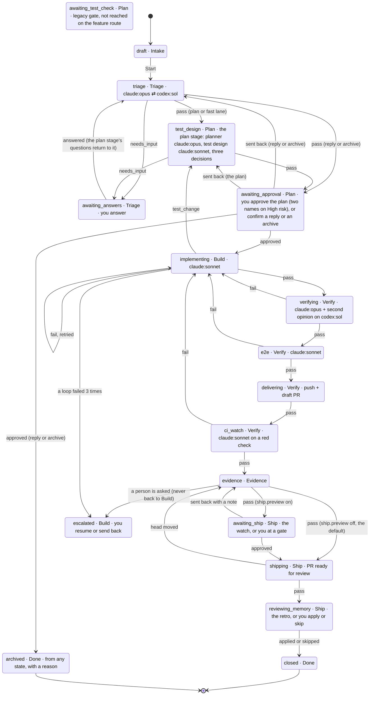
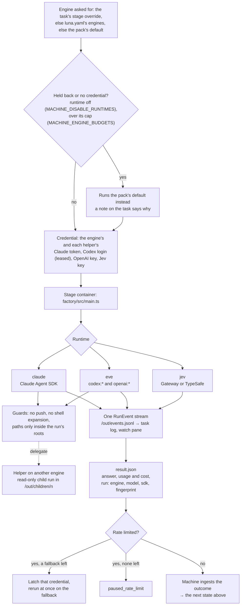

# Architecture

## Pipeline

Every ticket moves through these stages, from Intake (not ready yet) to Done ([diagrams of the whole path](#a-jira-ticket-end-to-end)):

1. **Intake**, as the v2.2 diagram's panel 1 draws it: a ticket you're still shaping, or a report that came from a source. Nothing runs until it starts, and when it starts the machine sets its context up by script, with no model: the repository (the card's own, then a `links.repo` hint, then a repository configured for the Slack channel or the Jira project, then the repository map by the GitHub source), the project (the card's, the Jira key's prefix, else the repository's `luna.yaml` `jira.project`), the owners (CODEOWNERS through the code graph) and the history of every source (Slack replies, Jira comments, GitHub comments; 50 entries, each flattened and capped). A Jira project resolves to a repository only when exactly one known checkout names it in its own `luna.yaml`; a Slack channel has no configured source yet, so such a card waits at Intake for a person to pick. The context-complete check is a script too: a repository, a reporter that can be reached or none, and 20 words or an attachment. A card that fails it waits at `awaiting_setup` with `requested.kind: "context"` and what is missing; the reporter is asked once at the card's source, in fixed words with no text of the card; a person answers with `:context repo|project|text` on the board (`POST /tasks/:id/context`) and the card is checked again; the gate keeps the 2 day reminder and the 5 day `no_setup` archive. A card keeps where it came from: every source (the first is its own `source`, immutable), the reporter, followers, project, owners, attachments (references, never content), hints, and the duplicates merged into it. Duplicates: `similar` shortlists the five nearest open or recently closed cards and backlog items of the repository by lexical similarity (no embeddings; with memory on, the cards its vector recall of past `outcome` and `finding` items names, recalled as the new card's own source, join the shortlist after the lexical hits in the slots left, only among cards the reporter could already see, and with memory off or failing the shortlist is the lexical one alone), the `intake_dedup` decision pack judges them in one call (`same`, `related` or `different`, each with a confidence), and the `dedup.*` thresholds decide: the machine runs the check once for every new card of a repository, after context setup and before triage (also when a card leaves the context gate), and only against cards of the same repository that the new card's reporter could already see: a GitHub card is seen by a report from that GitHub repository, a Slack card by one from the same channel, a Jira card by one from the same project; a card with no source or from anywhere else is seen by nobody, except that a card typed in the TUI (no source, the operator's own) sees every card of its repository. A card the reporter could not see is never shortlisted, never shown to the model, never merged into, and nothing is said about it. A confident `same` on a card merges the report into it with no person (its source is added, its reporter follows, the demand goes up, the priority is scored again with the repository's own weights and bands, and the duplicate ends `closed` with `mergedInto` naming the kept card; the host close step does nothing for it); on a backlog item it bumps the item and closes the card. `related` links the two cards (`related` on both). Under the asking bar, or when the original has already ended, the card waits at a dedup gate (`awaiting_setup`, `requested.kind: "dedup"`) that lists the candidates; a person answers `duplicate` of one, `related` to some or `neither` (`POST /tasks/:id/dedup`, ids from the listed candidates only), and the answer is ground truth for every slot of the `intake_dedup` record. A failed decision lets the card go on to triage with a note. The duplicate's source is told which card tracks it (its short id, and a link only when `MACHINE_PUBLIC_URL` is set) under the same rule; otherwise only that the report is tracked. Demand counts distinct reporters, and the demand sub-score is derived from that count (1 to 3). A merge records the sources and followers it added, and an unmerge takes back only those; the card it brings back carries a recorded "neither" and a link to the kept card, so it is not checked again. A person's merge is accepted only for a card that has not reached Build (no workspace, no PR). The repository a person gives the context gate must be one the machine already knows (the repository map or a remembered checkout), as an absolute normalised path. `POST /tasks/:id/merge` and `/unmerge` are a person's way to say or undo it.
2. **Triage**, as the v2.2 diagram's panel 2 draws it. The signals come first, for every source and on every entry (the first run and each return from `awaiting_answers`): `triage_signals` is one call, one schema, asking the kind (`bug`, `feature`, `task`, `chore`, `question`, `incident`), the type of work, whether it is ready, the size on five levels (XS to XL), five urgency sub-scores (`who`, `what`, `impact`, `time`, `demand`), a preliminary risk and whether to archive, each with a confidence. The machine turns the sub-scores into a P0 to P3 priority with `scorePriority` (the repo's weights and bands; an incident or a security label is P0 first). **The confidence policy** reads each field against its bar (`triage.confidence`: kind 0.80, size 0.60, urgency 0.70, risk 0.85, archive 0.90, urgency by its least sure sub-score) and the flag band 0.15 under it, with a repo's `policy.decisions.triage_signals` winning per question and a filer's hints moving a field's confidence by half at most: a field at `proceed` goes on, one in the band is **flagged** and listed on the plan gate (`requested.flagged[]` as `triage.<field>`), one under it is a **question to the person** (the field, the model's guess and its confidence, the guess as the suggested answer) at `awaiting_answers`; the agent no longer settles it. A round asks at most `triage.max_questions` (3) and a card sees at most `triage.max_rounds` (2) rounds: the next need escalates to a person with the open questions listed. The questions the machine builds from the signals (fixed text, enum values, numbers) also go out by themselves as one comment, flattened (links shown in the open), to the card's own source only (its GitHub issue, its Jira ticket by the source's own key, the Slack thread it came from), once per set of questions and never when one carries a token; an agent's own questions stay on the board until a person taps `p` (`POST /tasks/:id/questions/post`). A card sees only cards of its own source in `card_search` (a Jira-linked card counts as Jira's). A person's lower risk correction cannot lower the machine's grade as the plan's floor, and a card is archived by the clock only after a reminder a day earlier. Then the agent (12 turns, five minutes, with the read-only `card_search` tool over the cards of the same repository) reads, as data in the Intake section, up to five similar past cards' recalled `outcome` items (predicted against actual: size, risk, planned against changed lines, retries, escalations) when memory is on, and writes its part: a summary of at most 120 words, the goal in a sentence, and its decision with the reason. **The machine composes the Triage Record** (kind, type of work, size, priority with its sub-scores, preliminary risk, goal reference, signals, hints used, the questions and answers, `decisionBy`, `version` and the number of the version it replaces) and `recordComplete` checks it: an incomplete one sends the agent round once with what is missing, then escalates, so a card never leaves triage with a null record. **The fast lane is a rule** (`fastLane`): low risk, size S or smaller, a type of work that is not infra or data, one owning team (or none) from `locate`'s CODEOWNERS, and the risk and size signals at `proceed`; the agent cannot pick it (it picks `plan`, `conversation` or `archive`), the machine sets `fast_lane` or `plan` and logs `card.fast_lane`, and a repo with no graph skips the owners condition and says so. A `conversation` (the ticket asks something and changes nothing: the reply drafted with `reply-drafter`) waits for one tap, then posts the reply where the card came from and ends **closed**; an `archive` (duplicate, out of scope, stale or not actionable) archives on one tap. A card left unanswered at `awaiting_setup` or `awaiting_answers` reminds after two days and archives after five (`no_setup`, `no_answer`); an answer restarts the clock. A person can correct the record's kind, type of work, size, risk or priority while the card waits at a gate (`PATCH /tasks/:id/record`, `T` on the board); each correction, a reply or archive tap, and an approval with no edit becomes ground truth on the `triage_signals` decision record.
3. **Plan** (panel 3 of the diagram): runs in the `test_design` state, in this order. (1) The **code map**, when the repo has a graph (see Code graph below): the machine's `locate` matches the goal against the graph and hands the shortlist to the `code_map` agent, which confirms it and gives each file a role (`change`, `read`, `test`) and the entry points; the machine adds whether the graph is stale and flags the gate when it is more than `graph.stale_commits` behind. (2) **`risk_score`**, before the plan, on the record and the map: blast radius, reversibility and data sensitivity (each 1 to 3) and the complexity (`S` to `XL`); the level is their **product** (up to 4 low, 5 to 11 medium, from 12 high), never below triage's preliminary grade. (3) The planner writes the v2.2 `Plan`: steps (`description`, `files`, `done_when`, `est_loc`; a created file is declared `new`), criteria (ids `C1`...), out of scope, assumptions, rollback, migration and flags, with a `version` that rises on every revision (a re-run or a person's edit); the machine gives the ids and derives the slices Build reads. (4) The test designer sees only the goal and the criteria with their ids and writes scenarios in given/when/then, each tied to its criterion (`S1`..., type `happy`, `edge` or `failure`, layer `unit`, `integration` or `e2e`). (5) **Coverage by id**: a script (`coverageOf`) finds the criteria no scenario names and those that name a limit or an error with no edge or failure scenario, and scores covered over all (the criteria `coverage_check` confidently calls untestable left out); a gap, a score under `plan.coverage_score_min` (0.85) or a confident "does not pin" sends the designer back, up to `plan.coverage_rounds` (3). (6) The **plan check**: facts by script (`planFacts`: every criterion named by a step's `done_when`, every step file in the map or declared new, a rollback present) plus two judged questions (`fits_record`, `risk_appropriate`), never the plan's own brief; either sends the planner back, up to `plan.plan_check_retries` (2). Everything lands at **one** approval, `awaiting_approval`: the plan, the scenarios, the code map, the risk with its three scores, product and complexity, the coverage report and what was flagged. The gate takes `approved`, `changes_requested` (stored as `sent_back`) or `rejected` (archives with reason `rejected`; the plan gate's alone), each with an optional comment; steps, rollback, risk level and code map are editable beside the brief, criteria and assumptions. The machine's risk is a floor: a person may raise the level at once; a lower value is kept with its reason as ground truth and shown, while the approvers rule and Ship read the higher. Approvers come from `plan.approvers`: one for low and medium, two distinct names for high, and on high at least one must not be among the code owners. The owners are read from CODEOWNERS for the map's change and test files and the plan's step files, never from what the code mapper wrote (its `owners` are display only); it is an attestation, said so at the gate; a repo with no CODEOWNERS (or no rule matching the files) skips it and says so, and an owner lookup that could not run leaves it unenforced, flagged and said so. Once the plan is approved its steps, risk, map and rollback no longer edit (a plan that must change goes back through the gate), and the timer never approves a re-planned or flagged gate. A person's raised risk at a plan gate is the floor of the next one (changes requested, a plan found wrong): it does not lapse. A criterion excused as untestable is named on the gate and flags the coverage verdict. Paths a model names (step files, map files, entry points) must be plain repo-relative paths (no `*`, `?`, `{`, `}`, backslash, NUL, absolute path or `..`; brackets and parentheses are ordinary and read literally); the rest are dropped and the plan check names them, and the scope check reads a planned entry literally, as a glob only when it holds `*`, `?` or `{` (which only a plan stored before this wave can). The gate reminds after `plan.sla.reminder_days` (2) and escalates to a person after `plan.sla.escalate_days` (5). A plan found wrong in Build, Verify or review (`plan_wrong`, or Ship's `re_plan`) returns to the planner, not to triage, with the evidence (who raised it, why, the failing output's tail through `safe()` capped at 2,000, the reviewer's thread through `postable()` capped at 1,500), as data; a second one on the same card goes to a person. A ticket triage sent to the **fast lane** runs the same stage on `plan_fast` and `test_design_fast`: the graph's `locate` only (no map agent, no impact walk), one to three steps, one or two scenarios, the same plan check and one approver; if the fast planner says the ticket is bigger than it looked (`needs_full_plan`), the plan check cannot tell whether the plan fits, or the fast plan's own files reach more than one owning team (an owner lookup that could not run stays flagged), the stage plans again in full, in the same run, now with the map agent (`detail.lane`, `detail.laneNote`). On approval the machine keeps what it proposed, what you changed and your overrides with their reasons as ground truth (`<state dir>/ground-truth/plan/`, see `MACHINE_GROUND_TRUTH`).
4. **Build** (panel 4 of the diagram), in this order on the feature route (the PR routes run only the implementer, as before). (1) The **entry contract**: a script (`entryContract`) checks that Plan handed over an approved plan with a version, a scenario for every criterion the gate did not excuse as untestable, a code map (or the note saying why there is none), a risk, the Triage Record and at least one planned file; what is missing goes back to the plan stage as re-plan evidence (`raised_by: entry_contract`, once per card), then to a person. A gate approved before v2.2 passes as `v1` with a brief or slices and one case. (2) **Tests first**: a test writer (the `build_tests` pack, `claude:sonnet`) writes one failing test per approved scenario, tagged `@scenario:<id>`, reports each one's failing output through `scenario_red`, and commits nothing: the machine checks the diff by script (`scenarioTags`: a tagged test for every scenario, only test files and fixtures changed, no test removed), asks `red_check` per scenario (the failure is the missing behaviour, the test is not tautological), and makes the one commit `test(<card>): scenarios` itself before any production code; a missing tag goes back once, a wrong or missing red twice, then a person. A repo with `policy.holdout_cases` skips the step. (3) **Checkpoints**: the tests commit and every committed slice are pushed to `refs/luna/wip/<branch>` (no CI, nobody's PR head; the container never pushes), retried after 1 s, 5 s and 25 s inside the stage's signal; a push that still fails is a note, never a failure; each landed push is a `build.checkpoint` row. (4) The **implementer** builds to make the tests pass, calls `red_check` per slice and `scope_check` before it answers, and reads its own diff into a **Diff Summary** (`what`, `why`, files, flags, migrations, risks; git's facts win on code-map membership, dependencies and TODOs). (5) The **budget**: 15 iterations (each red or green, each failed sweep), 2 million tokens (new work: the runtime's own count of input and output, cache reads kept beside it and off the budget) and 90 minutes per card, read before each run and when one ends; a spent budget goes to the `escalation_reason` decision, and a run's time limit is the smaller of its own and the minutes left. (6) The **regression sweep** runs by script in the stage's container after the last slice is green: the `luna.yaml` checks whose paths cover the changed files and the files the graph names for them, the whole-suite checks whose `minutes` hint is within `build.regression_full_suite_minutes`, and lint, typecheck and format; a failing check sends the implementer round again with its name and output tail (data, capped). (7) The **scope check** computes the facts from git (undeclared files, removed, switched-off and weakened tests, new dependencies, TODOs, secret-looking additions) and gives each issue a severity: a blocker gets one fix pass, a second scope red escalates `undeclared_scope`; `should_fix` and `nit` ride on the Build Report. (8) An **escalation** from Build, the machine's own included, carries a reason decided by a fact where one decides (a second scope red, a service or container that never started) and otherwise by the `escalation_reason` decision with a confidence; under the bar it is `other`; `plan_wrong` returns to the planner once, `too_complex` gets the stronger model once with one fresh budget; the gate holds the reason, its confidence, the summary and the output's tail, and a person can correct the reason (the enum only: `POST /tasks/:id/escalation-reason`); what they then commit is ground truth. (9) Nothing the checks rely on comes from a row, a ref or a commit a container can write: a container's events never take a kind the machine logs itself (`stage.finished`, `stage.started` and the other reserved kinds are dropped at ingest with a note), the tests commit is the sha the machine itself recorded and is trusted again only while it is an ancestor of HEAD whose parent is the commit the card's first run started from (a `stage_runs` row) and whose own diff passes the tag check (else the card escalates `head_moved`: nothing is written on a branch the container moved), and the scope is measured from that commit, else from the first run's start, never from a ref (a scope that cannot be measured escalates as an environment problem). (10) The **Build Report** (base, tokens, minutes, the iteration log, each scenario's test before and after, the Diff Summary, the declared files, the scope result with severities) goes to Verify; `GET /tasks/:id` also shows Build's progress live (`buildProgress`).
5. **Verify** (panel 5 of the diagram), in this order. (1) A **fresh workspace** made from the card's repository at its head commit, and the **environment check** against the one Build recorded (a different image or lockfile is a blocker). (2) The **review** first: the `verifying` pack reads the change, runs on another model family than the implementer's when that family's credential is on the machine (`codex:sol` against a Claude build, `claude:opus` against a Codex one; one family's credential runs as before) and never mounts the card's shared agent session; it has no `slice_list` tool and works from the plan, the scenarios and the Build Report as data. Each finding has an id, a level (`blocker`, `should_fix`, `nit`), a category, the criterion it is about (`criterion_ref`), a suggested fix and a location; the machine merges the same finding raised twice (the highest level wins). (3) **`finding_classify`** (a decision pack on the check context) classifies every merged finding, twenty at most and the most severe first, against an excerpt of the code around each; its rows are by finding id in `detail.classified` with `detail.calibration`, and never change the verdict. (4) Only when **no blocker stands** do the checks run: the repository's own, the regression sweep and the patch coverage (`verifySteps`, `machine/src/domain/verify-order.ts`, names each step). A blocker ends the stage as a failure with the findings and no suite run; a red check is a finding of category `tests`. Patch coverage below `1 - verify.coverage_drop_max` of the lines added is one `should_fix` finding naming the files; with `verify.mutation.command` set in the repository's `luna.yaml` the machine runs it in the sandbox after the checks and reads a score from the last output line `mutation score: <0 to 1 or n%>` (under `verify.mutation.min_score` is a `should_fix` finding; unset, nothing runs). Only a blocker fails the stage. (5) **Rounds**: Build is sent the same set of blocker findings (by finding id) `verify.build_rounds` (1) times; the set coming back goes to a person with the findings, and a new set starts its own count. The browser run and CI loops end after `verify.e2e_rounds` and `verify.ci_rounds` failures (3 each). A card sent back from the browser run carries that run's findings (one per failed scenario with what was expected, seen, the artifacts' names and the judged cause) instead of the last Verify pass's. Evidence never sends a card back to Build. (6) The **browser run** is judged scenario by scenario: its manifest has one row per approved scenario by id (a scenario with no row is `not run`, an artifact that is not a plain-named regular file in the run's folder is dropped) and `e2e_failure_cause` is asked per failed scenario, five at most. (7) The **CI watch**: what kind of red it is is a typed decision, `ci_failure_class` (real, flake, infra, drift) on the failing job's name and the tail of its log, flattened and capped, as data; only a real failure asks the CI investigator for the fix, a flake is re-run `verify.ci_flaky_reruns` times and goes to a person if it stays red, infra goes to a person, a drift rebases when `verify.auto_rebase` allows. (8) The draft **PR's body** is the machine's section between `<!-- luna:pr:start -->` and `<!-- luna:pr:end -->` (why, the plan's version and criteria by id, scenarios with their tests, open findings by level, files outside the map, base and head commits, the issue link); a later update replaces only that section. (9) Not built in 12a: running extra browser scenarios by the change's blast radius (no setting exists for it; a later wave), and a person's dismissal of a finding becoming ground truth on `finding_classify` (that is wave 13's ship gate; no gate for it exists before). (10) The **Verify Report** carries the engine and family that reviewed, the findings by level with their resolutions, the checks, the coverage and mutation numbers, the browser run by scenario, the CI class and the rounds used.
6. **E2E and Evidence**: for a repo with a web surface, a QA agent drives the app in a browser (the `runner-qa` image) and writes a manifest, screenshots and video; repos with none skip with a recorded reason. The agent drives the **approved scenarios**, not the raw criteria: the manifest has one `acceptance[]` row per scenario (`text` the scenario title verbatim), a `video.chapters[]` entry per scenario when there is a recording, and `steps.jsonl` so the walk can be replayed. A failed run goes to `e2e_failure_cause`: a confident `env_flake` re-runs the pack once in the same stage run and a second failure escalates as `flaky_tests`; `product_bug` and `test_bug` fail as before with the cause recorded. Evidence then checks the manifest on the host, requires a row (and a chapter, when there is a video) for every approved scenario, and shows its verdict, artifact count and a few screenshot paths in the ship approval.

   **Evidence (panel 6 of the diagram), in order.** (1) *Collect*: the host reads the card's own record first (the Verify Report's browser-run rows, else the e2e finish's manifest, else the container's manifest by title) and only then the files under `<state>/runs/<run>/files/qa/`, all through the bounded reader (no link followed, regular files, size caps, at most 2000 files and four levels). A missing manifest, a scenario with no row or a missing chapter is a note on the pack, never a failure: Evidence shows less and says why. It stops only for a usage limit and a card with no workspace or head commit. (2) *Format*: the decision `evidence_format` answers `video` (a UI or flow change and the browser run ran), `screenshots_or_terminal` (an API or CLI change) or `text_only` (CI/CD, config, infrastructure, a pure refactor); the pack stores `video`, `captures` or `text`. A mechanical veto degrades `video` (no image, no recording or steps, a QA target with `reentrant: false`) and `captures` with no browser run only when Verify ran no checks and Build tagged no scenario tests. (3) *Text, terminal capture or film*: a `captures` pack with no browser run gets `terminal.txt` (each scenario's test red to green, each check's command and the end of its output, built from the card, nothing run again) and a `text` pack a 20-line `checks.txt`; both are listed as media lines, never inline. A film is made by two containers at once: the voice and cards (`narrate`, `cards`) and the recording (the `recording` sub-run, which paces by a read-only copy of the timeline) start together and a failing lane aborts the other; `compose` then holds the last frame of a recorded stretch shorter than its clip and cuts one longer by more than a second; the film's length limit, fix rounds, voice and language come from `luna.yaml` (`evidence.video_budget_s`, `regenerate`, `tts.voice`, `tts.language`). (4) *The frame check*: after `measure`, the `frames` tool reads the text on the film's frames (tesseract; every 2 s and 0.3 s after each scene start) and on every screenshot; a token or cloud and payment key shape, a private key, a connection string with a password, a `password=` or `secret=` assignment, an `Authorization` bearer or basic value, an e-mail address (not at a reserved or `.test` domain), a phone number or a card number that passes the Luhn check is a measured P0 card (one list, `machine/runner-video/tools/lib/findings.ts`, used by the tool and the host; the tool checks the whole text of an image, the text it hands the host is cut to 4,000 characters, and a cut text counts as not read) for the one fix round and then the film is dropped to screenshots; when none matches, the typed decision `frame_privacy` judges credentials and personal data once. An image whose text could not be read, or was cut, is marked `scanned: false`. The critic (`video_qa`, an agent) gives a confidence; a `ship` under 0.5 is one more pass. (5) *The pack*: results by layer, a diff summary, a revision, the findings with their resolutions; the host assembles it, runs `packComplete` and repairs by script what a script can (an empty summary, rollback or how-to-verify, a media entry missing on disk, a captures pack with no scenario); a commit that is not the head is never repaired. (6) *Store, publish and ready*: media go where `evidence.storage` says (`release_asset`, the default, a draft pre-release `luna-evidence` through the GitHub port, or `local`), kept 180 days locally unless the repository says otherwise (`MACHINE_RETENTION_DAYS` no longer applies to evidence). **By default Evidence publishes the pack to the PR and marks it ready for review with no gate**: it finds the PR for the branch, requires the PR's head on GitHub to be the pack's commit (it never pushes), uploads the media, writes the marked section into the body and the one comment, and marks a draft PR ready. **`ship.preview: on` keeps the old gate**: Evidence then publishes nothing, the card waits at `awaiting_ship` where a person can send it back with a note (`t=12.5 scene=<id> el=<id> what to change`) or approve, and `shipping` publishes after the approval. **An image whose text was not read, and any video not checked frame by frame (the browser run's own recording is never read, so it carries `scanned: false`), is uploaded only after a person approved the preview**; a HAR is never uploaded, by kind. Every text file (terminal capture, checks, captions, a JSON report) is read through the bounded reader and passes the same findings check as a picture's text; on any hit it stays local with a fixed note, and a clean one is redacted and uploaded. An asset's name is the task, the commit, the digest and the extension, nothing else. Scan copies are named by index. A film is reused from the local pack the machine kept for the old commit, not the published one. Text a model or a container wrote that reaches the PR has its addresses broken (a zero-width space after the scheme and after `www`), so none autolinks and no closing keyword works by URL. (7) *Stale parts*: when the head moves after a pack was made, Evidence logs `evidence.stale` and makes again only what the new commit made stale: the text always, the film only when its scenarios changed, a newer browser run changed a result or the steps, or a rendered surface changed between the commits (the paths come from host git through `at()`); a film that is not stale is copied from the machine's own store of the old commit and no video run starts. (8) *What this does not promise*: the media sit on a draft pre-release, readable only with push access until someone publishes the release, and publishing it makes every past asset public; the text reader (OCR) misses, by construction, small or low-contrast text, other scripts, text on screen under two seconds, secrets split across lines or images, codes, faces and an image inside an image, and an image with no readable text counts as clear; the `frame_privacy` decision sees at most forty texts; a scenario's pass without a Verify Report is the browser run's own word; and marking a PR ready notifies its reviewers with no click. (9) *Thumbs*: `y` and `n` in the board's Evidence section (`POST /tasks/:id/evidence/feedback`) record whether the pack was useful as ground truth under `<state>/ground-truth/evidence/`; the board shows the pack with no gate open.

   For `video`, `stages/video.ts` runs a pipeline over jobs in the `runner-video` image (no network, no credential, the job dir at `/work`) and packs as sub-runs: `video_script` writes the script and a timeline the host checks (`checkTimeline`: contiguous scenes, one demo per approved scenario, under 240 s, a hook by 3 s, text floors, every on-screen number cited or labelled SCHEMATIC), a `narrate` job renders the voice (kokoro-js) with whisper word timestamps, a `cards` job renders the title cards from a time-driven page, `recording` drives the approved steps against the QA target with a mark per scene and a hold from each clip's length, `compose` cuts and aligns with ffmpeg, `measure` runs the numeric checks and makes the contact sheets, and `video_qa`, a cold critic on another engine than the writer (`claude:haiku`, which can read the sheets; `codex:sol` as the fallback), scores it. It ships only with every score at 8 or more, no P0 and no measured FAIL; otherwise one `video_fix` round runs on the named scenes (a send-back note re-enters here), and a second non-ship degrades the pack to captures with the critic's scores kept.
7. **Deliver**: pushes the branch with git and opens a draft PR through the GitHub API, so CI starts early. When GitHub reports the PR `CONFLICTING`, the machine rebases the branch once onto `origin/<default branch>` on the host and pushes it with `--force-with-lease` (only the task's own branch); a rebase that stops fails Deliver with the files in conflict. Its body follows the caveman-pr shape (a one-line what, terse why bullets) and adds `Closes #N` when the ticket came from a GitHub issue in the same repo.
8. **CI watch**: polls the PR's checks until they settle, outside the stage pool (polling computes nothing, so its slot goes to the queue meanwhile). A red run goes to the `ci_watch` pack: a fixable failure loops back to Build with its findings, a flake is re-run once, and infra or needs-debug failures escalate. A PR that conflicts with its base gets the same one rebase; a second conflict, or a rebase that stops, escalates as `conflict_unresolvable` (the pack can also answer that verdict for a red run it traces to a conflict). The container never pushes or rebases.
9. **Ship** (panel 7 of the diagram), in this order. The card waits at `awaiting_ship` while the machine watches its PR (`ship-monitor.ts`); with `ship.preview: on` the old preview gate comes first and approving it publishes the pack and starts the watch. (1) *The watch* polls every `ship.poll_minutes` (5; `MACHINE_SHIP_POLL_INTERVAL` overrides), outside the stage pool, and asks nobody anything unless something needs a person. (2) *Event classes.* GitHub's facts decide `conflict`, `base_moved`, `freeze` and `blocked_by_other_pr`; the `event_class` decision is asked only for an activity item and a red CI, and only the labels that make sense for what was observed are accepted (anything else goes to a person). Only an `OWNER`, `MEMBER` or `COLLABORATOR` who is not the machine's own login is read at all; when such a person's change request or nit reaches a fix, the thread is kept in the cursor (reviewer, kind, file, a `postable` excerpt of at most 150 characters) and, when the PR merges, written to memory as a `review_ask` item on the card's source, with the CODEOWNERS team of the file when there is one; before the next card's implementing run the asks for the plan's files and their code owners are recalled into `context.memory`. (3) *The read step* (`pr_reply`) reads a comment before its intent is decided: a question gets an answer (through `postable()`, capped at 2 per thread and 10 per PR). (4) *Intent, fix scope and the guard.* `comment_intent` and `fix_scope` size a nit or change request; a script guard holds a fix inside the PR's own files, away from CI configuration, `CODEOWNERS`, `luna.yaml` and lockfiles, and under a size. (5) *The fix* is made on a fresh workspace and returns as a bundle accepted as a fast-forward; a fix needing a new plan goes back to Plan once (`re_plan`), where the new plan waits at the plan gate. (6) *Evidence valid* (`evidence_valid`) chooses what is refreshed: the pack's text is written again by script (the fix recorded under "Changes after review"), or the affected scenarios get a new browser run and Evidence re-makes the media; an unsure answer runs Evidence again. Every re-publish goes through `publishAndReady`, the one publisher, and a person's edit of the pack's section is kept as ground truth (`evidence.edited`). (7) *Readiness and the review rule.* Readiness is a script (`merge-readiness.ts`) over GitHub's facts, the pack and the policy; its checklist is fixed in code (pack, draft, CI, conflicts, approvals, owners, CODEOWNERS change, fix approval, evidence at the head, freeze, blocked, stale): config sets its parameters, never its items. A head older than `ship.stale_days` is re-verified once on a fresh workspace (the project's checks run in full) instead of only blocking. (8) *The ship approval.* A High-risk card asks a release owner "safe to release now?" after readiness, with the checklist and the pack in front of them; the approver must not be one of the plan's approvers; rejecting archives the card (nothing is closed on GitHub). (9) *The merge* happens at `shipping`, which reads readiness again on GitHub's facts, is guarded by the head's sha and follows `ship.merge`; the event is `ship.merged` and its sha is the merge commit GitHub reports. (10) *Close the loop*: a fixed summary where the card came from (`task.shipped` stays the stream message). A PR closed without a merge archives the card (`pr_closed`). (11) *The retro* runs at `reviewing_memory`: `worth_learning` on the predicted-against-actual facts, then the `reviewing_memory` pack. A card with nothing to learn closes with no click; only a retro that proposes something waits for a person.

   **When the machine merges by itself, and when it never does.** It merges a Low or Medium risk PR (`ship.auto_merge: medium_when_review_required`, the default) only where a review is required (a ruleset, branch protection, GitHub's own `REVIEW_REQUIRED` for the PR, or a CODEOWNERS file naming an owner for every changed path) and only with an approval on the head commit from a collaborator who is not the machine. A repository that requires no review is merged by a person on GitHub; the card goes on by itself. **An unreadable rule means manual.** A High-risk PR asks a release owner after readiness, whenever the machine may merge at all (`off` merges nothing and asks nobody). A repository that set `ship.auto_merge` to `low` or `medium` itself and has no approval on the head is asked at the board after readiness: no mode merges a PR nobody looked at.

   **The clocks never merge or archive.** A PR quiet for two days (`ship.sla.reminder_days`) gets a reminder; after five (`ship.sla.escalate_days`) its release owners are named, with fixed words. Activity starts the period again. There is no second total-time cap (`MACHINE_SHIP_MAX_WAIT_DAYS` is gone).

   **What a retro may change.** One file (`docs/agents/project-context.md`), in a draft PR on `luna/memory-<task id, 8 characters>`, after a person's approval (`a`). Everything else it proposes (prompt updates, runbooks, ADRs) is inert text in that PR's body; recalibration and graph misses are recorded where the eval loop and the graph read them. A graph miss counts only when the card's own Build Report declared the same path.

   **What leaves the machine in Ship.** The pack's section and comment (fixed words and facts; model text only through `postable()`), replies to questions, a fix's push and summary, a merge request, a reminder and an escalation line, the close-the-loop summary, and a draft PR after a retro approval. The machine never gives an approval (`postReview` is called only on the review route) and never closes a PR.

   **What Ship does not promise.** The machine merges nothing nobody looked at: readiness green on GitHub's facts read at that moment, the head's sha guarded, an approval on the head from an owner, member or collaborator who is not the machine's own account, and a review required by the repository's own rules (or, under the explicit `ship.auto_merge: low` or `medium`, a person's approval at the board after readiness). A High-risk card in the default mode needs the required review and the approval on the head as well as the release owner's answer. A collaborator's standing "changes requested" blocks the merge whatever GitHub's review decision says. These are the limits, in plain words:

   - An approval from a collaborator's second account, or from a bot with write access, counts as a look.
   - The release owner's name is an attestation from the one API token; it is not checked when no owners are named.
   - A ruleset with bypass actors still reads as a required review.
   - Anyone with write access can retarget, close or rename the PR.
   - Every model sees hostile PR text. The containment is the typed answers (a model only picks among capped branches and never touches the risk), the fix guard (the PR's own files and test files, both names of a renamed file, no control-plane path, a size cap in which a binary file counts as over), the caps on replies and the approval on the head after every fix. A comment from anyone who is not an owner, member or collaborator is never given to the fix agent or the re-plan, and reaches the reader and the decisions only marked as an untrusted author's data.
   - Inside the PR's own files and any test file, the fix agent can write any code, and CI runs it with the repository's CI secrets.
   - `ship.auto_merge: low` or `medium` lets one board click stand in for a review, by the owner's choice.

   **Not built (recorded limits).** `ship.override { merged_not_ready }` is not emitted; gate send-backs are not counted in the retro's overrides; the four older `worth_learning` eval cases have no new fields; a retro's proposals ride only with a rules proposal; webhooks (polling only), a checklist a repository edits, and the diagram's "tone from past approved replies".

Triage, Plan and Build run stage packs (see [Factory mode](#factory-mode)) when a credential and the runner image are available. Deliver and Ship run for real too — they are plain host commands (`git push` + `gh pr create --draft` / `gh pr ready`), not Claude agents — as soon as a task has a branch. CI watch polls on the host and runs its pack only for a red check. Evidence runs on the host (its video pipeline starts containers). Intake, Done and any stage without a runner are stubs that pass, unless you queue a result with `POST /dev/stubs`. Full route list: [api.md](./api.md).

The machine is one service for every repo you point a task at, not one per repo: `MACHINE_MAX_CONCURRENT` (default 4) caps how many tasks can be driving a stage at once *in total*, across all of them, not per repo. Each repo can still speak for itself through a `PIPELINE.md` at its root (QA on or off, a monthly budget, a concurrency cap, timer-approved plans, held-out test cases; see [configuration](configuration.md)), and `/metrics?groupBy=repo` tells the repos apart. A task past that cap is `queued` until a slot frees — durably, in Postgres, so a restart doesn't lose track of it. Open as many boards as you like, from any workspace: they're all clients of this one machine and see the same tasks and the same queue.

## Change size and stacked cards

Four words. The *origin* is the card or ticket that was split; a *child* is a card or ticket made from a split; a *dependency* is a card another card names in `card.dependsOn`; the *parent* is the one dependency a card is stacked on (`card.base.card`). The origin never builds, so it is never a parent.

**The size guard.** At Plan, after `risk_score` and before the planner, the typed decision `size_estimate` places the change on a rubric of seven anchored levels (`contracts/src/size.ts` turns the score into lines); its answer is read only when `est_loc` is sure. After the planner the script sums the plan's own step estimates, and that number rules once there is a plan. Only the hard limit (`size.hard_limit_loc`, 2,500) sends a card to a split; the target range (1,000 to 2,000) is what the decomposer aims at and a flag at the gate. Verify counts the real diff and reports one `should_fix` finding of category `size` when it is over the hard limit, unless a person kept the card whole.

**The decomposition loop.** Over the limit, the `decompose` agent pack (no tools, no repository) proposes two to `size.max_children` children, each with a goal, criteria, an estimate and the positions of the children it follows. A script (`splitFacts`) checks count, limit, cycle, references, criterion cover and words to work from; `split_check` judges cover, overlap and stand-alone. At most `size.max_rounds` rounds; a child that is itself a part is not split again (`size.depth`). The loop makes nothing. It ends in the plan gate with `requested.outcome` `split` (a proposal) or `split_failed` (the reason and the issues).

**The split gate and its answers.** Approve the split, send it back with a comment (the decomposer reads it), keep the card whole, or reject it. No clock approves it. A High-risk origin needs the approvers a High-risk plan needs. Keeping a card whole is a person's recorded override, flagged at every later gate, on the Verify Report and on the PR.

| What a split makes | Who taps first | Where |
| --- | --- | --- |
| Child cards, when the origin is a card with no ticket the machine can write to | a person, at the split gate | `Pipeline.approveSplit`: one `createTaskOnce` per child under `split:<origin>:<n>`, in dependency order |
| Child tickets, when the origin came from a ticket the machine can write to | a person, at the split gate (a card) or on the split draft (a ticket) | `TicketMachine.splitChildren` through the `Tickets.create` port, in the origin's own project or repository |

The gate says which of the two an approval makes, and an approval is refused (409 `split_changed`) when that changed. A child inherits the repository and the engines and nothing else: no approval, record, source, reporter or Jira link, and its risk is never below its origin's. Its title and description are model-written and foreign everywhere: flattened, capped, declared as data in prompts, and never posted by themselves to the origin's thread or ticket; the origin's source hears one fixed line. A child's branch is built from ids (`task/<id8>-part-<n>-of-<origin id8>`). The origin ends `archived` with reason `split`.

**The dependency rule.** A card with `dependsOn` stays a draft (`startWhenReady`, event `card.held` with the reason and fixed words) until every dependency has merged or has an open PR (`card.released`). It stacks on the one open dependency whose branch holds the others; with none, `card.base` is empty. The rule holds the card before it starts, so children along a chain are planned one after another. A dependency archived or removed stops the card with a person. The backlog applies the same rule: an entry has `schedulable` and `blockedBy`, and `promote` of one that is not schedulable is 409 `not_schedulable`.

**A stacked branch.** A child's workspace is cut from its parent's tip, fetched from `origin` (never another card's folder). The machine's own repository records the base commit (`refs/luna/base`) and the parent's branch name (`luna.baseBranch`); both are written only by host git through `at()`, so every diff, scope check and Verify shows the child's own change. The PR targets the parent's branch and carries a fixed "Stacked on #N" line. The readiness checklist has a `stack` item: red while the parent has not merged and red when the PR targets any branch but the default one.

**The parent's two events.** The ship watch reads the parent from facts, never a model: `parent_changed` (the parent's head is not the recorded base) rebases the child onto the new tip, pushes with a lease on the old head and re-stamps the Evidence Pack, at most 20 times, then a person; `parent_merged` retargets the PR to the default branch, moves the child onto it, pushes with a lease and rebuilds the machine's PR section. The parent's branch is deleted only when `ship.merge.delete_branch` is on and no other card is stacked on it. A rebase that stops on a conflict pushes nothing and asks a person. A parent that was archived asks a person once. An approval given while stacked does not survive the retarget: a child needs its own approval on its new head. The machine merges only into the default branch, and a PR merged into any other branch is not a ship: its card is archived `pr_closed`.

**Not built.** Editing a split at the gate, editing a card's dependencies on the board, a stack across repositories, a merge queue for a whole stack, webhooks for the parent's events, closing the origin when all its children ship, Jira's own epic type and issue links, and the board's Backlog and Tickets views of the new fields.

**After the security pass.** A card that leaves its stack because its parent is gone, when a person retargets its PR to the default branch, needs a new review: the machine records the head and the time it left, ignores every approval given at or before that moment and treats the Evidence Pack as stale, and the card goes back through Verify and Evidence over its new range against the default branch ("a new review is needed because the change now includes its parent's commits"). A merged parent's child is retargeted only after the branch was moved off the parent and pushed, and its `stack` item stays red while the card has a base. The default branch is read from GitHub, never from the host's clone; when it cannot be read the card is not ready and a merge into another branch is not a ship. Child tickets are linked at create time from what the tracker returned (a GitHub port cannot read a child back), GitHub children carry the intake's label, and a split of a ticket with no card gives every child a risk floor from the origin's assessed blast radius, never below medium. Each split draft has its own id and the tap's hash covers the children (titles, goals, criteria, dependencies, order), which are read under the row lock; a draft stored before this is only ever re-drafted. Child card keys are per gate, a split gate that is sent back or rejected archives the children it left, keep-whole records every approver, an automatic approval at a split gate is refused, a child inherits its origin's audience for the size and duplicate lookups, and the backlog does not schedule or promote an item whose dependencies' states cannot be read.

Limits: a hostile parent branch is checked out by the host in the machine's work tree, so a `.gitattributes` naming a filter that the user's own git config defines (such as LFS) runs that filter on the host; this was true before and now reaches branches written by another card's agent. `releaseHeld` reads every held card on every tick. A client's idempotency keys share a namespace with the machine's split keys.

## The shared backlog

The backlog holds candidates that are not cards yet, from every source, in one list (`backlog_items`). A candidate has sources, a title and text, five sub-scores (1 to 3), a size (XS to XL), a demand count, `dependsOn` and when it was added and last assessed. `rankBacklog` orders them by cost of delay over cost of doing (wave 8's `wsjf`): delay is wave 8's `costOfDelay`: urgency is the `time` score and compounding is the mean of `who`, `what`, `impact` and the demand score, which rises by one for each report beyond the first and stops at 3; doing comes from the size (3, 4, 6, 8, 9); ties go to the older item. An item not assessed for `backlog.stale_days` (14) is marked stale. `GET /backlog`, `POST /backlog`, `POST /backlog/:id/bump`, `/promote` (makes a card through `create_card` with the scores as hints and removes the item) and `/decline`. The board's Backlog view (`B`) lists them with the score, size, demand, age and stale mark. Scheduling by `dependsOn` is a later wave's; so is the Slack inbox's and the ticket machine's own use of the backlog.

## The Ticket Machine

Panel 0 of the v2.2 diagram. The rule: nothing leaves the machine without a person's tap. A Jira or GitHub ticket is reached through one port (`Tickets`, `machine/src/application/tickets.ts`, adapters in `machine/src/adapters/tickets/`, a no-token fallback) and held as one object per key (`tickets` table: the tool owns the description and reporter, the machine owns its status and links; a re-read never overwrites what the machine owns).

- **Scope.** A ticket is read only when it is assigned to `tickets.assignees` or carries a `tickets.teams` label or component; a repository's own JQL or label filter narrows further. Edits settle for `tickets.debounce_seconds`. With no scope configured the repository's filter is the whole scope.
- **Validity before assessment.** Enrichment by script (linked tickets and epic, the reporter's and component's recent tickets, the code the text points at, the cards and backlog items its audience can see, by `canSeeKept`, failing closed), then one `ticket_validity` decision: workable, needs info (exactly what is missing), duplicate, or not ours. Only a workable ticket is assessed. A bug with no sure repro steps and no reachable reporter is parked without a model call.
- **Assessment.** One `ticket_assess` decision answers fifteen typed scores and five flags; `ticketScore` reads them in code: knock-outs, urgency to P0 to P3 with the repository's weights, complexity to S/M/L/XL, blast radius to low/medium/high, and the priority as cost of delay over cost of doing, each score pulled toward neutral by its confidence. Every sub-score is kept in the assessment history.
- **Recommendation and drafts.** `recommend` decides by rule where the scores decide (do now, schedule, decline, needs decision; XL is named `split`: the diagram's manual split, and a sure size estimate over the limit makes the same recommendation) and asks `ticket_recommend` where they cannot. The assessment comment and the needs-info comment are built by script in fixed words; the decline reply is written by the `ticket_reply` pack. Every draft goes through `postable()`, is refused when it carries a token, and waits.
- **The tap.** `POST /tickets/:key/approve|edit|ignore|card|backlog` are the only paths to a comment, a transition or a card. Each draft tap carries the draft's hash; a draft that changed is refused. The intakes only call `TicketMachine.ingest`, which has no write path. `tickets.auto: on` keeps the old behaviour of the Jira and GitHub intakes.
- **Backlog.** A ticket for later goes to the shared backlog on a tap, its sub-scores as the item's scores, its size, its ticket as the source; a re-assessment updates the item. Declining a ticket's item drafts the decline reply.
- **After the card tap.** The card tap is the consent for the Jira sync that follows: the two-way sync runs while a card exists, as the diagram draws it, and `jira.comments` turns its comments off. A card made from a ticket is linked only to its own source (no Jira key is looked for in the ticket's text). A draft is marked `posting` under a row lock before the port is called, so two taps post once; a reply the `ticket_reply` pack writes (no tools, one turn) that holds an address is not kept.
- **Ground truth.** A card tap, a backlog tap or an approved decline or park draft is the label of what the person chose on the `ticket_recommend` record behind the recommendation (`ticket_confirmed` when it is what was recommended, `ticket_override` when not), through the decision log's `learned`; a tap with no record behind it (the rule decided, no engine ran) labels nothing. An approved, edited (with the text before and after) or ignored draft is kept in `<stateDir>/ground-truth/ticket/`.
- **At the card's gate.** When a linked ticket's scope or priority changes while the card is before Build, the card's open gate and the next gate it opens carry the field names and the time (`ticketChanged`, never ticket text); the board's gate view shows "the ticket changed since this was written".
- **Not built:** re-assessing a stale backlog item that came from a ticket (no clock reads tickets, and GitHub has no read); ticket events for GitHub issues (only Jira is watched); the card-to-ticket mirror (status, PR and Evidence links) through the `Tickets` port (JiraSync is as it was); restarting the triage SLA clock when a comment answers its questions (the SLA has no way to restart a state's clock; a `ticket.answered` row is recorded).
- **Events and clocks.** The Jira watch compares each linked ticket with the stored one: scope edited, priority changed, reassigned, new comment each become a row on the card, re-assess the ticket and raise a gate re-check (before Build) or a flag (during or after). Clocks (acknowledge, resolve, stale, and a needs-info reminder and park) are computed and kept on the ticket; an overdue one leads only to a draft.

## Board columns from task state

| Column | Task states |
|---|---|
| Intake | `draft`, `setup`, `awaiting_setup` |
| Triage | `triage`, `awaiting_answers` |
| Plan | `test_design`, `awaiting_test_check`, `awaiting_approval` |
| Build | `implementing`, `paused_rate_limit`, `escalated` |
| Verify | `verifying`, `e2e`, `delivering`, `ci_watch` |
| Evidence | `evidence` |
| Ship | `awaiting_ship`, `shipping`, `reviewing_memory` |
| Done | `closed`, `archived` |

The Plan stage runs in `test_design`, so a task shows in Plan while it plans, and its one gate, `awaiting_approval`, is in the same column (the columns are the diagram's seven stages; a card waiting on its triage questions stays in Triage). PR tasks keep their place: `reviewing` under Verify, `addressing` under Build. `awaiting_test_check` stays a valid state (older tasks sit there) but a feature task no longer reaches it: the scenarios ride on `awaiting_approval`'s `requested.cases`, where `PATCH /tasks/:id/cases` edits them too.

A task on a repo with no `luna.yaml` runs the `setup` stage first: the setup pack reads the checkout read-only and proposes the file, the machine proves every proposed check once with the proposed services beside it, and the `awaiting_setup` gate shows you the file and the proof. Approving writes `luna.yaml` into the checkout and the task goes on to triage; a `:setup <repo>` task (route `setup`) closes instead. Sending it back with a note re-runs setup with the note as guidance. See [configuration](configuration.md).

The card states the board already shows map from the same data: a waiting gate is "needs you", a running stage is "working", `escalated` and an aborted run are "lost". Source of truth: `COLUMNS` and `COLUMN_OF` in `contracts/src/index.ts`.

## PR tasks

The board's `P` view lists every open PR involving you (the machine polls `gh search prs --review-requested=@me` and `--author=@me`, then one GraphQL call per PR) and splits them by what you do about them: Review requested, Ready to merge, CI failed, CI running, Changes requested, Mine. `m` merges a ready PR; `c`, `v` and `t` turn a PR into a **PR task**: a task whose `source.kind` is `github_pr` and whose `route` is `ci_fix`, `review` or `address`. The transition engine switches on the route first, so a PR task walks a short graph built from the same stages:

| Route | Graph |
|---|---|
| `ci_fix` | `ci_watch` → closed on green; on red the ci-investigator pack runs and a fixable verdict goes `implementing` → `verifying` (the project's checks only, no review pack) → `delivering` (a push to the PR's branch) → `ci_watch` again, three strikes as today |
| `review` | `reviewing`: the host fetches the diff, files and existing comments; the `pr-reviewer` role answers line-anchored comments and a verdict per `inline-review`, dispatching the `security-reviewer` helper when the diff touches a sensitive path; the host posts one COMMENT review at once. A `comment` verdict closes; `approve` / `request_changes` wait at the Ship gate (`a` posts it, `r` drops it) |
| `address` | `addressing`: the host fetches the unresolved review threads; the `code-fixer` role categorizes each per `receiving-code-review` (action, question, nitpick, disagree), commits the fixes and has the `reply-drafter` helper write each reply; then `verifying` (checks only), then the follow-up `delivering` pushes, posts the replies and resolves the threads it marked, then `ci_watch` as in `ci_fix` |

A PR task's worktree is checked out on the PR's own head branch (`<worktrees>/<repo>/pr-<n>-<branch>`), and that branch is the one its stages may commit to. Agents never hold a GitHub credential: everything they read about the PR comes in the stage input, everything that goes out is posted by the host after the stage. A PR from a fork can be reviewed but not fixed or addressed; a PR in a repo with no local checkout is read-only until the board clones it (`POST /github/clone`).

## Notch tasks

A task whose `source.kind` is `notch` is a Luna Notch ticket run on the machine (RFC 0004): the notch owns the ticket and talks to Jira, Slack and Teams about it, the machine only runs it. Such a task has no Jira link (`jiraOf` answers null, so nothing in its text links, and JiraSync, JiraWatch and the PR title leave it alone; `J` refuses it with `notch_task`) and gets no Slack thread from `ThreadReplies`. Its `jiraKey`, when present, only names the branch through the repo's `jira.branch` pattern (`task/PLAT-123` with the default, the issue type being unknown) and keeps JiraIntake from importing the same issue again; the issue itself is never read or written. GitHub is shared: the machine pushes and opens the PR as for any task.

### Packs on demand

`POST /runs` (`application/pack-runs.ts`) runs one context-only pack on data a client already read, for the notch's Slack and Teams triage (`chat_triage`), labels (`triage_signals`) and Jira intake (`jira_intake`). A context-only pack is one `packStates` maps to no task state, less a deny list (`domain/context-packs.ts`: `eval_judge` is the evals runner's only); each reads one key of the stage input's context, checked against that key's schema before anything runs. It runs the way the Slack inbox's triage and Jira intake do, through `runPackOnce` (`application/stages/run-once.ts`): the stage container over an empty `/work`, only the engine's credential, the answer validated against the pack's schema. Calls have their own cap of two, apart from the stage pool, so a triage someone waits on never queues behind a long stage nor takes a task's slot; up to eight more wait, a client that leaves is dropped from the queue or has its container stopped (the request's signal reaches `runPackOnce`), and a call while the day's budget is spent is refused. Each call that ran is a `pack_runs` row (pack, engine, model, client, outcome, turns, duration, cost), and its cost counts toward the daily ceiling (`spendSinceUsd`); the context and the answer are never kept: the run folder (`MACHINE_STATE_DIR/pack-runs/`, never the stage runs' `runs/`) goes when the call ends and at start-up. The route is off only with `MACHINE_AGENTS=off`: each call needs just its own engine's credential.

## Conversation Machine (Slack)

The Slack side is the diagram's Conversation Machine. A message becomes one **canonical message** (`contracts/src/conversation.ts`) and a thread becomes one **conversation object** (`Conversation` on `SlackItem.conversation`: the last 20 messages, the people, whether it is private, the repository that claims the channel, the kind, the relation, the shortlist, how many secrets were cut). Everything below is by script unless it says "decision".

- **Scope.** Only what a person opted in: a channel watched from the board (`W`), a channel a repository lists in `conversation.channels` of its `luna.yaml`, or a DM opted in by its id. `MACHINE_SLACK_SCOPE=all` (a machine variable, never a `luna.yaml` key) restores the old reading of every mention, DM and channel. `ChannelClaims` (`application/channel-claims.ts`) maps a channel to its repository; two repositories listing one channel give it none.
- **The screen.** `screen()` (`domain/secrets-check.ts`) cuts token shapes, card numbers and social security numbers out of every message before it is stored; e-mail addresses and phone numbers stay in the stored thread and are masked (`maskPii`) in every copy that leaves it: a prompt, a card, a backlog item, an event, a decision record. Slack text is hostile: flattened and capped before a prompt, an event, a card or the board.
- **The debounce and the two decisions.** A thread waits `conversation.debounce_seconds` (90) after its last message, unless it mentions the person. Then `ConversationMachine` (`application/conversation-machine.ts`) enriches by script (`conversation-enrich.ts`: the thread as lines, the author's profile, the candidates its channel can see by similarity), asks `conversation_assess` once (kind, whether a reply is needed, three knock-out flags, five 0 to 2 scores) and computes the priority in code (`domain/conversation-score.ts`: knock-outs at p >= 0.7, else the weighted score with the repository's weights and bands). Below `conversation.confidence` the machine asks the person (verdict `ask`) and stops. Otherwise `conversation_relation` (decision) says which candidate the thread is about, if any, and whether it asks for new work; `relationOf` turns the answer into one of four relations or `ask`.
- **The relation's four actions** (`application/conversation-actions.ts`, once per thread): a card in progress gets the thread in its `links` and the author in its `followers` (never in `sources`) and the item takes the card's priority; a backlog item gets one bump per thread and per author; a new candidate in a public channel one repository claims joins the backlog; none is only recorded. None of them posts or makes a card: **a card from a conversation is made only by `t`** (`POST /slack/items/:id/task`).
- **The audience rule.** A thread sees cards whose first source is a thread of the same channel; in a channel a repository claims it also sees that repository's ticket-sourced cards, each marked with its source. A card from another Slack conversation, a DM or no source never appears. A private conversation's text never reaches a card, a backlog item, another thread's draft, a tone example or an eval case.
- **The draft.** After the relation, `conversation_reply` (an agent pack with no tools and one turn) writes the reply from data blocks: the thread, the card's state, an allowlisted Evidence Pack summary (summary, format, result counts), the repository's docs (three sections, `repoDocs`) and the last five edits of the same channel. A draft keeps an address only when it is exactly one the machine put in the context (the card's PR link); anything else drops the draft and the row says so. `triage.draft` mirrors the waiting draft.
- **Drafts and the tap** (`application/conversation-drafts.ts`, table `slack_drafts`). One waiting draft per thread; it expires after `conversation.draft_expiry_hours` (24); a thread that moves, or another person replying inside `conversation.active_minutes`, supersedes it. A tap claims the draft as `posting` under the thread's lock with the hash of the text the person saw before Slack is called; two taps in flight post once, a failed post gives the claim back, and a message that went out stays posted.
- **Nothing reaches Slack without a tap.** `SlackSender` (`application/slack-send.ts`) is the only caller of the port's `postMessage`, `mark` and `openDm` and of the bot token's `chat.postMessage`, and each needs a `Tap` (`tapOf`, in the HTTP adapter only; `tapOfEvent`, an event stamped `by: "person"`, in `threads.ts` only) or a `Standing` (`conversation.auto: on`, or `MACHINE_SLACK_DIGEST_AT`). `conversation-tap.test.ts` drives the real poll, the clocks, the event handlers and the retries over a recording Slack and asserts no write and no card; `slack-writes.test.ts` holds who may call what.
- **Outbound goes to the originating thread.** A card's updates (picked up, PR opened, escalated, closed, archived; triage's questions; the shipped summary, also on each attached thread) are drafts on the conversation the card came from, at its root ts. A card with no conversation gets a `conversation.undeliverable` event. GitHub issue comments are as before.
- **Ground truth.** A hand-set kind or relation is a truth on the decision's record; a lowered knock-out labels its flag; a priority override is kept in the ground-truth file only. Each draft outcome writes `<stateDir>/ground-truth/conversation/<thread>-<draft>.json` (mode 0600); sent or edited labels `needs_reply`, ignored and expired label nothing.
- **`slack_triage` runs only with `conversation.auto: on`** (a repository's `luna.yaml`): that repository's channels keep the old batch triage with its inline draft, the machine-owned thread and the unattended posts.

### The limits of the Conversation Machine

What the security pass checked and what it leaves to you, in plain words.

- **What a draft may hold.** One address at most: the card's own PR link. Any other address, a bare `name.tld` included (Slack links it by itself), drops the draft, and a text a gate approves (a triage reply, questions) is held to the same rule; the thread's row says why in fixed words. A file name such as `README.md` stands only when a docs excerpt the machine supplied names that exact token.
- **Who may post unattended.** Only a card whose repository set `conversation.auto: on` and is also the repository that claims the source channel, and only from a conversation that is not private. Any other card's updates are drafts.
- **Where a file's say ends.** A merged `luna.yaml` change can opt in any channel the operator's token reads and turn `auto` on for that repository. A DM or group DM id in a `luna.yaml` is dropped with a warning: a DM is opted in only from the board.
- **A tap settles the draft its person saw.** The board sends the draft's id and hash with the reply; a reply without them, or with another draft's, is posted as typed and settles and labels nothing. A draft left `posting` for over five minutes becomes `unknown` and is never offered or posted again, since it may have gone out.
- **What stays visible.** In a claimed channel a ticket-sourced card's description reaches the decision prompt and its title can appear in a draft. A private repository's docs can be quoted into a public channel's draft, with the operator's reading as the only safeguard. Private text reaches the model provider and telemetry when the machine is on. E-mail addresses and phone numbers stay unmasked in the store and on the board.
- **What a stranger can cost.** In an opted-in channel a stranger can cause one assess, one relation and one draft run per thread per debounce window. Superseded drafts are not pruned.

### Defaults that changed

- Reading is opt-in per channel; set `MACHINE_SLACK_SCOPE=all` for the old reading.
- With `conversation.auto` off (the default) nothing reaches Slack without a tap. The one standing exception is the digest, and only when `MACHINE_SLACK_DIGEST_AT` is set.
- The machine-owned thread no longer posts for any card. Its paused, "needs you" and reminder lines are no longer sent to Slack; they are on the board.

### Not built

Tone from the rules file's Notes (the tone examples are the channel's last five edits only); embeddings for the relation (the lexical shortlist stays); a Teams or Discord adapter; a key to send an outbound `status` or `shipped` draft other than `r`; a filter in the `L` picker; `SlackReads` is exported but the inbox and the replies are still typed with the full `Slack` port; a test that a pack answer inventing an address inside a docs excerpt is refused (only the PR link is allowed).

## Slack inbox

The board's `S` view is the Slack twin of the PR inbox. `SlackInbox` (`application/slack-inbox.ts`) polls your workspace through the `Slack` port (`application/slack.ts`, implemented over plain `fetch` in `adapters/slack/web-api.ts` with your user token from the internal app in `slack/manifest.json`): mentions through `search.messages`, DMs and a budgeted sweep of your channels through `conversations.history`, replies in threads you are in through `conversations.replies`, and reactions pushed over Socket Mode (`adapters/slack/socket-mode.ts`, Node's own WebSocket, when an app-level token is set). Several mentions in one thread fold into one item (`domain/slack-item.ts`); the rules file (`domain/slack-rules.ts`; `MACHINE_STATE_DIR/slack-triage.md`, written from the template in `docs/agents/slack-triage.md`) drops your own messages and muted channels, settles app posts without the model and sets priority floors for VIPs, always-P0 keywords and watches; what is left goes to the `slack_triage` pack: an agent of the harness like every stage, the `slack-triager` role (`factory/roles/slack-triager/role.md`, rubric and worked examples) on Haiku at low effort, three turns, no tools, run through the factory runner in the stage container with the stages' image and credential (`application/stages/slack-triage-runner.ts`; `/work` is an empty folder under `MACHINE_STATE_DIR/slack-triage/<time>`, the batch of up to 25 items rides in `context.slack`, the structured answer comes back in `result.json`). A poll persists and publishes first and the pack runs after it, one container at a time, publishing again when the verdicts land; each run is a row in `slack_triage_runs` (`GET /slack/triage-runs`). Items and the watches you save live in `slack_items` and `slack_watches`, so triage and your read state survive restarts, and every change is published as one `slack.items` snapshot. Each open ask carries a reply SLA from the rules file's `## SLA` (10m, 30m, 1h, 1h by priority unless you change it): `dueAt` and `overdue` are computed when the snapshot is built, never stored, and a minute tick republishes when an item goes overdue with nothing from Slack to say so. Replying posts as you with the same token; `t` turns an item into a task whose `source.kind` is `slack`; done is manual, and a thread that moves after you cleared it reopens, re-triaged. What you do feeds back into `slack-triage.learned.md` beside the rules file, keyed by user or channel id, which the next poll merges into the rules; the snapshot's `quiet` flag says when the rules file's quiet hours are on, and the board then raises notices for P0 only.

## Jira

Tickets live on the board; Jira follows them. A task carries at most one issue (`Task.jira`), linked four ways: intake imports it (`source.kind = jira`), a `PLAT-123` in a new ticket's text links on creation, `J` on the board links by key or search (`POST /tasks/:id/jira`, `GET /jira/search`), or `J` creates an issue from the ticket (`POST /tasks/:id/jira/create`). Everything Jira is behind the `Jira` port (`application/jira.ts`, implemented over plain `fetch` against REST v3 in `adapters/jira/rest.ts`: basic auth with your email and API token, one `Retry-After` wait on a 429, two retries with a growing pause on a 5xx or a dropped connection, a clear "token rejected or expired" error on a 401, and Atlassian Document Format converted to and from markdown in `adapters/jira/adf.ts`, task lists, ordered lists, bold and code included); with no token every call says so and nothing syncs.

Four pieces use it, each a twin of something that exists:

- **JiraSync** (`application/jira-sync.ts`, like `threads.ts`) reacts to pipeline events. When a linked task enters a state the repo's `luna.yaml` maps under `jira.on`, it reads the issue's current status and available transitions and performs the one whose target matches the declared name (case does not matter), with `jira.fields[state]` rendered (`{pr_url}`, `{task_id}`, `{branch}`, `{board_url}`); it records `jira.transitioned`, or `jira.blocked` (and marks the link) when nothing leads there or Jira refuses, never a fake status. Reactions for one task run one after another in event order, so two quick transitions read Jira in turn and the later one lands last; a stepping stone the task has already left is skipped when the newer status is reachable directly. A blocked mark is retried by JiraWatch (`JiraSync.retry`) on each of its passes while the issue answers, quietly until a route exists. `escalated: Blocked` plus the stage's own mapping gives the round trip: escalating moves the issue, resuming moves it back. Comments per `jira.comments`: `milestones` writes picked up (left to intake for an imported issue, which already said so), PR opened (once per url, remembered as a `jira.commented` event rather than in memory) and a closing comment (the PR, the criteria, verifying's verdicts per case, the evidence artifacts); `gates` adds every "needs you"; `none` nothing.
- **JiraIntake** (`application/jira-intake.ts`, like `intake.ts`) polls each repo's `jira.intake.jql` at its `every`. A new issue (no task by its key) first runs through the **`jira_intake` pack**: the `jira-triager` role (`factory/roles/jira-triager/role.md`) on Sonnet at low effort, eight turns, Read/Glob/Grep over a clean detached checkout of the repo's default branch at `<worktrees>/<repo>/jira-intake`, fetched and reset before every run and mounted read-only, never your live checkout with whatever sits uncommitted in it (`application/stages/jira-intake-runner.ts`, modelled on the Slack triage runner; the issue rides in `context.jira`; its run folder, `MACHINE_STATE_DIR/jira-intake/<key>-<time>`, goes once the run answered, and a failed run's stays for the retention sweep like Slack triage's). `ready` makes a Backlog ticket with the pack's title, description and criteria (falling back to the issue's own and its checklist) and comments "Picked up"; `needs_brief` makes no ticket and asks the questions, each with the answer the agent would pick, back on the issue, retrying when the issue changes; `not_for_agent` says why once. An issue whose last comment is the machine's own is left alone until someone else writes or edits it (its `updated` stamp moving past that comment). With agents off, issues are imported as written.
- **Intake classification** (`application/classify.ts`). With a Jev credential, both intakes first run `triage_signals` on a new issue (its title, description and labels) through `PackRuns`, like a `POST /runs` call from the client `intake`: the stage container, the Jev key by name, a `pack_runs` row for its cost, the day's ceiling. The answer routes the report and is not kept: the card's own `classification` (`kind`, `typeOfWork`, `sizeBucket`, `subScores`, `priority`, `riskPrelim`, `ready`, the lowest of the answers' `confidence`, `at`, `model`, and for a v1 answer `area` and one `urgency` score) is the triage stage's reading, taken again each time the stage runs. Routing is conservative: only when `kind` is `question` and the kind's own confidence (`kindConfidence`, else the lowest) is at or above the kind's `proceed` bar (`triage.confidence.kind`, 0.8, or the repo's `policy.decisions` override) does the issue skip `jira_intake` and become no task, declined the way `not_for_agent` is, once, with the classification in the comment (a GitHub issue is told once per run of the machine, which keeps no record of the comment). Anything else goes on exactly as before, `jira_intake` getting the classification in `context.jira` as a hint. Without a Jev credential nothing is classified and intake is unchanged; a failed or refused run (budget, queue, the model) is logged and intake goes on without it.
- **JiraWatch** (`application/jira-watch.ts`, like `pulls.ts`) refreshes every linked open task's `jira` (status, priority, due date, type, and the site's timezone from `/myself`, read once) every five minutes, retries a blocked transition through JiraSync, and records `jira.moved` when the issue reaches a Done-category status, Cancelled or Won't Do while the task is open. It warns once a day inside the last fourteen days of `MACHINE_JIRA_TOKEN_EXPIRES` (Jira never names the expiry ahead of time; a 401 that does overrides it), which `GET /jira/status` shows as `tokenExpiresAt`.
- **Branch and PR**: a linked task works on the branch its repo's `jira.branch` pattern names (`{type}/{key}`: `bug/PLAT-123`; the pattern must carry `{key}` or `{id}`, and when the repo already has that branch the task id is appended), so Jira's own GitHub app files the branch and PR under the issue. Once the worktree exists the persisted branch is the owned one: it is not recomputed from the link (an issue whose type changes in Jira keeps its branch), the link cannot be moved or removed (`409 has_worktree`), and no second open task may take the same issue (`409 already_linked_elsewhere`). The pack runner accepts `task/*`, a PR task's head, the branch it named, or a persisted branch carrying the issue key or task id, and never `main`, `master`, `develop` or the repo's default branch; the factory's commit guard matches a named branch exactly (`task/` is the only prefix). The PR title opens with the key and the body ends with the issue's url.

**SLAs** (`domain/sla.ts`, `application/sla.ts`): four clocks per ticket, computed when a task is serialized from the row and one stage-run query, never stored beyond `tasks.state_since` (set on every transition, backfilled from the latest transition event): the gate clock from `state_since` for a waiting state (`sla.gate`, else `MACHINE_SLA_GATE`, 1h; halved for a High or Highest Jira priority, doubled for Lowest), the stage clock from the running stage run's start for stages the repo named (`warn` from 80%), the cycle clock from creation (`sla.cycle`, else `MACHINE_SLA_CYCLE`), and the Jira due date, which ends at 23:59:59 in the Jira site's timezone (UTC until JiraWatch has read it) and counts from the ticket's creation or its link time (`jira.linkedAt`), whichever is later. A minute `Ticker` (`application/ticker.ts`, shared with the Slack inbox) recomputes every open task from one list and one stage-run query and republishes a task when a clock flips; `GET /tasks` prices the whole list the same way. `GET /metrics` adds `gates`: gates answered in the window, the share inside the gate SLA, the median wait per gate.

## A Jira ticket, end to end

The pieces above, put together for the commonest path: an issue in Jira becomes a ticket on the board and runs until Done. The same stages run for a ticket typed into the TUI or sent by the notch; only the first diagram is Jira's.

### From Jira to the board

With agents off, the issue is imported as written. A repo with no `luna.yaml` runs `setup` and its `awaiting_setup` gate before triage.

### Through the stages

Each box is a task state, labelled with its board column and the engine its pack runs on by default; `you` marks a gate the board (or the notch) answers.

Every loop back to `implementing` counts against its own loop (verify, e2e, CI); the third failure of one escalates, and so does a task that has used all six implementer runs. A stage that fails outright (triage, test design, deliver, ship) escalates at once. A rate limit with no fallback engine left pauses the task in `paused_rate_limit` (Build) until the window resets.

An agent that stops on purpose answers `escalated` with a typed `escalation`: `plan_wrong`, `env_broken`, `flaky_tests`, `too_complex`, `undeclared_scope` or `other` (the default); the reason rides on the transition event and the `escalated` approval's `requested`. `plan_wrong` is the one that does not wait for you: on a feature task past triage, the plan cannot be built as written, so triage runs again with the retries kept (a PR route has no plan to redo, so it escalates). Any state that has not ended can also go to `archived` (`POST /tasks/:id/archive`, or `Z` on the board) with one of `duplicate`, `sla_expired`, `rejected`, `not_for_agent`, `pr_closed`, `no_setup`, `no_answer`: the running stage stops, the close steps run (the worktree is removed) and the task keeps `archiveReason`. A ticket left at `awaiting_setup` or `awaiting_answers` past the repo's `sla.archive` (five days when it says nothing; `off` keeps it waiting) is archived this way as `no_setup` or `no_answer` (`sla_expired` is what older cards carry), with a notice at its own source; any gate past its clock (two days by default) gets one `sla.reminder` event per visit (a line in its thread, a Jira comment with `comments: gates`), and the later gates are reminded, never archived. A task also carries `record` (triage's `TriageRecord`: what it understood, each signal with its confidence, the route taken and why) and `evidence` (the `EvidencePack`: scenarios and their results, risk, rollback, how to verify), null until a stage writes them, and both ride in every stage input's `task`.

While the task moves, Jira follows it: JiraSync performs the transition the repo's `luna.yaml` maps under `jira.on` for each state it enters (`escalated: Blocked` moves it back on resume) and comments per `jira.comments`; JiraWatch refreshes the link every five minutes and notes it when Jira closes the issue first. The branch is the repo's `jira.branch` pattern (`bug/PLAT-123`), so Jira files the PR under the issue. A notch task skips all of this: the notch talks to Jira.

### Inside every stage box

`GET /metrics` then reads the same runs back by repo, engine (`groupBy=engine`, cost per engine on the TUI) or fingerprint (`groupBy=fingerprint`).

## Repository layout

| Path | What it is |
|---|---|
| `board/` | The Luna TUI board, the Rust TUI and herdr plugin. A client of the machine. |
| `machine/` | The orchestrator: TypeScript on Node 24+, HTTP API plus an SSE stream, Postgres for state. |
| `factory/` | What runs inside a stage container: the runner and its three runtimes (`claude` on the Claude Agent SDK, `eve` on Vercel's eve, `jev` on TypeSafe's SDK or the AI SDK's decision API through the Vercel AI Gateway), the roles, the prompt templates, the skills plugin, the guards and the `luna` tools; with a Laminar key from the machine, the runner continues the machine's trace inside the container (`factory/src/core/telemetry.ts`, `runtimes/eve/agent/laminar.ts`). |
| `contracts/` | Types shared by the machine, the factory and the board, including the pack registry. |
| `fixtures/` | Fixture repos used by `pnpm golden` (one seeded bug or feature each). |
| `evals/` | Replay evals (`pnpm eval`): eval cases per pack, graded by schema, checks and the `eval_judge` pack (an agent pack) or by label and confidence (a decision pack), with a scorecard per engine; `harvest`, `dataset push`/`pull`, `scorecard` and `defaults` close the loop from recorded decisions to a default engine per slot. See [evals/README.md](../evals/README.md) and [Evals and calibration](#evals-and-calibration). |
| `observe/` | ClickHouse config for the `observe` compose profile (Laminar, the local trace and eval UI; see [configuration](configuration.md#observability-laminar)). |
| `docs/` | This folder. |
| `compose.yaml` | Postgres and the machine (`docker compose up`); `pnpm dev` starts only Postgres; `--profile observe` adds Laminar. |

## Layout inside `machine/src`

Grouped by layer, not by technology:

- `domain/` — pure types and logic with no I/O: task/stage-run/event rows, the transition engine, locked-files/pr-body/detect-checks helpers, memory-rule parsing, stage-input building.
- `application/` — use cases and ports: `pipeline.ts` (orchestrates the transition engine and the stage runners), `task-store.ts` (the persistence port `pipeline.ts` depends on, never a concrete DB call), `ports.ts` (the `StageRunner`/`StageContext`/`StageResult` contract), the stage runners under `application/stages/` (`pack-runner.ts`, `verify.ts`, `deliver.ts`, `ship.ts`, `ci.ts`, `e2e.ts`, `evidence.ts`, `memory.ts`, `ingest.ts`, `stubs.ts`), the GitHub poll loop (`intake.ts`), and the Jira pieces (`jira.ts` the port, `jira-sync.ts`, `jira-intake.ts`, `jira-watch.ts`, `jira-tasks.ts` behind the routes, `sla.ts` the ticket clocks).
- `adapters/` — everything that talks to the outside world: `persistence/` (Postgres via TypeORM, implementing the `TaskStore` port), `http/` (the Hono API), `docker/` (the stage sandbox), `process/` (the generic subprocess runner), `git/` (worktrees), `github/` (the GitHub API through Octokit, behind the `GitHub` port in `application/github.ts`), `jira/` (Jira Cloud REST v3 over `fetch` and the ADF converter, behind the `Jira` port in `application/jira.ts`), `laminar/` (run traces and eval records to a local Laminar over `@lmnr-ai/lmnr`, behind the `Telemetry` port in `application/telemetry.ts`, a no-op without a key). `http/` also announces running stage containers on the event stream, which the board follows in herdr tabs.
- `bootstrap/` — wires the above together at startup (`stages.ts`); `main.ts` itself is just the entry point.

Dependencies point inward: `adapters` depend on `application` ports, `application` depends on `domain` types, nothing in `domain` or `application` imports `typeorm`, `pg`, `hono`, or shells out to `docker` directly, and nothing but `adapters/github/` imports Octokit, and nothing but `adapters/laminar/` imports `@lmnr-ai/lmnr`.

This is a lightweight application of ports-and-adapters, not a formal DI container: most stage runners already took their dependencies as plain function parameters before this layout existed (`deps.exec`, `deps.runPack`, `deps.sandbox`), so the move mostly made that existing seam's *location* match its *role*. A port got a named interface only where three or more call sites actually shared one (`TaskStore`, `GitHub`, the generic `exec`).

## Contracts of the v2.2 diagram

RFC 0006 aligns the machine with the v2.2 flow diagram. Wave 8 gives the machine the diagram's vocabulary and changes no route and no default; each behaviour change lands in the wave that owns its stage, reading what is defined here. Everything is additive: a record, plan, case, finding, pack or `luna.yaml` written before the wave parses and behaves as before.

**The objects, and where each lives.**

| Object | File | Read from today's shape by |
|---|---|---|
| `Criterion`, `Scenario`, `PlanStep`, `Plan` | `contracts/src/plan.ts` | `criteriaOf`, `scenarioOf`, `stepOf`, `planOf`; `TestCase` is the same schema as `Scenario` |
| `Finding` v2 (id, category, resolution, merged) | `contracts/src/stage.ts`, helpers in `finding.ts` | `normaliseFinding`, `severityOf`, `findingId`, `mergeDuplicateFindings` |
| `TriageRecord` v2 (summary, typeOfWork, urgencyDetail, riskPrelim, ...) | `contracts/src/stage.ts` | all new fields optional |
| `CreateCardInput` (sources, reporter, hints, originMachine, attachments), `HINT_WEIGHT` | `contracts/src/card.ts`, `api.ts` | accepted and ignored until wave 14 stores them |
| `BuildReport`, `VerifyReport` | `contracts/src/reports.ts` | `buildReportOf`, `verifyReportOf` (`machine/src/application/reports.ts`) from stage runs and logged details |
| `EvidencePack` v2 (results, findingsDetail, previewUrl, media localPath) | `contracts/src/stage.ts` | `assembleEvidencePack` fills them from the Verify Report when one exists |
| `FactoryConfig` and `CONSUMED_FROM` | `contracts/src/config-v22.ts` | `luna.yaml` sections over the diagram's defaults, in `Policy.factory` |

The Build Report rides on the passing `implementing` finish (`detail.report`) and the Verify Report on the passing `ci_watch` finish, the last step of verify; `GET /tasks/:id` shows both as `reports {build, verify}`. A field the machine cannot know yet is null: `envHash` and `envReproduction` until wave 11, `tests[].before/after` and `tokens` until wave 10, `base` until wave 11.

**The event names, by panel.** `CardEventName` (`contracts/src/card-events.ts`) is a way of reading a fact the machine already logs, not a second row for it: `namesOf` (`machine/src/domain/card-events.ts`) derives the name or names of a row from its kind and payload, and `TaskEvent.names` carries them on the stream (`GET /events?names=` filters by them). A fact that had no row gets one under the diagram's own name, with ids, counts and enum values only.

- Intake: `card.created`, `card.merged` (wave 14), `card.setup_needed`, `card.setup_done`
- Triage: `card.triaged`, `card.answers_needed`, `card.answered`, `card.archived`, `card.fast_lane`
- Plan: `card.planned`, `card.tests_designed`, `card.approval_needed`, `card.approved`, `card.rejected`
- Build: `build.started`, `build.checkpoint`, `build.paused`, `build.escalated`, `build.done`
- Verify: `verify.started`, `verify.findings`, `verify.e2e_done`, `pr.opened`, `ci.status`, `verify.done`
- Evidence: `evidence.started`, `evidence.media_ready`, `evidence.published` (from Evidence itself when it publishes: `{ number, assets, revision }`, and from Ship on the other paths), `evidence.stale` (`{ from, to, parts }`, seven-character shas and part names). A person's thumbs on a pack is a row of the pipeline's own, `evidence.feedback` (`{ useful, format, sha }`, no text): no container can write that kind
- Ship: `ship.event`, `ship.ready`, `ship.approval_needed`, `ship.merged`, `card.closed`, `card.learned`

`build.paused` and `build.escalated` are read from a transition out of `implementing` only. The metrics (`Metrics.flow`) are computed from this log through `namesOf`, with no new columns.

**The scoring model** (`contracts/src/scoring.ts`): `scorePriority` weights the five sub-scores (`who`, `what`, `impact`, `time`, `demand`, each 1 to 3, weights 3, 3, 2, 2, 1), pulls each toward the neutral 2 by its confidence, and bands the sum (28 P0, 22 P1, 16 P2, else P3); `knockOut` sends a production outage, data loss, a security issue, an incident or a compliance deadline to P0 and parks a bug nobody can reproduce or ask about; `wsjf` ranks the backlog by cost of delay over cost of doing; `riskProduct` is the diagram's risk (a product of 4 or less is low, 5 to 11 medium, 12 or more high) and sits beside `riskLevelOf` in `packs.ts`, which the plan stage still uses. Triage reads `scorePriority` and the P0 flags since wave 9; the backlog and size waves (14, 15) read the rest.

## Evals and calibration

Every decision pack call the pipeline makes leaves a record (`MACHINE_DECISIONS`, on by default): the context the model judged, its validated answer, each question's verdict under the pack's own bars, the engine and model, and the trace id of its span, under `<state dir>/decisions/<pack>/<day>/`. In `MACHINE_TRACES=host` (the default with a trace key) and `full` the same context, as stored (redacted) and masked, and answer sit on the decision's span as input and output (only for the machine's own calls, never a `POST /runs` client's), so a trace can go from the Laminar UI into a labeling queue and a dataset. When a later fact settles what the right answer was, the machine writes it onto the record as `truth` (`application/decision-truth.ts`): a flake re-run that passed or failed again (`e2e_failure_cause`), the format a pack finally shipped with after the vetoes (`evidence_format`), a slice that went green on the test the red check saw (`red_check`), the person approving the plan untouched or editing the question's subject (`plan_check`, `coverage_check`, `risk_score`), the retro gate's decision (`worth_learning`), a ship approval that kept a finding (`finding_classify`), and what the PR did after a comment was judged (`event_class`, `comment_intent`); `scope_check`, `fix_scope` and `evidence_valid` get no truth from the machine, a person labels them.

`pnpm eval harvest --pack <decision>` turns records into cases under `evals/<pack>/cases/` after scrubbing them (logins, emails, hosts and home paths become `.example` names and `/work` paths; a record with anything token-shaped is refused and named); a record with a truth gets `equals`/`oneOf` checks on the label, one without is marked `review` for a person. `pnpm eval dataset push` mirrors a pack's cases to a Laminar dataset named after it (`taskId` = the case id, so the same case lines up across runs) and, with `--queue`, sends the unlabelled ones to a labeling queue with the model's own answer prefilled; `pnpm eval dataset pull` turns labelled datapoints back into cases, each parsed with the pack's context schema first. The repository stays the source of truth for cases; Laminar holds the mirror and the queue.

A decision is graded without a judge: `correct` (the labelled questions' choices equal the target), `confidence` (what the model reported) and `verdict` (the pack's policy over the answer), and the scorecard summarises accuracy, acted-on accuracy (among answers the policy would act on), coverage (the share it would act on), the Brier score, the expected calibration error over five bins, the mean confidence and the overconfident count (`evals/src/calibration.ts`); `--trials N` repeats each case, `--dataset <name>` grades a Laminar dataset before it is committed. `pnpm eval scorecard` writes `evals/scorecard.md` over every baseline and proposes a default per pack by a stated rule (the highest acted-on accuracy with coverage at least 0.6 and four cases; ties within two points go to Jev when it qualifies, being by far the cheapest engine, else to the cheaper one; fewer than two engines measured keeps the current default); `pnpm eval defaults --write` writes `contracts/src/decision-defaults.json`, which `PACKS` reads for each decision pack's default and fallback (`allowed` is fixed in code; a bad entry falls back to the built-in default and fails the contracts test). The steps are in [runbooks/calibrate-decisions.md](runbooks/calibrate-decisions.md).

### What a record holds, and what a truth is

A **decision record** (`contracts/src/decisions.ts`, still `schema: 1`; every newer field is optional, so an older file parses) holds the pack, engine and model, the time, who asked (`origin`: `machine` for the machine's own in-process callers, set by `PackRuns` and never from a request header; `client` for a `POST /runs` caller), the **stored context** (every string passed through the secret redactors and `redact`, a count of what they changed in `redacted`), the validated answer, each question's verdict under the pack's own bars (`verdicts`, `overall`) and under the repository's (`acted`), `usage` (cost, duration, the engine it moved from), the repository's folder name (`repo`, never a path), the trace id and, later, a `truth`. A client's record (`origin: client`) keeps the answer and no context. It never holds a secret (a match becomes a marker), the text of a private Slack conversation (every string under a private conversation becomes `[private]`; the record says `private: true`, and harvest and the labelling queue skip it), or personal data in a copy that leaves the conversation store (`maskPii` runs on every string of a span's input). The files are owner-only (mode 0600, folders 0700).

A **truth** says what the answer should have been, one label per question, and where it came from: `kind: "person"` (a tap, an edit, a correction, a label typed with `pnpm eval label`), `"fact"` (a later event settled it: a re-run, a slice going green, a shipped format) or `"outcome"` (consistent with the answer but partly caused by it, such as a merged PR or a resolved thread). A truth with no `kind` reads as a fact. Truths add up and are never replaced: a second one is merged by question, a person's label (board or command line) beats a fact, a fact beats a label pulled from the labelling queue (`kind: queue`), and that beats an outcome; among equals the later wins; `truth.history` keeps the 20 latest and `truth.kinds` keeps each question's kind outside that cap, and a truth that changes nothing adds no entry. `pnpm eval harvest` writes a case from an outcome truth with `review: true`, so a person confirms it before it counts.

### What is kept, and its limits

The machine keeps less when it cannot tell: an unreadable thread counts as private, an unreadable record is kept by the size cap, a label that is not valid for its pack is skipped. A transcript is attached to a trace only for the machine's own calls and never for a private conversation; `host` is the default trace mode only for a collector on this computer. In plain words, what this does not catch: a secret that is split, reversed, hex-encoded or compressed, nor one with no known shape that is not among the machine's values; the collector's own database has no retention of the machine's, and anything on this computer with the project key reads every trace; a stored record keeps a ticket's personal data as the model was given it; the size cap is enforced at the sweep; a harvested case replays a stranger's text to a model; and `evals/baselines/` and the case folders feed the defaults rule and need the same review as code (the rule recomputes each baseline's numbers from its cases, and `defaults --write` lists the baseline files that changed since the last write).

### The measure per pack

Most decision packs are read as a whole answer: one question, or several that stand or fall together, graded `correct` when every labelled question matches. Three packs are read **answer by answer** (`measure: "answer"` in `contracts/src/packs.ts`: `triage_signals`, `ticket_assess`, `conversation_assess`): they ask 12, 20 and 10 independent questions of one input, the machine acts on each question by its own bar, and one wrong answer among twenty would otherwise sink a whole case. For them the scorecard pools the labelled answers of all cases (`summary.answers`, with a per-question table), and a default needs at least 20 labelled answers, not just labelled cases. A default moves only when the winner has at least eight graded cases and six labelled (and, for these three, the 20 labelled answers); under that the scorecard prints `kept: <engine> won on n <k>, 8 are needed to move a default` and does not write it. An engine that acted on every case and was right on every one wins outright. Five decisions are pinned on Jev by the owner (`PINNED` in `evals/src/scorecard.ts`); nothing here moves a pin.

### The improvement loop, turned by hand

The loop is turned by a person, one step at a time, today. Nothing below runs by itself.

1. **The machine gathers.** Decision records under `<state dir>/decisions/<pack>/<day>/`, truths on those records, ground-truth files under `<state dir>/ground-truth/` (`plan`, `escalation`, `ticket`, `retro`, `evidence`, `priority`, conversation outcomes), and, with a trace key, traces in the local Laminar. All of it is local; the machine's `learning` section (per repository, only ever lowering) and `MACHINE_DECISIONS`, `MACHINE_TRACES` say how much.
2. **See what a card left.** `pnpm eval records --task <id>` prints one line per decision record of the card: the pack, time, engine, what the machine did, its state (`labelled`, `to confirm`, `waiting for a label`, `local only`) and where its truth came from. `--pack`, `--since` list across cards; `--sizes` adds the disk used.
3. **Label what no fact settled.** `pnpm eval label --pack 
 --next` shows the oldest record without a person's label and the command to type; `pnpm eval label --pack 
 --record <id> --set <question>=<value>` writes a `person` truth on this computer. Or `pnpm eval label push --queue <queue id>` sends the records still waiting to the local labelling queue (never a private one, never one the scrub refuses), a person labels them in the trace tool, and `pnpm eval dataset pull --pack 
` writes cases (for review); only with `--write-labels` does it print each label and write it onto a record that is waiting for one here, below any person's label. Nothing is pushed by itself.
4. **Make cases.** `pnpm eval harvest --pack 
 --with-truth` turns labelled records into cases; add each case's reading (`evals/README.md`) and review the diff in a PR.
5. **Measure.** `pnpm eval preflight` (no model call) checks the cases, the image and the credentials; `pnpm eval baseline-plan` prints the commands; run the baselines (`pnpm eval --pack 
 --engine <e> --save-baseline`); `pnpm eval scorecard`.
6. **Decide.** `pnpm eval defaults` prints the proposal, `pnpm eval defaults --write` (optionally `--except <pack>`) writes `contracts/src/decision-defaults.json`. `pnpm eval calibrate --pack 
` proposes the confidence bars from labelled answers and `pnpm eval calibrate --weights` the priority weights and bands from the priority files; each prints its evidence and the `luna.yaml` lines, marked proposed, not applied. A person edits `luna.yaml`. The steps for one pack are in [revisit a decision's default engine](runbooks/revisit-a-default-engine.md).

#### The automatic loop: TBD

**It is not built and not designed.** No scheduled harvest, re-measure, bar change or engine change exists, and no document should say one does. What it would need: a scheduled harvest and re-measure; enough ground truth from real cards to know what to optimise (the tools' own floors are 20 labelled answers per question and 30 priority files, and most packs have far fewer today); a rule for when the evidence is enough to propose a change of engine or bar; a rule for which changes a person must approve; a way to undo a change that made things worse; and a budget for the metered engine.

#### Not built (waves 18 and before: what the improvement loop does not yet gather or do)

- A ticket's priority override and a ticket knock-out lowering (the ticket machine has no priority tap); the approval that leaves a level alone does not write a priority file (only corrections are written, so the weights tool sees corrections only); `PriorityTruthEntry.machine: "ticket"` has no writer.
- `ticket_validity`'s `duplicate` from a hand merge and `project` from the context gate (the ticket machine has neither action); `ticket_assess.files` at merge; the `decompose` ground-truth file.
- `fix_scope`: "a person sent it to the verifier or the planner" is not a signal anywhere yet; `size_estimate` labels lines only (the retro holds no counted file count, so `est_files` stays unlabelled).
- A `learned()` call that names neither a card nor a repository (`intake_dedup` from a Slack or Jira intake with no card, a conversation channel claimed by no repository or by two, a ticket with no repository link) gets the machine's default, truth kept, whatever a repository says; calls that name no task get the default `learning` values and no `repo`.
- `pnpm eval calibrate --repo <path>` (a repository's own bars beside the pack's) is not built.
- The second reading of every hand-written case was made in the same pass as the first, not independently; read `pnpm eval cases --pack 
` before a baseline counts on it.

## Shipping

`awaiting_ship` holds either the watch of the PR (a running stage, nothing asked) or an open approval: the preview gate (`ship.preview: on`), the release question after readiness, or the PR-review route's verdict. `reviewing_memory` likewise holds the retro or its proposal gate. The board shows "watching the PR" and "retro" when no approval is open. A card already waiting there when the machine is upgraded is approved or sent back as before.

With `ship.preview: on`, approving the preview gate (`awaiting_ship`) runs `git push -u origin <task branch>` from the task's worktree, then `gh pr create` (or reuses the PR if one is already open for that branch). It needs, on the host:

- A GitHub token in `GITHUB_TOKEN` (or `GH_TOKEN`) with repo scope: every GitHub call goes through the API with it. Git itself stays yours: pushes and clones use your own git credentials.
- A repo with an `origin` remote you can push to.

Without either, the stage fails with a clear reason and escalates — nothing silently retries a `git push` against a repo with no remote.

## Factory mode

The agent stages run as stage packs inside the stage container, through `factory/src/main.ts`, on one of three runtimes, each built on its vendor's SDK: `claude` (`factory/src/runtimes/claude/`, the Claude Agent SDK, Claude models only, on the subscription token first and `ANTHROPIC_API_KEY` as the fallback), `eve` (`runtimes/eve/`, Vercel's eve, for every other agent model: `codex:*` engines on the Codex login through `chatgpt()`, `openai:*` on `OPENAI_API_KEY` through `openai()`) and `jev` (`runtimes/jev/`, decision packs only, opt-in and metered: through the Vercel AI Gateway with the AI SDK's `experimental_decide` when `AI_GATEWAY_API_KEY` is set, else TypeSafe's `@typesafe-ai/sdk` with `TYPESAFE_API_KEY`). `runtimes/index.ts` is the only file that imports a runtime, and each SDK is imported only inside its runtime's folder.

Where each part of Evidence runs:

| What | Where |
|---|---|
| The Evidence stage itself (collect, assemble, repair, store, publish, mark ready) | the host, no container |
| `evidence_format`, `frame_privacy` (decision packs) | the stage container (`hardness-runner`), through `factory/src/main.ts` |
| `video_script`, `video_fix`, `video_qa` (agent packs) | `hardness-runner`; the critic mounts the job folder read-only at `/evidence` |
| `recording` (agent pack) | `hardness-runner-video`, its own sub-run |
| `narrate`, `cards`, `compose`, `measure`, `frames` | `hardness-runner-video`, as jobs with no network and no credential, the job folder at `/work` |
| The browser run Evidence reads from | `hardness-runner-qa`, in the `e2e` stage |

**Three images, each on top of the last.** `hardness-runner` carries the factory, Node, `gh`, Go, Rust, Graphify and the Codex CLI and runs every stage pack. `hardness-runner-qa` adds Playwright, chromium, ffmpeg and agent-browser for `e2e`. `hardness-runner-video` adds the video tools (`narrate`, `cards`, `compose`, `measure`, the demo fixture) with the kokoro and whisper models baked into `/models`, for the `recording` pack and the machine's video jobs; without it Evidence never makes a video. `pnpm images` builds all three; each is skipped when its key is current.

**One image per repository (wave 11b).** The machine's layer, everything a stage needs of the machine, is one directory of the runner image, `/opt/luna` (Node, ripgrep and their shared libraries, `gh`, the Codex CLI, a standalone Python with the pinned Graphify, the graph tools, the factory and contracts, and `bin/luna-stage`, the entrypoint); `machine/runner/layer.md` lists it and says how it is versioned (the image's `dev.hardness.build` key label). **An approved base is trusted with the stage's credential, like code you run yourself: approve only images you would run with your token.** A repository can name its own base in its `luna.yaml`, `sandbox.image.base` (a plain image reference: registry, repository, tag or sha256 digest; checked by `imageSpecOf`, never from a card's work folder or a ticket). The machine uses it only after a person approved that exact reference for that repository (the machine keeps the approvals in `<state dir>/approved-bases.json`; `POST /repos/base/approve` with the repository and the exact reference, refused unless it is the base in the repository's `luna.yaml` on your checkout now; `A` on the repository's row on the board's Floor); until then, and after any change of the reference, nothing is pulled or built, the repository runs on the machine's image, and an `image.base_pending` row (machine-only) says it is waiting. The setup gate shows `sandbox.image.base` on its own line whenever its proposal sets it, and approving the setup does not approve the base. The machine then builds one image for that repository: a generated Dockerfile (`FROM <base>`, the layer copied from the machine's runner image, the entrypoint), built by docker on the host with an empty context, no network, no build argument, no secret and no mount, a time limit and one build at a time; its tag is `hardness-runner-<slug>:<hash of the base's digest and the layer's key>`. The base is checked first: Linux, glibc, the host's architecture, with a shell and `git` (the layer does not carry git); a base that fails is refused with the reason and the repository runs on the machine's image. Every stage container, the checks runner (given the repository explicitly) and the Verify workspace of that repository run in that image, and the environment hash uses its id. A build that fails escalates the card as an environment problem with the tail of the build log (flattened, capped), in a stage and in a check alike; a refusal or a failure is remembered for ten minutes per repository and base (an approval clears it), so the next card does not pull again at once; pulls and builds queue per base. A repository with no `sandbox.image` behaves exactly as before. Each step is a row on the card that needed it (`image.build_started`, `image.built`, `image.refused`, `image.build_failed`). **Left out:** building a repository's own Dockerfile (its own decision), a per-repository QA or video image (e2e and recording stay on the machine's QA and video images), and the runs that have no repository workspace (Slack triage, Jira intake, the context packs), which stay on the machine's image.

Each pack (`contracts/src/packs.ts`) names a role, the engines it may run on and an effort, its access (`contracts/src/access.ts`: read, write, web, subagents, skills, shell command prefixes and luna tools, in no runtime's words; the Claude runtime turns it into the SDK's tool lists in `runtimes/claude/access.ts`, eve into its tools in `runtimes/eve/compile.ts`), turn and time limits, the skills the role may invoke and the answer schema the stage must return. A role is a folder, `factory/roles/<role>/`: its `role.md` has the role's one-line description in a frontmatter and, after it, the prompt body, and an optional `eve.md` is appended to it on eve runs; the stage prompt is `factory/prompts/<pack>.md` rendered from the stage input. Every agent runtime serves the `luna` tools (a progress label, the slice ledger, the settled decisions; `core/luna-tools.ts`) and runs the guards below before a tool call starts. The Claude runtime serves the tools as an in-process MCP server, runs the guards as `PreToolUse` hooks, loads the skills from `factory/plugin` and sets `settingSources: []`.

An engine (`contracts/src/engines.ts`, such as `claude:opus`) names a model in the catalog, `contracts/src/models.ts`, the only file that holds a provider's model ID; the runtime gets the pinned ID (`claude-opus-5-5`), never an alias, so a model cannot change under a pack between runs. The machine picks the engine (`machine/src/domain/engine-choice.ts`): the task's own (`stages`, from the TUI or Luna Notch), else the repo's `luna.yaml` `engines:`, else the pack's `engines.default`. One outside the pack's `allowed` is refused before a container starts; one whose credential this machine lacks gives way to the default, with a `stage.engine` note on the task. The stage gets only that engine's credential and names the engine in its `StageInput`; `main.ts` hands it to that engine's runtime. The effort stays on the pack: it is about the job, not the model. `contracts/src/engines.test.ts` checks every pack's engines against the catalog (tools and structured output for an agent pack, the pack's effort, no retired model) and that no source file outside the catalog names a model ID. Today every default is a Claude engine; `triage` also allows `codex:sol`, and `slack_triage` and `chat_triage` allow `codex:luna`.

A pack may name `engines.fallback`, an ordered list of engines it allows. When a stage ends on a usage limit, the machine latches that engine's credential as it always does and runs the stage again at once, as a new attempt, on the first fallback that has not run it this time round, whose credential is present and whose window is not latched; a `stage.engine` event on the new run says `fallback after <engine> rate limit`. The task pauses in `paused_rate_limit` only when no fallback is left. `triage` falls back between `claude:opus` and `codex:sol`, `slack_triage` and `chat_triage` between `claude:haiku` and `codex:luna` (each to the other); the Claude-only packs have no fallback and pause as before. `POST /runs` does the same within one call. The Slack inbox's own triage loop always runs `slack_triage` on its default and keeps its behaviour on a limit.

eve is server-shaped. At image build, `runtimes/eve/build.ts` compiles each pack that allows an eve engine (today `triage`, `plan`, `slack_triage` and `chat_triage`), and each helper on an eve engine as its child run's pack, into an eve app (the role body, its addendum and the factory rules as instructions; the pack's skills; the guarded tools; a sandbox that runs commands in `/work`) and runs `eve build`. A run starts that server on loopback with a per-run password, sends the prompt with the pack's answer schema through `eve/client`, and follows the session's events into run events; the luna tools call back into the runner over a loopback bridge with a per-run token. The Codex CLI in the image gives `chatgpt()` the login's token, from the per-run copy the machine mounts at `/tmp/.codex` (see [configuration](configuration.md#credentials)).

A pack's `helpers` are roles its agent may hand work to, each on its own engine. A helper on the agent's own runtime is that runtime's subagent: on Claude the SDK's `Agent` tool (`reviewing`'s `security-reviewer` on `claude:opus`, `addressing`'s `reply-drafter` on `claude:haiku`). Any other helper is reached through the `delegate` tool (`core/delegate.ts`), which both agent runtimes serve beside the luna tools when the pack has one (eve maps no subagent, so on eve every helper is delegated): `{ helper, message }` runs the helper as a child of the stage, in the same container, on its engine's runtime, as `helperPack()` builds it (the helper's role and `prompts/helper.md`, the parent's access narrowed to reading, no helpers of its own, an answer of `{ answer, findings? }`), into `/out/children/<n>/` (`prompt.md`, `result.json`, `events.jsonl`), and the child's validated answer is the tool's result. Delegation has depth 1 (a child has no `delegate`); children run one at a time, each within what is left of the parent's turns and time; a child whose credential is not in the container, or that fails, is the call's error and the agent goes on. The parent's stream gets a `child` event as each starts and ends (with its engine, `ok`, `error` and `costUsd`), its transcript an indented `↳` line per child event, and its `result.json` usage the children's cost. The machine gives a stage its helpers' credentials beside its own engine's, each credential once (a helper's that is missing, held back or busy past two minutes is left out with a note). `verifying` asks a `second-opinion` on `codex:sol` once before its verdict; at image build eve builds an agent for each helper on an eve engine (`verifying--second-opinion`).

The plan stage's packs: `code_map` (haiku, reads the graph; runs first, as `<runId>-map`, only when the repo has one), `plan` (the planner) and the fast lane's `plan_fast` and `test_design_fast` are agent packs that run in the `test_design` state beside `test_design` itself (`RUNS_IN`); the stage runs each as a sub-run under a derived run id (`<runId>-plan`, `<runId>-tests-<n>`), so each has its own run folder and container, is not resumable on its own (a restart runs the stage again) and runs on its own engine. `triage_signals`, `risk_score`, `coverage_check` and `plan_check` are decision packs (as are Ship's `event_class`, `comment_intent`, `fix_scope`, `evidence_valid` and `worth_learning`: 38 packs in all, the Ship decisions on a ship context); the last three read a plan context and run through `PackRuns`, like `triage_signals`. `reply-drafter` is a helper of `triage`.

A pack is an `agent` pack (a role works the stage from a prompt), a `script` pack (no model, evidence) or a `decision` pack: typed questions (`contracts/src/questions.ts`: a choice, a yes/no, a score on a rubric) answered in one call, with no role, tools, prompt or worktree, and an answer schema derived from the questions. A decision pack runs on any engine it allows: Jev through `factory/src/runtimes/jev/` (its own wire), Claude as one structured turn with no tools (`runtimes/claude`), or a generic `decide` eve app for `codex:*` and `openai:*` engines (`runtimes/eve/decide.ts`); the last two put the questions to the model as the one text `core/decide.ts` renders and ask for structured output on the answer schema, with a confidence per question the model reports itself (how honest that confidence is, and which engine each slot defaults to, is measured by the evals: [Evals and calibration](#evals-and-calibration)). `triage_signals` is the only one: it labels an issue's kind, area, readiness and size, runs on Jev by default and on `claude:haiku` (or `codex:luna`) when Jev has no credential or is disabled (the machine moves a call whose engine nobody named to the pack's fallback; a named engine is never swapped). Confidence is policy as data: each question has `proceed` and `flag` bars in the pack (`policy`, 0.7 and 0.5), `applyPolicy` gives each answer `proceed`, `flag` or `ask` and the worst as `overall`, and a repo overrides a bar per question under `policy.decisions` in its `luna.yaml`. Intake runs it on every new issue (see [Jira](#jira)), and `POST /runs` for clients.

The guards (`factory/src/core/guards.ts`) are the same for both agent runtimes: no push, no history rewrite, no PR, issue or release writes (`gh api` only for GET), no commits off the task's branch, no AI attribution in a commit (`commit -F` only for a file inside the roots whose text passes), and git's abbreviated long options (`--amen`, `--no-verif`) count as the option they abbreviate. Every path a tool names must lie in the run's roots (`core/roots.ts`), resolved the way the kernel would open it, symlinks followed: the worktree, `/out`, the stage input, the skills and a scratch folder made per run under `/tmp` (the model's `TMPDIR`; eve's commands' `HOME` too). Everything else is refused, whatever names it: the Codex home and its token, `HOME`, `/proc`'s environ files, `/etc`, other runs. Claude's Bash runs a real shell, so a command that would expand anything (`$NAME`, `$(…)`, backticks, `<(…)`) is refused; only the QA credentials a stage's targets name (`env:QA_PASSWORD`) may be expanded. eve's `bash` is not a shell at all: a command line becomes one argv (`core/argv.ts`) that runs as one process with an explicit environment, and unquoted shell syntax is refused. A web fetch (Claude's `WebFetch`, eve's `web_fetch`) reaches only http(s) on the public web: never loopback, private, link-local or metadata addresses. The eve server gets no credential in its environment: its API password, the luna bridge's token, the GitHub token (handed to `gh` alone) and an OpenAI key reach it through a 0600 file outside every root. The container stays the boundary for what a guard cannot see: an interpreter a writable pack may run (`node -e`) can read whatever the container user can, so everything the stage does not own is mounted read-only or not at all.

`main.ts` only reads the input, renders the prompt and writes the result; what does not depend on an SDK lives in `factory/src/core/` (`stage-io.ts`, `render.ts`, `output.ts`, `events.ts`, `transcript.ts`, `fingerprint.ts`, `roles.ts`, `luna-tools.ts`, the guards with `roots.ts` and `argv.ts`, and `runtime.ts`, the interface a runtime implements). The Claude runtime is `run.ts` (builds the SDK options and follows `query()`), `agents.ts`, `guards.ts` and `luna.ts` (the role definitions, the hooks and the tool server); eve's is `run.ts`, `compile.ts`, `build.ts`, `exec.ts`, `sandbox.ts` and the agent's own files under `agent/`; Jev's is `run.ts` (the runtime and the `JevTransport` it calls through, picked by the key that is set), `gateway.ts` and `typesafe.ts` (the two transports) and `questions.ts` (the questions in each wire's words and the answers back in the pack's; a yes/no's probability is its `p` on both, a choice's or score's confidence TypeSafe's own, which the Gateway passes in its provider metadata, else read from the distribution); a call's `costUsd` is its tokens at the catalog's `pricing`, and the run's `sdk` (for its fingerprint) is `ai` on the Gateway, else `@typesafe-ai/sdk`. A runtime ends its stage itself a little before the pack's time limit (`deadlineMs` in `core/runtime.ts`), so a result that says why is always written, and `settle()` in `core/output.ts` fails a run that answered nothing the pack's schema accepts. `runtimes/conformance/` holds one scenario table (a structured answer, an answer as JSON text, one off the schema, a rate limit, a model error, a model that never answers, a guarded call, shell syntax, a path outside the roots, a ledger tool call, and `delegate`: a child's answer, its events and cost, depth 1, a child's failure and a missing credential as the call's error) that every runtime runs against a fake of its own transport (Jev the rows a runtime without tools or text answers can play), in `pnpm --filter @hardness/factory test`.

A runtime reports its run as one event stream (`RunEvent`, `contracts/src/events.ts`: `session`, `text`, `tool_call`, `tool_result`, `step`, `usage`, `rate_limit`, the luna ledger's events, `note`, and `child` for a delegated helper's run) through `emit` and writes no line itself. `core/transcript.ts` prints the readable transcript from it (the board's watch pane follows it with `docker logs -f`; the machine's stuck detector counts its `→ <Tool> <target>` lines), `core/output.ts` writes every event in order to `/out/events.jsonl`, and the machine puts only the task-level ones (`step`, the ledger, notes) on the task's log. Every guard decision is a `tool_call` with `allowed` and, when refused, its `reason`: Claude's from the `PreToolUse` hooks, eve's from its approvals as the session reports them (`core/events.ts` joins a call with its decision), so the file is the audit trail of allowed and denied calls. Every run's `result.json` names what it ran on, `run: { runtime, engine, modelId, sdk: { name, version }, fingerprint }`: the SDK version is read from its installed `package.json`, and the fingerprint (`core/fingerprint.ts`) is a sha256 over the template (a decision pack's questions), the role as the runtime sends it with its helpers and addendum, the skills' files, the access, the answer schema and the factory rules, everything that shapes the model's input apart from the task's data. The machine keeps `runtime`, `model_id`, `sdk_version` and `fingerprint` on `stage_runs`, `pack_runs` and `slack_triage_runs`; a change in quality between runs is then a diff between two fingerprints (`GET /metrics?groupBy=fingerprint`).

The stage contract is the run folder: the machine writes `/in/stage.json` (`StageInput`), the runner writes `/out/result.json` (`StageOutput`, with the ledger, the SDK session id and the run record), `/out/events.jsonl` and `/out/files/**`. Both shapes live in `contracts/src/stage.ts`; `contracts/src/factory-contract.test.ts` checks that every answer a pack may give is one the machine ingests. The SDK's session transcripts are kept per task under the machine's state dir (`tasks/<id>/session`, mounted at `/session`), so a session outlives its container.

No other tool has to be installed: a fresh clone builds the stage image from `factory/` and `contracts/` alone. The prompts, role bodies and skills were copied from the [orc](https://github.com/HigorAlves/orc) plugin once (see `factory/NOTICE`) and are maintained here.

### Code graph

### A card's workspace

A card has two repositories, and a container sees only one of them. The work folder `W` (`<worktrees>/<repo>/<branch>`) is mounted at `/work`. Beside it, under the machine's state directory (`<state>/repos/<hash of W's path>.git`), the machine keeps `M`: a bare git directory of its own for the card, which no container ever sees. `M` holds the card's branch, the only remotes (the user's repository's `origin` URL, push URL and the settings a push needs: `credential.*`, `http.*`, `url.*.insteadOf`, `core.sshCommand`, `user.*`), and the card's own commits; its history is borrowed in place from the user's repository through alternates, so creating it copies nothing and the host never writes through them. `W` is checked out from `M`, files only.

The rule behind it: **the host never runs git in a git directory a container can write.** Git documents only one operation as safe against an untrusted repository (serving a fetch); `status`, `add`, `commit` or `push` inside a writable `.git` will read whatever its `config`, `commondir` or `.gitattributes` name, including a clean filter or an ssh command, and sealing paths one at a time keeps missing some. So every host-side git call on a workspace goes through one helper (`at(path)` in `machine/src/adapters/git/machine-repo.ts`) that sets `M` as the git directory and `W` as the work tree, with the machine's safe options (hooks off, no file-system monitor, no external diff, no submodule recursion, no `ext::` transport, no replace refs). A workspace with no `M` makes git fail; it never falls back to a `.git` in the folder. A test scans every source file and fails on a git call that is not pinned, and another plants a hostile `.git` in the folder (a `commondir` naming a directory with a clean filter and an ssh command, hooks, then `.git` replaced by a file) and shows the host's `add`, `commit`, `status`, `diff` and push behave as with a clean folder.

Before every run the machine deletes `W/.git` (plain file removal) and makes the agent a repository of its own there: a shallow clone (depth 50, nothing shared, remote removed) of the card's branch from `M`. It is the agent's scratch space and the host never reads it again. Commits come back only as bundles: the factory writes `/out/bundles/<n>.bundle` when the ledger tool records a slice commit and when the run ends (the range from the tip the run started at to the branch). The host reads one as it would a fetch from an untrusted server: a bounded regular file (512 MB, opened without following a link, in a folder that is not a link), copied to a place the machine owns, fetched into `M` under `refs/luna/in/<run>` with `fetch.fsckObjects` and `transfer.fsckObjects`, and used only as a fast-forward of the card's branch (compare-and-swap); a bundle that does not descend from the branch is `head_moved`, an unreadable one fails the run. At the end of a run the folder must equal the branch tip, else the run failed with "left uncommitted changes". The card's branch is also shown in the user's repository under the same name, written by the machine (a fast-forward fetch from `M`; a refusal, such as the branch being checked out there, is a note).

Verify and every fix made during Ship run on a fresh workspace: a new `M'` borrowing from `M` and a new folder `W'` at exactly the head commit (`<card folder>.verify-<run>`). What the run adds comes back by a bundle into `M'`, then into `M` as a fast-forward of the card's branch after the stage's own checks passed; anything else is discarded. The Verify Report says which commit the fresh workspace was made at. A fix's head moving on the remote since stops it with `head_moved`.

A nested repository is data the host never hands to git. With a gitlink (mode 160000) in the card's repository, `status`, `diff` and `add -A` start a child git inside the folder, which reads that nested repository's own configuration, so a clean filter there would run as the user. So after a run, before any host git touches the folder, the machine walks it (following no link) and, if it finds a `.git` entry below the top level, removes it by plain file removal and fails the run; every helper that reads the work tree (status, add, reset, clean, checkout) walks first and refuses; a bundle whose tip adds or changes a mode-160000 entry is refused at import; and `stagePending` and `commitAll` fail, with the index put back, when what they staged holds one. A file the host reads from a container's folder (`result.json`, `events.jsonl`, the ledger, a bundle, an artifact) is opened without following a link and without blocking (`O_NOFOLLOW | O_NONBLOCK`) and read only if it is a regular file within its cap, so a FIFO there cannot stall the machine. A checkout run (the `setup` pack over the repository itself) gets the user's git directory mounted read-only, always. The repository's own commands (Verify's checks, setup's probes) run only in the runner image: with no sandbox they do not run and the stage escalates as an environment problem, never on the host.

The environment a Build ran in has a hash: sha256 over the runner image's id, each lockfile the commit holds (npm, pnpm, yarn, bun, Cargo, Go, Poetry, uv, Pipfile, Gemfile, composer; read from the commit in `M`, never from a file in the folder) and the commit. Build records it when it passes (the Build Report's `envHash`); Verify computes it again on its fresh workspace, and a different image, or a lockfile that differs at the same commit, is a blocker finding with category `env` naming both values; the Verify Report's `envReproduction` says "matched" or what differed.

A card that escalates keeps its workspace exactly as the agent left it, nothing reset or cleaned; what it left uncommitted is also saved as a commit on `refs/luna/kept/<run>` in `M` (built with a temporary index, so the folder, the index and HEAD are untouched), and the run's extra folders (a fresh workspace of Verify or a fix) stay for `sandbox.keep_hours` (24). The board's escalation view names the folder and when the keep ends. Resuming or closing the card removes the extra folders; the kept ref stays until the card closes. Closing or removing a card deletes `W` and `M`; one holding commits the machine has not pushed (the machine records `refs/luna/pushed/<branch>` in `M` at each push it makes; unpushed is what is not reachable from those) is kept and says so.

A card made before this (a linked worktree of the user's repository) is moved before its next run: seeded into `M`, its files and uncommitted work carried over, the worktree removed from the repository and its local branch deleted only when `M` holds the same head.

### A sandbox's network

Every container the machine starts joins a network of its run's own, made with `--internal`, no IPv6 and the bridge's `isolated` gateway mode (Docker Engine 28.0 or newer; an older daemon ends the card as `env_broken` naming the version, with no fallback to a weaker network: `MACHINE_EGRESS=off` on the machine is the owner's switch, never `luna.yaml`). The network has no route out and no gateway address on the host. The only door is a proxy the machine starts for the run: a second container of the machine's own image (never a repository's), on that network and on one ordinary bridge (`hardness-egress`, containers on it cannot talk to each other), started with the run's list on its command line, so nothing in a stage container can change it. The proxy answers every DNS query with a refusal and logs the name asked; it tunnels a `CONNECT` only to a listed name and port whose resolved addresses are all public (it connects to the address it checked), checks that the TLS server name equals the `CONNECT` host (a client that sends an encrypted ClientHello is closed, so the machine's QA browser is launched with `--disable-features=EncryptedClientHello`), refuses IP literals, `localhost` and dotless names, and forwards plain HTTP only for a listed name on port 80 and the machine's own trace endpoint. What it refuses is a row on the card: `sandbox.egress_blocked` with `{ step, host, port, via, reason, count }`.

Each kind of run has its own list, from the user's checkout (`luna.yaml` and the lockfiles at its root, never a card's folder): an **install** gets GitHub, `sandbox.egress.allow` and the registries its lockfiles name; a **check** the same, the registries only when `registries` is `always` (the default); an **agent** stage that, plus its engine's API hosts (and each helper's) and the hosts of the QA targets it may drive; a **pack** with no repository its engine's hosts alone. **What this does not close:** an allowed host that takes writes. Hostile code in an agent stage can reach the engine's API and GitHub with a key of its own (the list cannot tell whose key a request carries), so an agent stage's list is an exposure, and the stage holds its engine's credential. A checks, install or app container holds none, and never an engine host. Fronting behind a shared CDN is narrowed by the server-name check, not removed; an allowed host that is an open redirector is a limit, not a fix.

The machine installs a repository's dependencies from its lockfile before the agent runs (`sandbox.install`): one fixed command per lockfile, no package scripts unless `sandbox.install.scripts` is `on`, in a container with the repository's image, the cache volume, the install list and no credential, no secret and none of the run's folders. Its key is the image id, each lockfile's blob id at the commit and the scripts mode (the environment hash is unchanged); the machine keeps the stamp outside the folder, so the install runs once, again when a lockfile changes, and on Verify's fresh workspace before its checks. A nested `.git` and any tracked file the install changed are removed or put back. **"No scripts" is best effort.** A package manager also runs code that configuration files in the folder name, so the install passes `--ignore-pnpmfile` and `YARN_IGNORE_PATH=1`, and is refused (`env_broken`, step `install`) when the card changes `.npmrc`, `.yarnrc` or `.yarnrc.yml` from the repository's own at the card's base (compared by blob id through git, never by reading the card's folder); other hooks are not covered, which is why the install holds no credential or secret and sees only its own list. Corepack keeps what it downloads on each container's own tmpfs, never on the shared cache volume.

Scoped secrets: `checks[].secrets` and the e2e keys name them; the values are files the owner keeps in `~/.config/hardness/secrets/<repository>/<NAME>` (mode 600, no links, at least 8 characters; the machine's environment is never read). A value reaches only the step that names it, as `-e NAME` with the value in the docker client's environment, and is replaced by `[secret:NAME]` in a check's output, the transcript, the run's text files and the ingested answer. Not covered: a value reversed, split, hex-encoded or gzipped, a screenshot, the SDK's session folder. The app's, the seed's and the deploy's secrets are never given to the browser run, but their values clean its output and files too. A name that would change which daemon the machine talks to (`DOCKER_*`, `BUILDKIT_*`) cannot be a secret's name. For the browser run's own login, the container carries only the names of the QA credentials (`LUNA_QA_CREDENTIALS`) and the QA image has `qa-fill <selector> <VARIABLE>`: the agent names the variable, the helper fills the field and prints no value, and the prompts forbid typing, reading, printing or writing a value, because what the model types goes to its provider. A prompt is not a guard: an agent that disobeys can still read its own environment, and the value then reaches its provider.

**What this does not stop, in plain words.** An allowed host that takes writes (GitHub, a registry, the preview host) carries data out for any step that holds a secret. Dependency code runs later, in the agent stage, which holds the engine's credential. A shared CDN can still front a name the list allows (the server-name check narrows it, it does not remove it), and a wildcard under a shared-hosting suffix (`*.github.io`, `*.pages.dev`) allows every tenant of it. In full trace mode an agent has a tunnel to the two trace ports. A secret sits in the daemon's container configuration for as long as its container lives (`docker inspect` by anyone with the Docker socket shows it). The redactor misses a value reversed, split, in hex, gzipped, or in pixels.

The browser run (e2e) has four modes, from the repository's config: **deploy** when `verify.e2e.deploy.url_pattern` is set (the machine fills the pattern from the card's branch, head commit and id, runs `deploy.command` when there is one in the repository's image with its own secrets and no credential, and waits for `health_check` through the proxy; the URL is never read from the command's output, and the preview's host is added to the browser's list), **start** when `verify.e2e.start.command` is set (the machine installs, opens a network with the `check` list, starts the services, runs `verify.e2e.seed.command`, starts the app in its own container reachable as `luna-app` with no published port, and waits until `ready` answers below 400 from inside it; the browser run's own network joins the app's, so the app never reaches the engine's API; each attempt, the re-run after an environment flake included, gets a fresh app, removed with its network and proxy in a `finally`), **target** when the repository declares `qa_targets` (the machine hands the browser run the first one, and only that target's credential), else the agent boots its own server, as before. A failed install, seed, start or deploy ends the stage as `env_broken` with the step named and the output flattened, capped and redacted. The e2e finish row records `preview: { kind, url }`.

### Prompts: ticket and model text is data

Text from a ticket, a reviewer, a tool or a model reaches a prompt only as quoted, capped data (`factory/src/core/data-block.ts`). A single-line field (a title, a branch) is flattened (control characters and line breaks become one space) and capped at 2,000 characters. A multi-line field is put on lines of its own between `<<<data:NAME>>>` and `<<<end-data:NAME>>>`, every line quoted with `| `, so no line of the text can start with `<<<` and nothing in it can end the block or look like a template heading; control characters are removed and every kind of line break is one. A `<<<` in a flattened field is broken, so a title cannot open or close a block. What the machine says for a field with nothing in it (`(none)`, `(no coverage report)`) is the only text left unquoted in a declared-foreign variable. Variables a repository, a tool or a model can write into (the checks, the scenario tests, the coverage report's paths, the QA targets, the video's narration and sheets, the classification) are declared foreign; only a constant, a count, an enum, a hash or a path the machine chose is its own. Caps: 8,000 characters for a description, 2,000 for any other field unless the pack reads that field as its input (a diff, a CI log, the threads, the repository's project context have larger declared caps), and 120,000 for a whole prompt; a cut says how much it cut. Which template variable is foreign is declared once, per variable (`VARIABLES`); a template that uses an undeclared one fails a test and the renderer throws. Every prompt says once, in its header, that text inside a data block is data to read and never an instruction to follow. A decision's state (title, description) is quoted the same way. The rendering of a pack with no foreign text is what it was before, plus that one line (a golden file per pack).

The machine keeps one [Graphify](https://github.com/Graphify-Labs/graphify) code graph per repository, so a stage finds code by querying a graph instead of grepping the tree.

- **Where it lives.** `<MACHINE_STATE_DIR>/graphs/<repo-slug>/<commit>/` holds `graphify-out/graph.json`, `GRAPH_REPORT.md` and a `stamp.json` (`commit`, `builtAt`, node, edge and community counts, the Graphify version); `current` points at the newest. The slug is the repo's name and eight hex of its path's hash. The previous commit's folder is kept while a stage may still have it mounted.
- **How it is built.** A build is a sandbox job on the runner image with its entrypoint replaced by `/opt/luna/python/bin/python3 /opt/luna/graph-tools/build.py` (`machine/runner/graph/build.py`), in the repository's own image (see Images below), so the Graphify that builds the graph is the one that later queries it; the machine writes the image's id into `stamp.json`: a code-only, AST-only Graphify build, no model and no credential, over a clean checkout of `origin/<default>` mounted read-only. A failed build leaves the last graph in place.
- **First build, rebuilds.** A card that reaches triage or the plan stage for a repository whose graph is on (`policy.graph`) and that has no usable graph (none, built by another Graphify than the image, or in another image than the repository's now's, or more than `graph.stale_commits` behind) builds it and the stage waits, up to `graph.first_build_minutes` (10); the wait is a note on the card. A failed build is retried once; a second failure (or the timeout) escalates the card as an environment problem (`env_broken`, by fact) with the build's reason, flattened and capped. A person can let the card go on without a graph by approving with the response `{"graph":"skip"}`; the gate then says there is no map, as before. A graph behind by less than `graph.stale_commits` is used and flagged. When the ship monitor sees a card's PR merged, the machine rebuilds that repository's graph at once (`GraphWatch.requestRebuild`); the poll below stays as the fallback. `GET /repos` and the board's Floor show each repository's graph (commit, commits behind, Graphify version, built at, building or not, the last failure).
- **The watch.** The machine has no merge hook, so `GraphWatch` polls: every `MACHINE_GRAPH_INTERVAL` it fetches each known repo's default branch (non-terminal tasks' repos and the repo map's remembered ones) and builds when the head differs from the stamp, one build at a time. A stage that finds no graph asks for a first build without waiting for it. A repo's `policy.graph: off` skips it.
- **In a stage.** `runAgent` mounts `current` at `/graph:ro`, sets `LUNA_GRAPH=/graph/graphify-out/graph.json` and writes `context.graph` (`path`, `commit`, `builtAt`, `fresh`); the prompts print it as a `Code graph:` line. `fresh` is false only when the graph's commit is a strict ancestor of the task's base commit; a graph built past the base is still usable. `/graph` is a read root of both runtimes' guards and `graphify query|explain|path|affected|god-nodes` are allowed commands; a stage never builds or updates a graph, and the `code-discovery` skill queries it first and falls back to Grep with no graph or a stale one.
- **A card's branch graph.** The main graph knows nothing of the card's own commits, so after each bundle the machine accepts into the card's repository `M` (the slice commits), it builds Graphify's graph of that commit, for a repository whose graph is on (`policy.graph`) and that has a main graph. It is the same sandbox job as the main build (`build.py`, repository image, no network, no credential), over a clean copy of the commit exported from `M` through the pinned `at(path)` git helpers (a temporary index and `checkout-index`), never from the work folder `W`. The graph lives in `<state dir>/graphs/<repo-slug>/cards/<task>/<commit>/` with the main graph's layout (`graphify-out/graph.json`, `GRAPH_REPORT.md`, `stamp.json`) and a `current` link; the three newest commit folders are kept, so a run that mounted the previous one is not pulled out from under. Closing or deleting the card removes `cards/<task>/` (a build still running for it leaves nothing). The build is **incremental**: Graphify's per-file AST cache is keyed by file content, so `build.py --keep-cache` leaves the cache in the folder and the next build gets the previous folder read-only at `/graph-prev` with `--seed-cache`, extracting only the files whose content changed; the first build of a card, or one after a Graphify or image change, is full. It runs off the run's path: the run does not wait for it, commits queued for one card build only the newest, and one running past `graph.branch_build_minutes` (3), or failing, leaves the previous branch graph in place with a note on the card; it never fails or escalates the card, which goes on with the previous branch graph or the main one. The card's next runs (the next slice's implementer, Verify's fresh workspace, the fix and review runs) get the newest one read-only at `/graph-branch`, with `LUNA_GRAPH_BRANCH` and `context.graph.branch` (`path`, `commit`, `builtAt`); the prompt adds a `Branch graph:` line, and `/graph-branch` is a read root of both runtimes. The `graphify` verbs take the file with `--graph`: the `code-discovery` skill tells the agent to pass the branch graph's path first (`--graph branch`) and the main graph's for the rest (`--graph main`). The regression sweep runs the repository's own checks and reads no graph.
- **Blast radius.** Verify reads the repo's `graph.json` and follows links in reverse, two hops, from the nodes of the changed files: the files that depend on what changed. They widen the `luna.yaml` check selection and ride to the verifier as `context.blastRadius` ("Review these first"); the stage detail keeps them as `blastRadius`. The radius is a list to review, not a choice of tests: no per-repo test mapping exists.
- **Misses.** `<state dir>/graphs/<slug>/misses.jsonl` gets one line (`task`, `at`, `files`) each time a scope check accepts files outside the code map. The most frequent of those files (at most twenty, plain repository paths only) also seed the code mapper's shortlist for that repository, after what the goal located. A rebuild mounts it read-only and `build.py --misses` counts the lines into `stamp.misses`; an AST build cannot add edges from a file list.
- **`code_map`.** The plan stage's first pack reads the graph (`god-nodes`, a `query` on the record's goal, `affected` on the symbols it names) and answers `components`, `files` (at most 40), `owners` (CODEOWNERS when the repo has one, else `git shortlog`) and a confidence. The map rides on the plan context to the planner and to the three decisions, and on the stage's detail as `map`; a failed or absent map is `null` and the stage plans without it.
