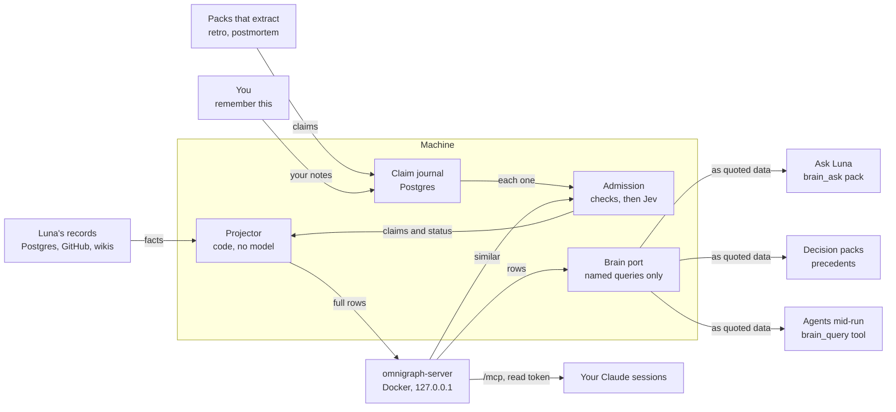
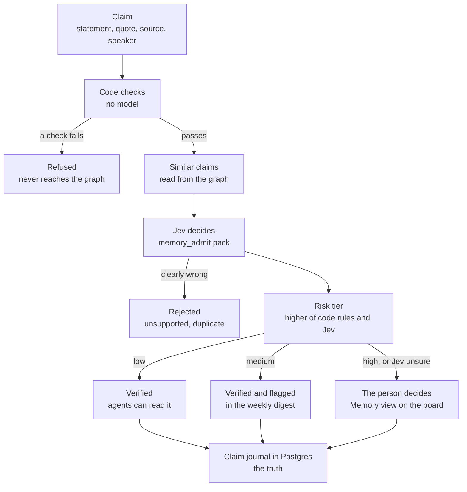

# RFC 0010 — A company brain on omnigraph: facts by code, claims verified by Jev, the person only on high risk

- **Author:** Higor Alves
- **Status:** Accepted (2026-11-16). Wave 0 (the spike) is done and says go.
- **Created:** 2026-11-16
- **Discussion:** the PR that carries this file and its implementation, stacked on #228
- **Related:** [RFC 0002](./0002-native-agent-runtimes.md) (runtimes, decision packs), [RFC 0005](./0005-software-factory-v1-5.md) (the retro), [RFC 0007](./0007-token-economy.md) (learned facts)
- **Source:** [ModernRelay/omnigraph](https://github.com/ModernRelay/omnigraph) v0.15.0 (MIT), read at `8ab6571`. Its examples, [omnigraph-cookbooks](https://github.com/ModernRelay/omnigraph-cookbooks) at `c13bac1`: `company-brain` and `dev-graph`.

## Summary

A card starts with two things from earlier cards: the rules in `docs/agents/project-context.md` and the learned facts of the token economy. Nothing links a card to its pull request, the decision behind it, the incident it caused or what was learned from it. Nothing answers "what did we decide about this, and why".

This RFC adds one graph that holds those links. Omnigraph serves it from a Docker container beside Postgres. Code writes facts into it. What a model learns enters as a claim with the exact quote from its source. A Jev decision pack verifies each claim, and the person is asked only when the risk is high or Jev is unsure. People ask it questions from the board, Slack and their own Claude Code sessions. Agents read it through named queries when they decide.

The machine's records stay the truth, with a journal of what the brain was given. The graph is rebuilt from them, so an omnigraph upgrade is a rebuild.

## Goals

- One graph across repositories: work, code, people, evidence, facts.
- Facts reach the graph by code, with no model.
- A claim is verified without the person unless its risk is high.
- A person or a pack can ask a question and get an answer that cites rows.
- A decision pack sees how similar past verdicts turned out.
- Luna works the same with the brain off.

## Non-goals

- Replacing Graphify, the learned facts or `project-context.md`. All three stay.
- A system of record. Postgres, the repositories and the wikis keep the truth.
- Agents writing claims in the middle of a run. Only finished packs extract.
- Embeddings in the first version. Search is full-text plus links.
- PHI or customer data in the graph. Nodes hold ids, titles and links.
- Run events, logs, test results, alerts and vulnerability findings. They are high in volume and short-lived. The graph links out to them.
- A server that other people or machines reach. It stays on `127.0.0.1`.

## Background

Omnigraph is a typed property graph on Lance datasets. A schema file (`.pg`) declares node and edge types, keys, enums and cardinalities. Its query language (`.gq`) has traversal, full-text search and BM25 in one query. It never calls an LLM. It calls an embedding API only when a query passes text to `nearest()`, and with no key set everything else works.

Its two examples shape this design:

- `company-brain` separates evidence from facts. An agent records what a source said as a claim with the exact quote. Verifying a claim and promoting it to a decision is a second step. Decisions are never rewritten.
- `dev-graph` models software work: issues, pull requests, incidents, decisions and learnings, with stable ids and state that queries derive.

Both examples gate a write with a review branch and a person. This RFC keeps their model and changes the gate, because the person asked for Jev to decide and for a per-claim verdict.

Draft PR #209 built memory on Cognee. The author chose a fresh build here, and #209 is left as it is.

## Proposed design

### Layout

| Path | What it holds |
|---|---|
| `brain/` | The cluster the server boots from: `cluster.yaml`, `schema.pg`, `queries/*.gq`, `policies/*.yaml` and `boot.sh` |
| `contracts/src/brain.ts` | Type names, row schemas, slugs and the list of named queries |
| `machine/src/application/brain.ts` | The port, with `noBrain()` |
| `machine/src/adapters/omnigraph/` | The HTTP adapter |
| `machine/src/domain/brain/` | Pure code: rows from Luna's records, the admission rules |
| `machine/src/application/brain-projector.ts` | The projection and its cursor |

### 1. The service

`compose.yaml` gets a `brain` service behind the `brain` profile, like Laminar's `observe`.

- The image is `modernrelay/omnigraph-server`, pinned by digest.
- It binds `127.0.0.1` only and keeps its data in a named volume.
- It has a memory limit, a restart policy and `RUST_MIN_STACK=8388608` (see the spike).
- Its environment holds no embedding key and no `OMNIGRAPH_EMBED_*` variable, so it makes no outbound call.
- It starts through `brain/boot.sh`, which applies the cluster config, clears a lock that an earlier crash left, and then starts the server. Clearing the lock is safe only because this container is the volume's one user.
- `~/.config/hardness/brain-tokens.json` holds one token per actor: `luna-facts` writes facts, `luna-memories` writes claims and their status, `luna-reader` reads, and `owner`, the person, does everything. The commit history then says which job wrote what.

### 2. The port

`Brain` has five operations: `health`, `load` (rows, as one commit), `query` (a named query and its parameters), `unlink` (remove an edge) and `reset` (empty the graph). `noBrain()` loads nothing, answers no rows and never throws.

The list of queries an agent may run is in `contracts/src/brain.ts`. The port refuses any other name. Omnigraph's policy cannot do this, because its `invoke_query` permission covers the whole catalog. No agent holds a token, and no stage container reaches the service: the machine runs the query and passes the rows in the pack's input, as quoted and capped data.

### 3. The shape of the graph

| Layer | Types | Written from | How it changes |
|---|---|---|---|
| Work and code | Repo, Component, Card, Ticket, PR, Incident | Luna's records, by code | Updated in place |
| People | Person, Actor | GitHub and Slack ids, by code | Updated in place. Someone who leaves is marked inactive |
| Evidence | Source, Claim | The claim journal | A claim's words never change. Only its status does: unverified, verified or rejected |
| Facts | Decision, Learning, Verdict | Decisions and learnings are promoted from verified claims. A verdict is a decision pack's answer and what really happened, written by code | A decision or a learning is never rewritten: a new one supersedes the old. A verdict's answer never changes, and its truth is filled in when it is known |
| Governance | Principle, Control, Regime | `project-context.md` and the wikis, by code | Updated in place |

The rules the shape keeps:

- **Extracting is not deciding.** A pack records what a source said. Verifying and promoting is a separate step.
- **Facts rest on claims, and claims quote their source.** These are typed edges. There is no free-text source field.
- **Nothing is rewritten or deleted.** Removal is a status. A correction is a new node with a `Supersedes` edge.
- **State is derived.** "Current", "superseded" and "contested" are queries over the edges.
- **Ids are stable.** Every key is a slug, `<system>:<native id>`, such as `card:<task id>` or `pr:<owner>/<repo>#<number>`. Reading the same item twice changes nothing.
- **Two kinds of time.** When it happened, and when the brain learned it.
- **Every type has a description and an instruction** in the schema, so a session that reads the graph over MCP reads its rules too.
- **A person is a GitHub login and a Slack member id.** No email address and nothing else about a person.

Keys and cardinalities are fixed when a type is created. Because the graph can be rebuilt from the journal, a change to either is a new graph and a rebuild.

### 4. Projection

The projector turns Luna's records into rows and loads them. It runs after a card closes and once an hour.

- It always writes a whole row. A merge load replaces the row, and a field left out becomes null (see the spike).
- A node and the edges it must have go in one load, and a node goes after every node its edges point at. Omnigraph refuses a load that leaves a node under its edge's minimum, and an edge to a node it does not hold.
- It keeps a journal of every row it wrote, `<state dir>/brain/journal.json`, and loads only a row that differs from it. Every load is a commit, even one that changes nothing.
- A load only adds edges. An edge that moved or went away is removed first.
- Its cursor moves only when every load landed.
- After each run, the hygiene queries must return zero rows. Each one is a named query. In wave 1 they are an agent actor with no person and a pull request with no card.
- `POST /brain/rebuild` empties the graph and loads the journal back.

The journal exists because the machine prunes its own history: events and stage runs after 90 days, decision records by age and size. A fact computed from that history, such as a card's estimate against its diff, cannot be computed again later. So the truth of the graph is the machine's records plus the journal.

A verdict is written only once its truth is known. The graph keeps verdicts as precedents, and one with no truth is no precedent.

### 5. Ask

`brain_ask` is an agent pack (`claude:haiku`, low effort, no tools, one turn). The machine runs full-text search and fixed traversals for the question, and the pack answers from the rows with citations. It says so when nothing matches. `POST /brain/ask` serves the board and Slack. The person's own Claude Code sessions connect to the server's `/mcp` with the read token.

### 6. Remember

**Where claims come from.** The retro's answer gains `claims[]`. A postmortem's approved findings become claims. A person's "remember this" becomes a claim with that person as the speaker, and only the code checks run on it.

**Code checks, before any model.**

- It fits the schema: a known kind and scope, inside the size caps.
- Its source is something the machine holds.
- The quote appears word for word in that source.
- It has a speaker: a person or the pack that wrote it.
- It holds no secret shape and no personal data.
- It does not read as an instruction to an agent. This is the lint the learned facts already use.

**`memory_admit`** is a decision pack. It runs on Jev, and on `claude:haiku` when no Jev key is set.

| Question | Type | What it asks | Effect |
|---|---|---|---|
| `supported` | yes / no | Does the quoted source say what the statement claims? | A confident no rejects the claim |
| `relation` | choice | Against the similar claims shown: new, duplicate, refines or contradicts? | Duplicate rejects it. Contradicts links the pair and asks the person |
| `durable` | yes / no | Will this still hold for the next card? | A confident no keeps the claim as evidence and promotes nothing |
| `scope_fits` | yes / no | Does the evidence cover the scope it claims? | A no asks the person |
| `is_statement` | yes / no | Is it a statement of fact, with nothing addressed to an agent? | A confident no rejects the claim |
| `risk` | score | How much harm follows if this is wrong and agents act on it? | Sets the tier, with the code rules |

**Always the person's, whatever Jev says.**

- It contradicts a verified claim, or would supersede a current decision or learning.
- It applies to the whole org.
- It is about compliance, security, access or an incident.
- Its speaker is someone outside the org.
- Jev scores the risk high, or one of its answers is under the confidence bar.

**The shadow period.** For the first 50 claims of a repository, Jev's verdict is recorded and the person decides each one. Those decisions are the pack's ground truth and its eval cases. Jev verifies alone once it agreed at least 95% of the time and verified nothing that the person rejected. `luna.yaml` `brain.admit` holds the switch.

**After that.** The weekly report lists what was verified, flagged claims first. The Memory view shows current facts that a newer claim puts in question. The person can reject any claim later, and the facts that rest on it come back to supersede or retire.

Rules that bind agents keep their path. They reach `docs/agents/project-context.md` through the retro's draft pull request, with the person's approval. The graph mirrors them as read-only principles.

### 7. Help agents decide

- **Precedents.** A decision pack gets the most similar past verdicts in its context. Only a verdict with a known truth is used: a person's override or a measured outcome. Each pack's eval baseline is run again before precedents are on by default.
- **`brain_query`.** An agent calls a named query in the middle of a run. The machine answers through the checks mailbox, the file exchange the build checks already use.

## Trust

- Text from the graph enters a prompt only as a declared data block, capped, like ticket text.
- Agents read verified claims and current facts. A rejected or unverified claim stays in the graph with its status and reaches no agent.
- The server has no embedding key, so no text leaves the machine through it.
- A claim's quote is checked against the source by code. A model's statement with no matching quote is refused.
- The person can reject any claim and retire any fact. Nothing is deleted, so the history stays.

## Limits

- **Omnigraph is young.** Its storage format went from v6 to v17 in about ten weeks, and upgrades are one-way. The image is pinned, and an upgrade is a rebuild.
- **One graph has one audience.** Access is per graph and branch, never per row. The readers are the person and the machine. Another reader would need incident and compliance data in a graph of their own.
- **Word search misses paraphrases.** A duplicate or a contradiction written in other words can pass the "similar claims" step.
- **A model judges a model's claim.** The quote check, the shadow period and the rule on precedents limit this. They do not remove it.
- **The examples are schemas and seed data.** Nothing in them shows how the model behaves with thousands of claims.
- **Jev is metered.** Every claim costs one decision call.

## Alternatives

- **A review branch and a person,** as omnigraph's example does. A branch merges all or nothing, and its policy cannot tell one agent's branch from another's. The person asked not to approve each memory.
- **The CLI on a local directory, no server.** Less to run, but no MCP for the person's sessions and no actor per token. The machine's image is also older than the binary needs.
- **Only admitted claims in the graph.** Simpler, but contradictions and at-risk facts could not be derived in the graph.
- **Embeddings from a local model.** Omnigraph can call an OpenAI-compatible endpoint. That is a model call outside a pack under the rules of this repository, so it is left for a later decision.

## Rollout

| Wave | What it adds | Done when |
|---|---|---|
| 0 | The spike and this RFC | Done. See below |
| 1 | The service, the port, the adapter, the schema, the projector for work, code, people and verdicts, and the rebuild | Two rebuilds from empty give the same graph, and every hygiene query returns zero rows |
| 2 | Ask: named queries, `brain_ask`, `POST /brain/ask`, the board's popup, the read token for MCP | Eval cases pass: answers cite rows |
| 3 | Remember, in shadow: sources, claims, the journal, the checks, `memory_admit`, `claims[]` on the retro, the Memory view | 50 claims are decided and the agreement is measured |
| 4 | Jev verifies alone: the switch, the digest, the at-risk list | The bar is met and the person turns it on |
| 5 | Precedents, one decision pack at a time, and `brain_query` | Each pack's baseline shows no regression |
| 6 | Principles from `project-context.md`, then incidents, controls, regimes and the answer bank | The status report reads the chain from incident to control |

## Decided

The person decided each of these before the build.

1. The memory model is evidence, claim, fact.
2. A claim's status is the gate. There is no review branch.
3. The "always the person's" list defines high risk.
4. A shadow period of 50 claims and a 95% bar.
5. The person's own notes skip Jev.
6. Rules that bind agents keep their path.
7. A person is a GitHub login and a Slack member id.
8. No embeddings in the first version.
9. The spike comes first.
10. A fresh build on #228. Draft PR #209 (Cognee) is not continued here.

## What the spike found (wave 0, 2026-11-16)

The spike ran `modernrelay/omnigraph-server` v0.15.0 (`sha256:1346cc87…`) in Docker on an Apple Silicon Mac, with a draft of this schema, 210 cards made from the repository's merged pull requests, and Node's `fetch` as the client.

### As the plan assumed

- **HTTP from Node works over plain loopback HTTP.** A request needs a bearer token and the header `Omnigraph-Http-Api: 0.14`. Without the token the answer is 401. Without the header it is 400 `api_contract_mismatch`.
- **A read token cannot write.** A stored mutation and an ad-hoc mutation both get 403. A mutation sent to the read route gets 400.
- **A merge load of a partial row nulls what it leaves out.** A card loaded again without `actual_loc` and `closed_at` lost both.
- **Full-text search is good on words and blind to meaning.** "sandbox network egress" and "flaky test retry" found the right cards in 4 to 57 ms. "isolating containers from the internet" found nothing related.
- **Derived state works.** A claim that contradicts another shows as contested. After the older one is rejected, the learning that rests on it shows as at risk.
- **MCP works with `RUST_MIN_STACK=8388608`.** `initialize`, `tools/list` and a `tools/call` of `query` all answered, and the server stayed up.
- **It is light at this size.** 48 to 140 MiB of memory, 2.1 MB on disk, 0.4 s to load 421 rows, and a stored read in 7 ms at the median over 50 calls.

### Where it differs from what I had read

- **The image is `amd64` only.** On Apple Silicon it runs under emulation. That was fast enough here. The project ships a Linux `arm64` binary, so an image of our own is possible later.
- **A killed server cannot start again.** `docker stop` releases the cluster lock, and the next start needs nothing. `docker kill` leaves `__cluster/lock.json`, and the server then refuses to start until `omnigraph cluster force-unlock <id>` runs. A restart policy alone does not recover it. This is why the service starts through `boot.sh`.
- **The first start needs the same unlock.** `cluster apply` keeps its lock after it exits.
- **Omnigraph enforces an edge's minimum and maximum at load.** A learning with no `BasedOn` edge and a claim with no `ClaimFrom` edge were both refused with 400, and the whole load wrote nothing. The 0.14 example says the schema cannot force this. So a node and its required edges go in one load, and the hygiene queries cover derived state.
- **Every load is a commit, changed or not.** The second, identical load made a new commit. The projector therefore skips unchanged rows.
- **`append` mode refuses a key that exists** with 409. The projector uses it for append-only types.
- **Rows leave out null fields, and a `DateTime` comes back without a zone.** The adapter fills both in.

### Not verified

- More than a few hundred rows. Memory and search time at thousands of claims are not measured.
- The server's behaviour without the stack setting. The maintainers confirmed the crash, and the spike did not repeat it.
- `cluster apply` on every boot, when nothing changed.
- An upgrade from one omnigraph version to the next.

## What wave 1 built (2026-11-16)

Wave 1 is the service, the contracts, the port, the adapter, the projector and the routes. No pack reads the brain yet, and no model call was added.

### As designed

- `contracts/src/brain.ts` holds one table per node and edge type. The row schemas and `brain/schema.pg` both come from it, and tests hold the schema file, the stored queries, the policies and the compose service to it.
- The `brain` compose service: the pinned image, a loopback port, a memory limit, and no embedding or provider key.
- `Brain` with `noBrain()`, the HTTP adapter, and `agentQuery()`, which runs only a query the contracts list for agents.
- The projector writes whole rows, loads only what changed, and runs the hygiene queries after a change.
- `GET /brain/health`, `POST /brain/project` and `POST /brain/rebuild`.

### Where the build differs

- **The journal.** The design said Postgres is the truth and the graph is rebuilt from it. The machine prunes events, stage runs and decision records, so that would lose facts. The projector keeps every row it wrote in `<state dir>/brain/journal.json`, and a rebuild loads that back.
- **An ended card is final.** For the same reason, the projector does not build a card again once the journal holds it as closed or archived.
- **`unlink` and `reset` on the port.** A load only adds edges. A card linked to another ticket was refused by the edge's maximum until the old edge was removed. So the projector removes an edge that moved or went away, and a rebuild empties the graph first. These two deletes are the only queries written outside `brain/queries/`.
- **A verdict is written only with its truth,** and it is not append-only, because a truth can be corrected.
- **Load order.** `brainBatches()` puts a node after every node its edges point at. The server refuses an edge to a node it does not hold yet.
- **The volume is the image's home folder.** The image has no `/data`, and a new volume there belongs to root. `/var/lib/omnigraph` belongs to the server's user.
- **The hygiene queries of wave 1** are an agent actor with no person and a pull request with no card. The ones about claims come with wave 3.
- **A pull request's row** has the card's title and no author. It comes from the card's `pr.opened` and `ship.merged` events, and GitHub is not asked.
- **`retries`** is the task's own `total`, the count the retro reports.

### Checked against a real server

- `brain/boot.sh`: a first boot, a graceful restart and a start after `docker kill`.
- The compose service, started under a throwaway project: healthy in about 5 seconds.
- `machine/src/adapters/omnigraph/live.test.ts`: every row type loaded, every stored query answered, an edge moved, the graph emptied and loaded again. 7 tests pass.
- The projector with the real sources code, journal and adapter, fed three tasks by hand: 30 rows on the first run, none on the second, one edge removed and two rows loaded after a ticket changed, and 31 rows back after a rebuild.

### Not verified

- The machine's own boot with the brain on. `main.ts` was typechecked, not started: starting a machine here would run its housekeeping against Docker images and folders that other sessions share.
- A crash under the restart policy. Docker does not restart a container after `docker kill`, so only the manual start was checked.
- More than a few hundred rows.
- An upgrade from one omnigraph version to the next.

## What wave 2 built (2026-11-16)

Wave 2 is asking the brain a question.

### As designed

- `brain_ask` is an agent pack on `claude:haiku`, low effort, no tools and no worktree, registered the way `foreman` is. Its role is `brain-answerer`.
- `POST /brain/ask` gathers rows with named queries, runs the pack and answers with the rows the reply rests on.
- The board asks from a popup, on `b`.
- A person's own Claude Code session reads the graph over MCP with the `luna-reader` token. The runbook has the command.

### Where the build differs

- **The answer has `known`.** The design said the pack "says so when nothing matches". A flag lets the machine and the board act on it: the board shows no cite, and an answer whose cites were all dropped is returned as not known.
- **No pack runs when no row was found.** The machine answers that itself, so a question about nothing costs no model call.
- **Two more named queries,** `cards_for_ticket` and `search_components`, so a question can start from a ticket key or a component.
- **No Slack entry.** Luna's Slack is the person's own inbox, not a bot that others ask. Brain rows in a drafted reply fit wave 5 better.

### Checked

- The evidence builder against a real server: a ticket key, a title's words and a component each found the right card with its pull request and verdict, and an unrelated question found no row.
- The pack's dry run in the factory: no tools, the rows inside a data block, a valid result.
- The board popup through its tests, in both views it opens from.

### Not verified

- **The pack against a model.** Four eval cases exist (`evals/brain_ask/cases`): an answer with its rows, a question the rows do not answer, a title that gives an order, and a verdict that was wrong. They load, and nobody has run them: `pnpm eval --pack brain_ask --engine claude:haiku`.
- `POST /brain/ask` on a running machine, and the popup against one.
- The MCP endpoint from Claude Code itself. A plain MCP client was used in the spike.

## What wave 3 built (2026-11-16)

Wave 3 is remembering, in shadow.

### As designed

- A claim is one statement with the exact quote from its source. `Source`, `Claim` and `Learning` are in the graph, with the edges and the derived queries the design names.
- The code checks, then `memory_admit`, then the outcome, then the mode: `off`, `shadow` or `auto` in `luna.yaml` `brain.admit`.
- The retro's answer has `claims[]`. A person's note is verified once the code checks pass.
- The claim journal is a Postgres table, and the board has a Memory view.

### Where the build differs

- **One relation question per similar claim.** The design had one `relation` question. The pack asks `relation_1` to `relation_5`, as `intake_dedup` asks about its shortlist, so the machine knows which claim is repeated or contradicted.
- **A narrower instruction lint.** The design said the lint of the learned facts. That one refuses words a retro uses about its own stages, such as "verify" and "stop". The new lint catches only a sentence that addresses a reader, and the pack's `is_statement` question judges the rest.
- **A refused claim is kept, cleaned.** The journal keeps it with the reason, and cuts out the secret or masks the address it was refused for.
- **A lesson is one claim.** A verified claim that holds for the next card becomes one `Learning`. The `Decision` type, a lesson over several claims and superseding a lesson are not built.
- **No ground truth from a person's decision.** The shadow agreement is counted from the journal. A person's verify or reject is not written onto the pack's decision record, because it does not say which question was wrong.
- **The 50 and the 95%** are not enforced. The stats report them, and the person changes `brain.admit`.

### Checked against a real server

- The three new types and six queries were applied to a graph that already held data. The data was kept.
- With a stand-in for the pack: of three drafts, one waited with the outcome "verify" and two were refused, one for an address and one for a quote that was not in the source. The projector wrote the claim and its source. After a person's verify, the next run wrote the lesson. A rebuild brought all of it back. `brain_ask`'s evidence put the lesson first, with its quote.
- The live test: 8 tests pass on a new graph.

### Not verified

- `memory_admit` against a model. Its eight eval cases load and nobody has run them.
- The retro actually handing over claims: the changed role and prompt were not run against a model.
- A machine running with all of it. `main.ts` was typechecked, not started.
- The Memory view against a real machine. Its tests use servers that answer in the agreed shape.

## What wave 4 built (2026-11-16)

Wave 4 is living with `auto`. The switch itself came with wave 3, as `brain.admit`.

### As designed

- `GET /brain/digest`: what Jev verified alone, flagged claims first, what it rejected alone, the lessons at risk and the contested claims. The board's Memory view shows it as a page.
- A person can reject a verified claim later, and verify a rejected one.

### Where the build differs

- **The digest is not in the weekly report.** That report is RFC 0008's, which this branch does not have. The route is what the report will read.
- **The bar is reported, not enforced.** `stats.ready` is true at 50 decided, 95 in 100 agreed and none missed. A person still changes `brain.admit`.
- **A lesson at risk is hidden by the queries, not retired.** A lesson is never deleted. The two queries that find lessons for an agent ask for a claim that is still verified. Superseding a lesson is not built.

### Not verified

- The digest page and the later decisions against a running machine. The board's tests use servers that answer in the agreed shape.

## What waves 5 and 6 built (2026-11-16)

Wave 5 tells a run what the brain holds. Wave 6 adds a repository's rules to the graph. Everything here is off until a repository turns it on, except the rules in the graph, which no pack reads but `brain_ask`.

### As designed

- **Precedents.** A decision pack listed in `luna.yaml` `brain.precedents` reads its own earlier answers on similar cards, with what really happened. Only a verdict with a known truth is in the graph, so only such a verdict is a precedent.
- **`brain_query`.** A tool for `triage` and `question_council`, answered through the checks mailbox, limited to the queries marked for agents.
- **Principles.** The rules of a repository's `docs/agents/project-context.md` are in the graph, and a rule that left the file is retired.

### Where the build differs

- **Two opt-in keys instead of "on by default after a baseline".** `brain.precedents` is a list of packs and `brain.tell` covers the tool and the reply drafts. Nobody ran a baseline here, so nothing is on.
- **Slack reads the brain through its reply drafts.** The design had a Slack entry for asking. Luna's Slack is the person's own inbox, so the `conversation_reply` pack gets the brain's rows about the thread instead.
- **Precedents on Jev ride in the state's description.** Jev renders no prompt.
- **The decision record keeps the context without the precedents.**
- **A link from a brain row does not survive in a reply draft.** The check on outgoing addresses drops it. A title is cited instead.

### Not built

- **Incidents, controls, regimes and the answer bank in the graph, and the digest in the weekly report.** They are RFC 0008's, which this branch does not have. When that RFC lands: a row builder per type in `domain/brain/`, their node types in `contracts/src/brain.ts`, and a source each in `brain-sources.ts`, the way principles were added.
- **A lesson over several claims, a `Decision` type and superseding a lesson.**
- **Embeddings.** Search is by words.
- **Agents writing claims in the middle of a run.**

### Not verified, across all waves

- No pack was run against a model: `brain_ask`, `memory_admit`, the retro's `claims`, the precedents, `brain_query` and the reply drafts have eval cases, dry runs or unit tests only.
- The machine was never started with the brain on. `main.ts` is typechecked.
- The board's two views were tested against servers that answer in the agreed shape, not against a machine.
- More than a few hundred rows in the graph.
- An upgrade from one omnigraph version to the next.

